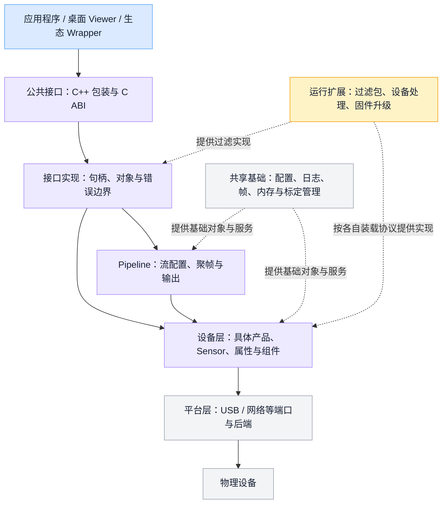
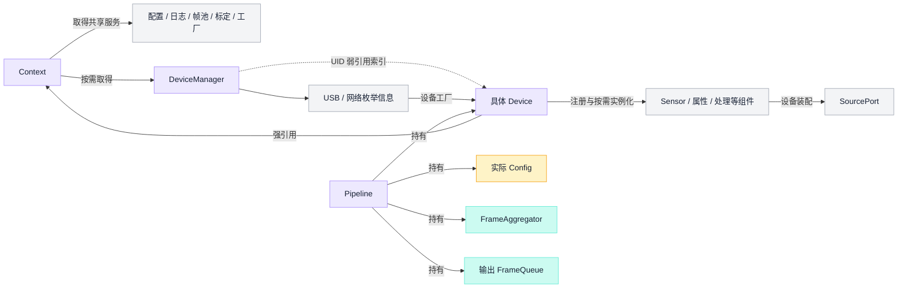
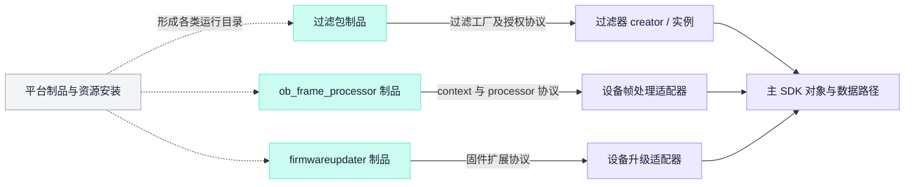

Orbbec SDK 把不同产品、传输方式和操作系统上的设备能力，组织成应用可以使用的设备、传感器、数据流、帧和控制接口。理解它的架构，需要同时看三件事：应用接触的公共接口、设备与数据在运行时怎样协作，以及主库和扩展制品怎样组合。单看 API 名称、源码目录或构建目标，都不足以说明整个系统。

本文面向需要建立整体认识的 SDK、应用、测试和技术支持工程师。它归并既有正式知识库的架构说明，图中“分层”是便于阅读的职责抽象；涉及对象、调用、构建和装载关系的陈述则转述所列来源的静态分析。固定基线为 **SDK-LOCAL-20261022-01（2026-10-22）**，主 SDK 提交为 `ad7518704a7ab630719a691748c4f36473a416bb`；八仓完整身份见[基线与范围说明](#sdk-source-1)。本文未重新构建 SDK、连接设备或运行性能测试，因而不把静态路径等同于设备兼容性、固件行为或运行验收结论。

## 1. SDK 的范围：一个主库、一组扩展与应用适配

应用主要通过 SDK 完成设备发现与创建、传感器及流配置、帧获取、属性控制、滤波处理和录制回放。数据对象不仅包含彩色、深度与红外图像，也覆盖 IMU 和 LiDAR。公共接口统一的是表达方式与访问入口；具体设备提供哪些传感器、流组合、属性和处理能力，仍由设备实现及其使用条件决定。

本基线的源码组合是一个总仓和七个子仓，共八个逻辑仓。它既包含供应用使用的主 SDK，也包含设备处理、滤波、固件扩展和桌面 Viewer。总仓负责这些仓库的版本组合与构建组织，不能与运行中的 SDK 对象混为一层。

| 逻辑仓 | 在系统中的角色 |
| --- | --- |
| `OpenOrbbecSDKGroup` | 管理子仓版本组合、构建脚本和制品回填；`OEMConfig` 是其中的普通目录。 |
| `OpenOrbbecSDK` | 主 SDK，提供公共接口、运行时对象、设备与平台适配、帧处理及录放基础。 |
| `FrameProcessor` | 设备帧处理扩展；按设备条件组织处理链，产物由主 SDK 的设备处理适配器装载。 |
| `OBFilterLib` | 滤波扩展仓之一，构建产物基名为 `FilterProcessor`，进入过滤包目录。 |
| `OBSDKPrivFilterLib` | 另一滤波扩展仓，构建产物基名为 `ob_priv_filter`。 |
| `OBEnhancedDepthFilter` | 构建 `enhanced_depth_filter` 扩展包，运行制品还涉及独立的引擎、模型等资源条件。 |
| `OpenOrbbecSDKExt` | 固件升级扩展；构建名与运行时装载名不同，打包阶段映射为 `firmwareupdater`。 |
| `OpenOrbbecViewer` | 使用 SDK 的桌面应用，另有自身的界面、业务封装、处理与显示逻辑。 |

Viewer 中的 `third_party/OpenOrbbecSDK` 是依赖副本，在这一基线中与主 SDK 对应相同提交，不是第九个独立业务仓。扩展制品也会被回填到主 SDK 和 Viewer 的 SDK 副本中。因此，理解一个交付包需要同时识别源码组合、扩展版本和最终制品，不能仅凭一个库名或版本字符串判断其完整身份。来源：[工程与仓库地图](#sdk-source-2)、[扩展仓与制品地图](#sdk-source-3)。

## 2. 从应用到设备的职责全景

可以沿着“应用表达任务—SDK 组织对象与数据—设备和平台执行具体访问”来阅读系统。公共接口之下，Pipeline 组织流配置与聚帧；设备层组织产品能力；平台层提供真实传输端口。帧、内存、配置和日志等基础设施贯穿这些职责，而动态扩展提供另一种算法或设备功能的实现边界。

这张图是职责视图：实线表示访问或委托，虚线表示基础服务或扩展实现的提供。每次调用只经过与自身职责相关的路径。例如，应用可以直接访问设备和传感器，而不必将所有操作都送入 Pipeline；属性控制也不需要经过聚帧器。设备识别、字节传输和像素算法分别属于不同实现，Pipeline 并不直接读取 USB 或网络包。来源：[SDK 能力与边界](#sdk-source-4)、[Pipeline 职责与边界](#sdk-source-5)。

源码中的构建模块又是另一张地图。`shared`、`core`、`filter`、`platform`、`device`、`pipeline`、`media` 分别构建为静态模块，再由接口实现汇入公开共享库。它们并非七个独立服务，也不对应七条工作线程。当前 CMake 声明还保留 `shared/core`、`filter/device` 两组双向依赖，因此上图的阅读分层不能被理解为源码已经实现了严格单向依赖。来源：[构建模块架构](#sdk-source-6)。

### 公共接口与内部对象的分界

公开 C++ 包装、C ABI 和内部 C++ 对象需要分开认识。公开的 `ob::Pipeline` 持有 C 句柄；C 接口实现再把句柄连接到内部对象，并承担异常到 `ob_error` 及入口返回值的转换。内部 Pipeline 才负责实际配置、传感器编排与聚帧。

这种边界使应用可以使用统一的公开接口，而内部实现继续组织设备、平台和算法对象。它也意味着同名类不等于同一类型、公开句柄不等于内部裸指针；对象释放与错误处理应遵守所在接口层的约定。C++ 包装包含自己的控制流，不能将其概括为对所有 C 返回路径都作完全相同的异常处理。来源：[三层 API 模型](#sdk-source-7)。

## 3. 运行时骨架：共享环境、设备与 Pipeline

`Context` 是共享运行环境的入口。它取得配置、日志、帧内存池、内外参管理、过滤工厂、平台及动态库管理等服务；设备管理器按需取得。这个组织方式让不同的设备和数据路径复用基础设施，但共享对象的存活又取决于实际引用，不能将“单例入口”理解为永远不可销毁的进程全局实例。

`DeviceManager` 负责枚举信息与设备对象之间的衔接，并用 UID 对已有设备作弱引用索引。已有对象仍存活且访问模式匹配时，可以复用该设备。具体设备则由枚举信息的工厂路径产生，进一步装配传感器、端口、属性、标定和处理组件。

图中只有明确标注的边表达强弱引用，其余边表达职责或装配关系，不是完整的内存所有权图。Pipeline 持有设备、实际配置、聚帧器和输出队列；DeviceBase 强持 Context。设备组件既可以在注册时给出实例，也可以登记创建器、在需要时实例化。“组件已注册”“组件已创建”“本次可取得组件”因而是不同状态。来源：[运行对象架构](#sdk-source-8)、[组件延迟创建与资源锁](#sdk-source-9)。

### 设备抽象统一接口，具体设备完成装配

设备层的关键职责不是把所有产品变成同样的硬件，而是把产品差异放在可组合的设备实现中。`IDevice` 组合设备信息、传感器、属性、同步、监控及升级等能力；组件 ID 用来定位内部组件。传感器类型列表来自设备实际登记的端口信息，不能从公共枚举中存在某个值，就推出该设备具备相应传感器。

枚举、产品过滤、端口分组和具体设备工厂是不同阶段。某个产品类或 PID 定义存在，只说明代码中有相关分支；是否能从本次枚举信息到达该分支，以及所需端口、组件和后端是否满足，仍由完整装配路径决定。这解释了为什么统一接口之下仍需要产品族实现和条件化的能力描述。来源：[设备接口与组件 ID](#sdk-source-10)、[PID 与设备工厂](#sdk-source-11)。

## 4. 控制与配置：几种不同的状态入口

SDK 中的“配置”并非一个可以统一热替换的对象。至少需要区分以下几种职责。

| 配置或控制对象 | 承担的职责 | 与其它层的关系 |
| --- | --- | --- |
| 共享环境配置 | 从外部与内置 XML 读取环境项，影响日志、部分默认行为和服务初始化。 | 配置按键查找和回落；已有 Context、EnvConfig 的寿命影响新路径何时生效。 |
| 流配置 `Config` | 表达启用哪些流、请求的 profile、对齐和聚帧输出模式。 | Pipeline 根据传感器实际 profile 形成生效配置。 |
| 设备属性 | 表达设备实例注册的标量、结构化或原始数据控制。 | PropertyServer 检查权限与当前访问模式，再分派到相应 accessor。 |
| 处理器或滤波配置 | 表达处理链中的参数、启禁和预置。 | 由实际过滤器及设备处理链解释，不能与流配置互相代替。 |

共享环境配置由外部与内置来源按键查找，外部缺项可以继续回落到内置值；它不是用一个文件整体替换另一个文件。Context 和 EnvConfig 各有自己的弱单例索引，存活实例复用时也不会因为新传入路径就自动重载。这属于初始化与对象寿命的关系。来源：[Context 初始化与配置入口](#sdk-source-12)。

流配置则描述采集意图。请求的 profile 与设备最后选出的实际 profile 不是同一身份，Pipeline 需要完成匹配和组织。设备属性走的是另一条路：属性服务器保存实例注册、权限与访问器，访问器可以实现硬件协议，也可以连接软件处理或插件状态。因此，“设置一个属性”不必然意味着下发一种统一的硬件命令。来源：[Config 数据模型](#sdk-source-13)、[PropertyServer 模型](#sdk-source-14)、[控制流与数据流](#sdk-source-15)。

## 5. 数据怎样进入应用

数据上行与控制下行在设备状态和配置处交汇，但两者不是一条对称的通道。以下用属性控制和视频数据两条代表路径说明责任分工。

```mermaid
flowchart TB
    accTitle: Orbbec SDK控制与视频数据路径
    accDescr: 属性控制下行与视频帧上行分开，聚帧输出按用户回调配置选择分支。
    subgraph CONTROL[控制面：以属性路径为例]
        CAPP[应用控制请求] --> PROP[设备实例的属性注册与权限]
        PROP --> ACCESS[实际 accessor]
        ACCESS --> VENDOR[协议与控制端口]
        VENDOR --> DEVICE[设备控制]
        ACCESS --> SOFT[软件或插件状态]
    end
    subgraph VIDEO[数据面：视频主链]
        INPUT[设备 / 传输后端] --> SENSOR[VideoSensor 校验与可选格式转换]
        SENSOR --> BASE[SensorBase：profile / metadata / 时间戳]
        BASE --> RECORD[可选录制回调]
        RECORD --> PROCESS[可选设备 FrameProcessor]
        PROCESS --> PIPE[Pipeline 接收]
        PIPE --> AGG[FrameAggregator]
        AGG -->|已设置用户回调| CALLBACK[应用回调]
        AGG -->|未设置用户回调| WAIT[等待输出队列]
    end
    classDef input fill:#DBEAFE,stroke:#60A5FA,color:#172033;
    classDef logic fill:#EDE9FE,stroke:#A78BFA,color:#172033;
    classDef data fill:#CCFBF1,stroke:#5EEAD4,color:#172033;
    classDef policy fill:#FEF3C7,stroke:#F59E0B,color:#172033;
    classDef infra fill:#F3F4F6,stroke:#9CA3AF,color:#172033;
    class CAPP input;
    class PROP,ACCESS,PIPE logic;
    class VENDOR,DEVICE,SOFT,INPUT,SENSOR infra;
    class BASE,RECORD,PROCESS,AGG,CALLBACK,WAIT data;
    style CONTROL fill:#FFFFFF,stroke:#CBD5E1;
    style VIDEO fill:#FFFFFF,stroke:#CBD5E1;
```

视频路径中，传输后端交来的数据先经过传感器层的状态、格式和有效载荷处理，再由 SensorBase 绑定 profile、补充 metadata 和时间信息。录制回调位于可选设备 FrameProcessor 之前，因此“记录到的帧”与“应用最后收到的处理结果”不是可以不加区分的同一观察点。可选节点不存在时直接进入后续路径；IMU、LiDAR 和回放有各自的前半段，不套用图中的视频格式检查。来源：[控制流与数据流](#sdk-source-16)。

Pipeline 负责将配置、传感器启停、聚帧与应用输出连接起来。它发起启动之后，后端与处理链才逐步交付数据；首个进入 Pipeline 的合适帧使其从 STARTING 转为 STREAMING，聚帧器再按配置决定如何组织 FrameSet。因而 API 返回、传感器首帧、Pipeline 首帧和应用首个 FrameSet，是不同的生命周期观察点。这里的区别是执行结构本身的一部分。来源：[开流完整链路](#sdk-source-17)。

输出到应用时，回调与等待队列是两种分支：设置用户回调后，输出直接交给该回调，不同时进入等待队列；没有该回调才进入等待取帧路径。聚帧器管理多路帧及其输出条件；应用收到的 FrameSet 由这些条件决定，不能仅凭容器类型就假定其包含所有已配置的帧类型。来源：[Pipeline 职责与边界](#sdk-source-18)。

### 帧是带上下文的数据对象

Frame 不只是像素指针。它包含有效数据与容量、序号、时间戳、metadata 和 stream profile 等信息。视频、深度、IMU、点云与雷达数据由不同类型承载；类型、数据格式和 profile 是相关但不同的维度，不能把所有帧都按视频宽高解释。

FrameSet 则是对子帧的聚合引用，不是把多个图像 buffer 拼成一张大图。容器释放自身引用之后，应用已经持有的子帧仍可能继续存活。这种共享关系让帧能够跨越队列、处理与应用边界，也要求区分“持有对象”与“可以任意并发修改对象”。来源：[Frame 类型模型](#sdk-source-19)、[FrameSet 与子帧](#sdk-source-20)。

录放模块复用这套设备和数据抽象：录制在真实设备的 sensor 回调处接入 writer；回放把文件恢复为设备、端口与传感器接口，再交由通常的上层消费路径处理。复用上层接口并不意味着文件完整复制了物理设备的全部状态或所有扩展信息。来源：[录放总体模型](#sdk-source-21)。

## 6. 执行与寿命：线程不沿目录划分

SDK 没有统一的“取帧线程”。线程或回调的来源在具体后端：有些由 SDK 建立，有些来自 libuvc、系统媒体框架等依赖，有些控制操作就在调用者线程执行。格式转换、设备处理或队列又可能引入新的异步边界。Platform 是后端工厂与分派入口，不拥有一条统一 I/O 工作线程；Pipeline 同样没有因其名字或职责而自动拥有专属采集线程。

因此，职责分层、调用链、线程图是不同视角。上面的图描述数据经过哪些对象，不能据箭头数量计算线程，也不能把应用回调当作已经自动切换到独立线程的通知。Pipeline 与聚帧器的同步调用关系意味着用户回调耗时会影响所在调用链；共享引用只延长对象寿命，不会替对象补上任意并发安全性。来源：[平台接口与工厂](#sdk-source-22)、[平台线程与停止矩阵](#sdk-source-23)、[运行对象架构](#sdk-source-24)。

生命周期也有几条不同的边界。停止流改变采集与输出状态，设备失活移除其组件关系，释放公开句柄改变引用计数，最后一个持有者释放后才发生相应对象销毁。Pipeline 停止并不删除应用已经持有的帧；设备清空组件表也不等于使所有外部引用即时消失。动态库创建的对象还必须通过对应销毁约定释放，并让库在销毁函数调用前继续存活。这些关系使停止、清队列、失活与销毁不能压缩成一个“自动释放全部资源”的动作。来源：[生命周期全景](#sdk-source-25)。

## 7. 跨平台与扩展：统一入口之下保留实现差异

Platform 根据端口类型分派到 USB、网络等 PAL 和具体 SourcePort。SourcePort 再区分控制请求、数据流与视频流等能力；接口定义传递什么信息，并不统一规定后端如何建线程、缓存端口或停止传输。Windows、Linux、macOS、Android 及不同传输方式仍有各自的实现条件。

这层抽象让设备层不必在每处直接重写操作系统访问，但也不会消除平台差异。是否编入某条路径、设备能否被枚举、实际端口是否可取得，是连续而不同的条件。例如，本基线的 GMSL 实用路径在 Linux USB PAL 中组织，不能因为 Platform 上存在同名 GMSL 方法，就把它理解成一套已经注册的独立 PAL。来源：[平台接口与工厂](#sdk-source-26)、[SourcePort 类型与分派](#sdk-source-27)。

动态扩展则解决另一类边界：把过滤、设备处理和固件相关实现组织成由主库装载的制品。它不是一种所有插件都能通用的协议。

过滤包需要发现工厂和创建入口，部分实例还受激活条件约束；设备 FrameProcessor 有自己的 context、processor、配置、处理与销毁接口；固件扩展又使用另一组导出入口。这些协议不能因为最终都是动态库就互换。源码中的平台目录、打包回填位置与最终运行目录同样需要区分；某个扩展文件存在，不代表依赖、符号、授权、实例及所需模型资源都已满足。来源：[动态扩展架构](#sdk-source-28)、[扩展仓与制品地图](#sdk-source-29)。

设备 FrameProcessor 与应用主动创建的 Filter 也不是同一层职责。前者按设备条件组织处理顺序、参数预置和启禁状态，嵌在设备帧上行路径中；后者通过过滤接口与工厂向应用提供处理对象。应用推荐过滤器列表和设备内部处理链不能互相替代。来源：[FrameProcessor 处理编排](#sdk-source-30)、[过滤接口与工厂](#sdk-source-31)。

## 8. Viewer 与 Wrapper 位于什么位置

Viewer 是 SDK 的一个上层使用者，同时拥有自己的应用结构。其 `app` 管理窗口和页面，`server` 封装 SDK 与业务操作，`common_view` 提供显示控件，`common` 提供工具；这些目录的源码编入同一个桌面可执行程序。这里的 `server` 是进程内服务，不是需要独立部署的网络服务。

Viewer 在 SDK 回调之上还有过滤、解码、显示队列和主线程 OpenGL 渲染。它提供可视交互与工具能力，但显示更新并不等同于 SDK 采集本身，界面层的职责也不应回填成公共 SDK 的行为承诺。来源：[Viewer 整体架构](#sdk-source-32)。

“Wrapper”还需要区分两个含义。SDK 内部的公开 C++ 包装，是前述 C++—C ABI—内部 C++ 三层模型的一部分；ROS、ROS 2、Python、K4A、C#、Android 等生态 Wrapper，则面向语言、框架或兼容接口组织上层接入。它们不会因此成为新的硬件传输后端，也不在本文八仓组合中自动增加为已分析的内部模块。此处只界定职责位置，不推导各 Wrapper 对型号、固件或功能的兼容范围。来源：[三层 API 模型](#sdk-source-33)、[SDK Wrapper 说明](#sdk-source-34)。

## 9. 这套结构带来的架构取舍

从这些已有结构，可以归纳出几项阅读和设计上的取舍；以下是对实现关系的架构解释，不是另设一套目标系统，也不代替历史设计动机的证据。

**统一接口与实例能力分别建模。** 公共 API、设备接口和帧对象为应用提供一致的表达方式，设备族、端口、profile、属性权限、当前访问模式及扩展共同决定实例能力。接口存在、组件注册、实例创建和实际运行是不同层级，不能压成一个无条件的“支持”布尔值。来源：[设备能力判定模型](#sdk-source-35)。

**对象组合提高复用，也让寿命与状态成为接口的一部分。** Context、设备组件、Frame 与 FrameSet 让不同路径共享对象；相应地，初始化时机、引用持有、停止次序和跨库释放必须按对象边界理解。仅看函数调用先后，无法替代所有权视角。

**扩展分离提供组合空间，也增加交付组合的约束。** 主库、处理扩展、过滤包和 Viewer 可以分仓组织，但实际可用组合需要源码身份、ABI、运行目录及外部资源相互匹配。构建依赖图解释怎样组成库，运行时对象图解释怎样协作，线程与所有权图解释怎样执行和存活；这几张图应相互参照，而不能用其中一张代替全部。

## 来源附录

以下为可复核的本地研究材料标识，路径相对工作资料根目录；行号为原来源行号。固定研究基线 SDK-LOCAL-20261022-01（2026-10-22），主 SDK 提交 `ad7518704a7ab630719a691748c4f36473a416bb`。八仓身份按《基线与范围说明》原证据核查；未确认可公开远程身份，因而不构造公开链接。

### sdk-source-1

基线与范围说明：`AI-SDK-Platform/sdk源码/OpenOrbbecSDKGroup/docs/knowledge-base/16-evidence/KB-EVD-001.md:70`。

### sdk-source-2

工程与仓库地图：`AI-SDK-Platform/sdk源码/OpenOrbbecSDKGroup/docs/knowledge-base/01-system/KB-SYS-001.md:25`。

### sdk-source-3

扩展仓与制品地图：`AI-SDK-Platform/sdk源码/OpenOrbbecSDKGroup/docs/knowledge-base/11-extensions/KB-EXT-001.md:27`。

### sdk-source-4

SDK 能力与边界：`AI-SDK-Platform/sdk源码/OpenOrbbecSDKGroup/docs/knowledge-base/01-system/KB-SYS-002.md:25`。

### sdk-source-5

Pipeline 职责与边界：`AI-SDK-Platform/sdk源码/OpenOrbbecSDKGroup/docs/knowledge-base/04-pipeline/KB-PIPE-001.md:57`。

### sdk-source-6

构建模块架构：`AI-SDK-Platform/sdk源码/OpenOrbbecSDKGroup/docs/knowledge-base/01-system/KB-SYS-003.md:35`。

### sdk-source-7

三层 API 模型：`AI-SDK-Platform/sdk源码/OpenOrbbecSDKGroup/docs/knowledge-base/01-system/KB-SYS-006.md:35`。

### sdk-source-8

运行对象架构：`AI-SDK-Platform/sdk源码/OpenOrbbecSDKGroup/docs/knowledge-base/01-system/KB-SYS-004.md:35`。

### sdk-source-9

组件延迟创建与资源锁：`AI-SDK-Platform/sdk源码/OpenOrbbecSDKGroup/docs/knowledge-base/05-device/KB-DEV-003.md:26`。

### sdk-source-10

设备接口与组件 ID：`AI-SDK-Platform/sdk源码/OpenOrbbecSDKGroup/docs/knowledge-base/05-device/KB-DEV-001.md:26`。

### sdk-source-11

PID 与设备工厂：`AI-SDK-Platform/sdk源码/OpenOrbbecSDKGroup/docs/knowledge-base/05-device/KB-DEV-002.md:26`。

### sdk-source-12

Context 初始化与配置入口：`AI-SDK-Platform/sdk源码/OpenOrbbecSDKGroup/docs/knowledge-base/03-runtime/KB-RUN-001.md:56`。

### sdk-source-13

Config 数据模型：`AI-SDK-Platform/sdk源码/OpenOrbbecSDKGroup/docs/knowledge-base/04-pipeline/KB-PIPE-002.md:33`。

### sdk-source-14

PropertyServer 模型：`AI-SDK-Platform/sdk源码/OpenOrbbecSDKGroup/docs/knowledge-base/09-control/KB-CTRL-001.md:26`。

### sdk-source-15

控制流与数据流：`AI-SDK-Platform/sdk源码/OpenOrbbecSDKGroup/docs/knowledge-base/01-system/KB-SYS-005.md:35`。

### sdk-source-16

控制流与数据流：`AI-SDK-Platform/sdk源码/OpenOrbbecSDKGroup/docs/knowledge-base/01-system/KB-SYS-005.md:41`。

### sdk-source-17

开流完整链路：`AI-SDK-Platform/sdk源码/OpenOrbbecSDKGroup/docs/knowledge-base/04-pipeline/KB-PIPE-005.md:59`。

### sdk-source-18

Pipeline 职责与边界：`AI-SDK-Platform/sdk源码/OpenOrbbecSDKGroup/docs/knowledge-base/04-pipeline/KB-PIPE-001.md:33`。

### sdk-source-19

Frame 类型模型：`AI-SDK-Platform/sdk源码/OpenOrbbecSDKGroup/docs/knowledge-base/07-frame-stream/KB-FRAME-001.md:33`。

### sdk-source-20

FrameSet 与子帧：`AI-SDK-Platform/sdk源码/OpenOrbbecSDKGroup/docs/knowledge-base/07-frame-stream/KB-FRAME-003.md:33`。

### sdk-source-21

录放总体模型：`AI-SDK-Platform/sdk源码/OpenOrbbecSDKGroup/docs/knowledge-base/10-media/KB-MEDIA-001.md:25`。

### sdk-source-22

平台接口与工厂：`AI-SDK-Platform/sdk源码/OpenOrbbecSDKGroup/docs/knowledge-base/06-platform/KB-PAL-001.md:26`。

### sdk-source-23

平台线程与停止矩阵：`AI-SDK-Platform/sdk源码/OpenOrbbecSDKGroup/docs/knowledge-base/06-platform/KB-PAL-021.md:24`。

### sdk-source-24

运行对象架构：`AI-SDK-Platform/sdk源码/OpenOrbbecSDKGroup/docs/knowledge-base/01-system/KB-SYS-004.md:47`。

### sdk-source-25

生命周期全景：`AI-SDK-Platform/sdk源码/OpenOrbbecSDKGroup/docs/knowledge-base/01-system/KB-SYS-009.md:35`。

### sdk-source-26

平台接口与工厂：`AI-SDK-Platform/sdk源码/OpenOrbbecSDKGroup/docs/knowledge-base/06-platform/KB-PAL-001.md:26`。

### sdk-source-27

SourcePort 类型与分派：`AI-SDK-Platform/sdk源码/OpenOrbbecSDKGroup/docs/knowledge-base/06-platform/KB-PAL-002.md:26`。

### sdk-source-28

动态扩展架构：`AI-SDK-Platform/sdk源码/OpenOrbbecSDKGroup/docs/knowledge-base/01-system/KB-SYS-007.md:35`。

### sdk-source-29

扩展仓与制品地图：`AI-SDK-Platform/sdk源码/OpenOrbbecSDKGroup/docs/knowledge-base/11-extensions/KB-EXT-001.md:60`。

### sdk-source-30

FrameProcessor 处理编排：`AI-SDK-Platform/sdk源码/OpenOrbbecSDKGroup/docs/knowledge-base/11-extensions/KB-EXT-003.md:25`。

### sdk-source-31

过滤接口与工厂：`AI-SDK-Platform/sdk源码/OpenOrbbecSDKGroup/docs/knowledge-base/08-processing/KB-FILTER-001.md:25`。

### sdk-source-32

Viewer 整体架构：`AI-SDK-Platform/sdk源码/OpenOrbbecSDKGroup/docs/knowledge-base/12-viewer/KB-VIEW-001.md:25`。

### sdk-source-33

三层 API 模型：`AI-SDK-Platform/sdk源码/OpenOrbbecSDKGroup/docs/knowledge-base/01-system/KB-SYS-006.md:25`。

### sdk-source-34

SDK Wrapper 说明：`AI-SDK-Platform/sdk源码/OpenOrbbecSDKGroup/OpenOrbbecSDK/wrappers/README.md:3`。

### sdk-source-35

设备能力判定模型：`AI-SDK-Platform/sdk源码/OpenOrbbecSDKGroup/docs/knowledge-base/01-system/KB-SYS-008.md:35`。

### 八仓固定身份

以下身份转录自固定知识基线，不表示本轮重新构建或运行验收。

| 逻辑仓 | 固定提交 |
| --- | --- |
| `OpenOrbbecSDKGroup` | `c7669cc67ff303a9d6fc45585d640a546a682dcc` |
| `OpenOrbbecSDK` | `ad7518704a7ab630719a691748c4f36473a416bb` |
| `FrameProcessor` | `c02079049ebe68e3dddc2d47af5ac32d9de38fd8` |
| `OBFilterLib` | `67704b2eccc0dfbc3c689934101bdb865d6e8fee` |
| `OBSDKPrivFilterLib` | `00459333dc8c54c8dbd731b1414d12aba9dee3a4` |
| `OBEnhancedDepthFilter` | `3a811afd370becc8c2d91b4885c875d795a49379` |
| `OpenOrbbecSDKExt` | `ea5e07c5969eb4e33b1b2f261bd5e9c4e84ba74a` |
| `OpenOrbbecViewer` | `e162db6b1b73e98e206c5b38637b35caaf57a195` |
