> 收录说明（2026-11-11）：本篇为完整业务与系统知识手册；文中“当前代码实现”等均为 2026-11-09 当时实施快照，不代表收录日现状。公司材料、通识与候选方案按原文标识区分，材料事实仍待现场核实。

以 OEM 制造工作流为主线的系统手册：先看公司系统现状与整体架构，再沿 S1—S9 工作流逐节点讲清**这一步在干什么、要懂什么知识、公司现状是什么、痛点在哪里、涉及什么系统、数据怎么流**。节点编号与[《OEM 制造业务流程总览》](https://github.com/ink-hz/AI-Manufacturing-Platform/blob/53958c7cede6707c41b99cba7c636402f3c23fe3/docs/workflows/manufacturing-process-overview.md)保持一致。整理日期：2026-10-27；2026-11-03 按"只做 OEM"的业务决定及公司材料完成实质修订。

---

## 前言：这本手册怎么用

**业务范围（已确认）**：平台与本手册只面向 **OEM 代工制造**——按客户提供产品定义、制造方承接制造展开；客户设计决策及批准、制造方 DFM 建议、厂内批准和质量放行分别表达。此前明确过代工代料；供料实际同时存在客供料、代采和客户直接带料，按合同／项目表达。机器人是已有材料中的主要案例（EX001 试产），是否只做机器人、首批客户及产线尚未确定。原自有相机（含数采相机）与 3D 打印机业务不再作为并列业务入口，相关软件能力转为复用资产评估。

**读者**：制造负责人及业务、IT、产品、技术团队——用于理解和统筹 OEM 业务与系统、组织需求讨论和建设决策。岗位级点击步骤与正式作业规程待现场核实后独立细化，本手册不是 SOP。

**材料依据**（原始材料为准，本手册注明出处）：

| 来源 | 性质与证据边界 |
| --- | --- |
| 《系统能力介绍_20261029_V2 (1).pptx》（IT 材料，15 页） | 现有系统与能力的材料陈述及部分界面证据；截图提供界面及历史记录的材料证据，不足以证明系统持续运行至今、所有 OEM 项目已启用或全部接口已验证运行；打码数值不引用 |
| 《奥比中光机器人代工制造方案-CEO汇报(1).pptx》及[文字整理](https://github.com/ink-hz/AI-Manufacturing-Platform/blob/53958c7cede6707c41b99cba7c636402f3c23fe3/docs/robot-oem-manufacturing-ceo-presentation.md) | 业务方向、问题线索、平台建设建议与路线图；目标值和建设建议是汇报建议，不是现状或已批准承诺 |
| 《OEM业务物料痛点.xlsx》"问题痛点"页 | 15 条已报告问题（P01—P15）及原改善建议；未经业务责任人共同签认和现场逐条复核 |
| [OEM AI 制造平台设计](/ai-notes/intelligent-manufacturing/oem-ai-manufacturing-platform) | 完整设计文档：现状、需求（P01—P15、R01—R13）、架构与场景 |
| 当前仓库代码 | 软件实现的检查依据；不等于真实系统或设备已接入 |

**事实与方案的表达约定（全书一致）**：**已确认范围**＝用户确认的业务决定；**材料所述／界面可见**＝来自上述材料，保留页码或单元格定位；**通识参考**＝通用制造与系统知识，不代表公司已部署；**候选方案**＝需评审的建议；**待核实**＝需要实际样本或责任人确认的事项。

全书三个部分：

- **第一部分 全景**：OEM 端到端工作流总图、公司系统现状图与候选目标图、系统缩写辞典与逐能力复用判断、三条贯穿的数据流。
- **第二部分 工作流逐节点（S1—S9）**：每节点按统一结构展开——干什么、节点流程、要懂的知识、公司现状与痛点、涉及的系统、核心数据对象、OEM 合同要点、常见断点。
- **第三部分 整体集成**：系统之间怎么连、数字化平台和 AI 放在哪里、建设的先后次序。

---

## 第一部分 全景

### 1. OEM 端到端工作流总图

客户需求与资料进入共用的制造管理主流程（S1—S9），异常与变更沿反馈边回流，客户触点（粉色）贯穿全程：

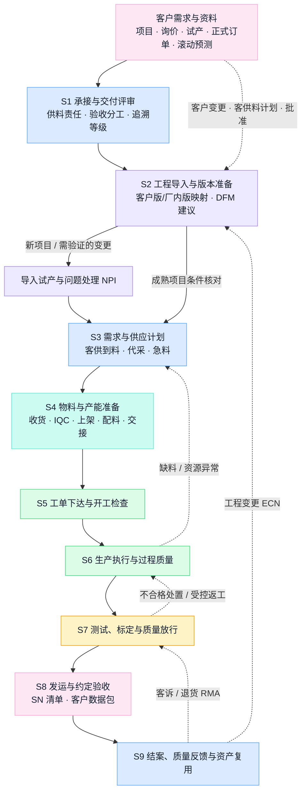

**配色约定（全书一致）**：蓝＝经营与计划，紫＝工程与产品定义，青＝物料与流转，绿＝执行与通过，琥珀＝质量与判定，红＝异常与变更，粉＝客户触点，灰＝数据与中性环节。

读这张图的四个要点：

1. **箭头是业务交接，不是软件边界。** 一个节点可能跨几个系统（S4 的物料链路横跨 SAP、WMS、MES），一个系统也可能服务几个节点——对应关系在第二部分逐一展开。
2. **虚线（反馈边）与实线同等重要。** 缺料回计划、不合格回执行、客户变更回工程、客诉回放行——信息化做得好不好，恰恰看这些"往回走"的路通不通。EX001 的教训（问题沿产线向后累积、后段达成率掉到 84%）本质是前段断点在后段爆发。
3. **客户触点贯穿全程，不只在两端。** 客户资料与批准进 S2，客供料计划进 S3—S4，客户见证或放行可能进 S7，验收位置随合同可能在 S8 发运前——每个触点都要分清"客户声称／批准"与"厂内核实／批准"。
4. **供料模式带着责任贯穿全程。** 客供、代采、客户带料在需求计算、收货、所有权、损耗、对账上全程不同，不是收货时处理一次就完。

### 2. 公司系统现状与目标图

本章三张图各有身份：2.1 是**材料所述现状**（依据 IT 材料，OEM 覆盖待核实）；2.2 是**通识参考**（通用分层模型，不代表公司部署）；2.3 是**候选目标**（待评审）。三者不能混读。

#### 2.1 公司系统现状图（材料所述，IT 材料第 1—3、10 页）

公司已有按业务域划分的多系统格局。与通用模型最重要的差别：**质量执行、线边仓储、设备管理、追溯在公司现状里是 MES 内的模块，不是独立的 QMS／EAM 系统**；WMS 承担盘点与库存分析，收发料记账在 SAP。

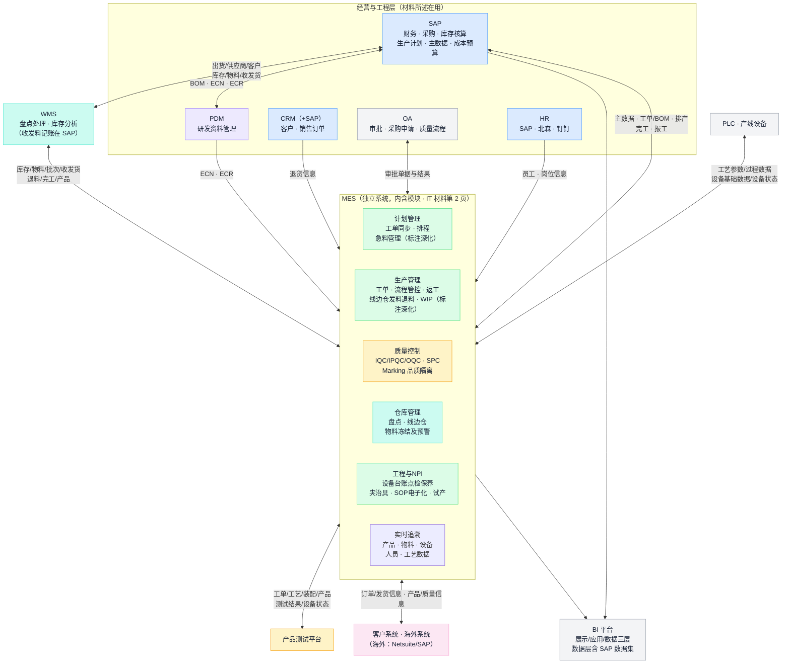

读图纪律与证据边界：

- **连线来自 IT 材料第 10 页集成架构图**（MES 居中；HR、CRM、PDM 对 MES 单向输入，其余双向）。图示连线与字段集合是材料陈述；除 HR／CRM／PDM→MES 的原始单向关系外，双向连线不证明每个字段的上下行方向，图中不作分配。**逐字段方向、每条接口的实际运行、频率、回执与对账仍需逐条核实**（第 14 章）。
- **MES 模块清单来自第 2 页功能全景**，其中"急料管理""WIP 管理"明确标注"深化"——恰好对应物料痛点最密集的两处（P03/P08/P10 急料传递、配料与在制可见性），说明 IT 侧已有同样判断；"深化"的具体含义与进度待核实。
- **独立的 APS、QMS、EAM、SRM、IIoT 平台、数据仓库在材料中未出现**。SRM 在 OEM 汇报中列为规划（"未来补 SRM"）。通用名称不能当成公司部署事实。
- **OEM 业务在上述各系统中的实际覆盖是最重要的待核实项**：实际账号、模块启用、工单样本与现场操作，区分未上线、未启用、绕行和接口问题（对应决策点 D05）。
- 可确认的外部产品名仅：SAP、ZOHO（市场）、Netsuite（海外）、北森（HR）、钉钉、CBS（资金）；MES／WMS／BI 的厂商产品名在材料中未出现，待核实。
- **界面与历史记录有材料证据**：Marking 界面显示约 99 万条查询结果，2019 年仅是查询日期区间的起点，不能据此推定记录自该年持续积累；追溯与良率截图可见 2026 年数据（第 6、12—15 页）。这些截图不证明系统持续运行至今，当前运行状态需以实际样本核实。

**现状能力速览（材料所述，逐项待核实 OEM 适用性）：**

| 能力 | 材料证据 | 对 OEM 的意义 | 待核实 |
| --- | --- | --- | --- |
| 检验建模与标准维护 | 第 4—5 页：抽样/检验方案/管制特性建模；检验标准维护真实界面（工序＋物料＋上下限＋量具），检验计划支持数量/时间/事件触发 | 质量规范受控有现成载体 | OEM 产品的检验标准是否已按客户要求维护；触发与判定的实际联动 |
| Marking 品质隔离 | 第 6 页：真实界面，文字称支持 SN 号段、工单锁 SN、风险物料批次、工序四类锁定，出货校验管控 | 冻结与拦截有现成机制 | 四类锁定的实际使用、解除权限、OEM 项目适用 |
| 过站校验与防错 | 第 7 页：账号/权限资质校验、扫描、物料校验、队列校验、扣料、合格性判定、重测校验；防错覆盖六环节 | 执行防错有现成骨架 | 哪些检查已启用；异常与离线处理 |
| SN 与组件追溯 | 第 8—9、13 页：工单→SN→部件SN→原材料批次→奥比批次→供方批次；组件正反向查询含操作者与秒级扫描时间（真实截图，至少两层组件） | **"只有批次能力"的旧前提不成立**，SN 级追溯已有界面证据 | 数据深度（原始测试曲线）、拆换历史、多层递归、OEM 覆盖 |
| 逐工序履历 | 第 14 页：SFC 步骤含工序、状态、结果、操作资源、秒级时间、测试次数 | 单台履历有现成来源 | 失败/返工/跳站与测试次数的实际口径 |
| BI 与良率报表 | 第 11—12 页：三层架构、SAP 数据集；良率明细（投入/一次不良/直通率/最终不良/维修OK 口径有定义）与 7 天趋势 | 指标与报表优先复用 | 数据模型、公式、刷新与权限；打码数值不可引用 |
| 设备状态 | 第 15 页：按工序—资源岗位—设备三级编码，开机/待机/故障/停机四类时间 | 设备状态可作准备与运行输入 | 数据时效、采集方式、故障关联 |

#### 2.2 通识参考：工厂系统分层模型

以下为通用分层模型（参照 ISA-95：L4 经营计划、L3 制造运营、L2 监视控制、L1/L0 设备），**用于建立知识框架，不代表公司部署**——图中 APS、独立 QMS/EAM、IIoT、数仓等在公司材料中未出现（见 2.1）：

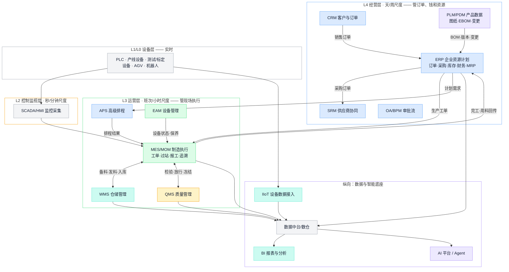

通识模型的三条认知仍然成立：**层级越低，时间越细、数据越多、容错越低**（ERP 以单据和天为粒度，MES 以"这一台、这一站、这一分钟"为粒度，两者必须分工）；**分层是逻辑模型，不是部署规定**；**没有一家工厂拥有全图**——对照 2.1 可见，公司现状把 L3 的质量、设备、线边仓收进了 MES，这是常见且合理的形态，判断能力够不够看对象与数据，不看是否买齐了名称。

#### 2.3 候选目标图：平台与现有系统的分工（待评审）

目标不是替换 2.1 的任何系统，而是在其上补齐 OEM 业务缺口（对应[设计文档 §13.1](/ai-notes/intelligent-manufacturing/oem-ai-manufacturing-platform)路径 B：跨系统协同与明确缺口建设）。结构性边界见[总体架构](/ai-notes/intelligent-manufacturing/manufacturing-platform-architecture)：

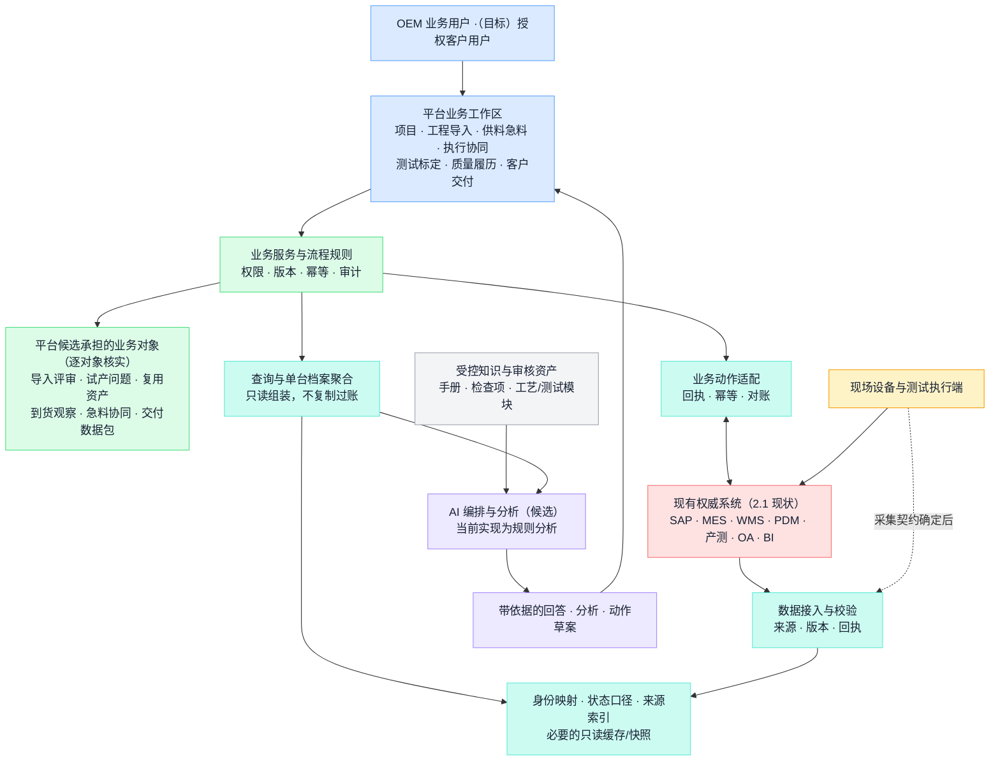

目标图的三条纪律：现有系统承担的事实继续由其产生，平台按契约接入并保留来源；平台只对经逐对象裁定由自己承担的业务对象过账，MES 已列有试产与质量异常管理，导入评审、试产问题及资产的实际边界仍需核实；每条与现有系统的连接经过"已登记→已核实→已连接"三态，未核实前只登记（总体架构 §7.4）。

### 3. 系统辞典与功能地图

#### 3.1 系统缩写辞典（通识参考）

按 2.2 通识架构从上到下排列。"典型权威对象"是该类系统的权威数据——判断两个系统谁说了算，看对象归谁。**公司实际对应关系以 2.1 为准**：表中 APS、QMS、EAM、LIMS、SCADA、IIoT、MDM 等在公司材料中未作为独立系统出现，其职责部分由 MES 模块或尚无系统承担。

| 缩写 | 全称 | 管什么（一句话） | 典型权威对象 | 主要使用者 |
| --- | --- | --- | --- | --- |
| ERP | Enterprise Resource Planning 企业资源计划 | 企业的"总账本"：订单、采购、库存、成本、财务一体记账 | 销售/采购订单、库存账、成本、凭证 | 财务、计划、采购、仓储 |
| MRP | Material Requirements Planning 物料需求计划 | 按 BOM 和提前期把需求算成"何时买/做什么"（通常是 ERP 的一个模块） | 计划订单、缺料例外 | 计划员、采购 |
| MRPII | Manufacturing Resource Planning 制造资源计划 | MRP 的闭环扩展：加产能核对与财务集成（历史概念，已融入 ERP） | — | — |
| APS | Advanced Planning & Scheduling 高级计划排程 | 在产能、换型、人员等约束下算"先做哪个、排在哪台" | 排程方案 | 计划员 |
| PLM | Product Lifecycle Management 产品生命周期管理 | 产品定义的权威库：图纸、EBOM、版本、工程变更流程 | EBOM、图纸、ECO | 研发、工艺 |
| PDM | Product Data Management 产品数据管理 | PLM 的核心子集：设计文件与版本管控（公司在用，见 2.1） | CAD 文件、版本 | 研发 |
| MES | Manufacturing Execution System 制造执行系统 | 车间的"黑匣子"：工单执行、过站、用料、报工、追溯（公司在用，内含质量/仓库/设备/追溯模块） | 工单执行记录、SN 履历 | 生产、工艺、质量 |
| MOM | Manufacturing Operations Management 制造运营管理 | 比 MES 更宽的范畴：生产+质量+维护+库存运营的统称 | — | 工厂管理 |
| SFC | Shop Floor Control 车间作业控制 | MES 的早期/轻量形态：派工与过站（公司 MES 的过站查询即以 SFC 命名） | 过站记录 | 生产 |
| WMS | Warehouse Management System 仓储管理系统 | 仓内执行：收货、上架、拣配、移库、盘点（公司在用，收发料记账在 SAP） | 库位、批次、仓内任务 | 仓储、物流 |
| WCS | Warehouse Control System 仓储控制系统 | 指挥立体库、输送线、AGV 等仓储设备 | 设备任务 | 自动化 |
| SRM | Supplier Relationship Management 供应商关系管理 | 供应商准入、询报价、交期协同、绩效（公司规划中，OEM 汇报第 8 页） | 供应商档案、报价、交期承诺 | 采购、SQE |
| CRM | Customer Relationship Management 客户关系管理 | 客户、商机、报价、订单入口（公司在用） | 客户档案、商机 | 销售 |
| QMS | Quality Management System 质量管理系统 | 检验标准、来料/过程/出货检验、不合格处置、CAPA（公司由 MES 质量模块＋OA 承担） | 检验记录、不合格单 | 质量 |
| LIMS | Laboratory Information Management System 实验室管理 | 实验室检测的样品、方法、结果管理 | 检测报告 | 实验室 |
| SPC | Statistical Process Control 统计过程控制 | 用控制图监控过程稳定性（公司在 MES 质量模块内） | 控制图、判异记录 | 质量、工艺 |
| EAM / CMMS | Enterprise Asset Management / 计算机化维护管理 | 设备台账、保养计划、维修工单、备件（公司由 MES 工程&NPI 模块承担） | 设备档案、维护记录 | 设备 |
| SCADA | Supervisory Control And Data Acquisition 监控与数据采集 | 产线设备的实时监视、报警、趋势 | 实时信号、报警 | 自动化、设备 |
| PLC | Programmable Logic Controller 可编程逻辑控制器 | 设备级实时控制（公司 MES 与 PLC 有集成连线） | 控制程序 | 自动化 |
| HMI | Human-Machine Interface 人机界面 | 设备旁的操作屏 | — | 操作员 |
| DNC | Distributed Numerical Control 程序传输 | 向数控/烧录设备下发受控程序 | 设备程序版本 | 工艺 |
| IIoT | Industrial Internet of Things 工业物联网平台 | 多源设备数据的接入、建模、转发 | 设备数据流 | OT/IT |
| AGV / RCS | Automated Guided Vehicle / Robot Control System | 搬运机器人及其调度 | 搬运任务 | 物流、自动化 |
| BI | Business Intelligence 商业智能 | 跨系统指标的报表、看板与下钻（公司在用，三层架构） | 指标与报表（非记账权威） | 管理层、分析 |
| MDM | Master Data Management 主数据管理 | 物料、客户、供应商等主数据的统一治理（公司主数据在 SAP） | 主数据标准与映射 | 主数据负责人 |
| OA / BPM | Office Automation / Business Process Management | 通用审批流（公司在用，承担采购申请与部分质量流程） | 审批记录 | 全员 |
| EDI / API | Electronic Data Interchange / 接口 | 企业间/系统间的数据交换通道 | 报文、接口契约 | IT |
| AI 平台 / Agent | — | 知识问答、分析辅助、受控业务动作（见第 15 章；当前平台实现为规则分析） | 知识库、任务记录 | 全员 |

两条使用纪律：**名称不等于能力**——判断看它管什么对象、谁在用；**功能重叠是常态**——公司 MES 带仓储与质量模块正是实例，关键不是买哪个，而是**裁定每类对象的唯一权威和唯一过账入口**（第 14 章）。

**各类系统的代表产品（通识示例，帮助建立印象，不是推荐名单）：**

| 类别 | 国际常见 | 国内常见 |
| --- | --- | --- |
| ERP | SAP、Oracle、Microsoft Dynamics | 用友、金蝶、鼎捷 |
| PLM/PDM | 西门子 Teamcenter、PTC Windchill、达索 3DEXPERIENCE | CAXA、华天软件、用友 PLM |
| MES/MOM | 西门子 Opcenter、罗克韦尔、AVEVA | 黑湖、鼎捷、赛意、摩尔 |
| APS | Asprova、西门子 Opcenter APS（原 Preactor） | 永凯、安达发 |
| WMS | Manhattan、Blue Yonder | 富勒、科箭、唯智 |
| SRM | SAP Ariba、Coupa | 甄云、企企通 |
| QMS | ETQ、Sparta；或 ERP/MES 内置质量模块 | 多随 MES/ERP 一体交付 |
| BI | Power BI、Tableau、Qlik | 帆软、观远、永洪 |
| IIoT 平台 | PTC ThingWorx、AWS/Azure IoT | 树根互联、卡奥斯、阿里云/华为云 IoT |

#### 3.2 功能地图与逐能力复用判断

功能地图的用途在本版调整为：学习时它是"这类系统的能力总纲"；建设时它是**逐能力判断的检查清单**。**本手册撤回此前"自建主场／别碰区"的笼统结论**——那套三区划分假设车间执行层无系统可用，而公司现状（2.1）是 MES 已覆盖过站、防错、质量执行、线边仓、设备台账、追溯的多数能力。正确的判断方式是逐能力走五路裁定：

| 路径 | 含义 | 适用判据 |
| --- | --- | --- |
| **沿用** | 已有系统该能力在用且满足 OEM 业务 | 实际样本核对通过（功能在用＋数据可信＋覆盖 OEM 对象） |
| **配置** | 已有系统具备该能力，需开启模块、配主数据或调规则 | 能力存在但未启用/未按 OEM 配置（如 Marking 锁定类型、检验计划触发） |
| **集成** | 能力在用但信息到不了需要的人/系统 | 断点在传递不在能力（如急料信息靠 MC 人工传递，P03/P08/P10） |
| **扩展** | 已有系统承载，但需二次开发或厂商深化 | 能力有骨架缺细节（如 MES 标注"深化"的急料与 WIP 管理），受开发许可与厂商支持约束 |
| **新建** | 逐对象核实已有承载及可配置范围后仍需新增的对象 | 候选如工程导入评审、复用资产、到货观察、跨系统单台档案聚合、客户数据包；需与 MES 试产、质量异常及相邻 PDM／OA 能力逐项核实，材料未详述不等于无人承担 |

判断纪律：① 每项能力先问"公司现状里谁在管这个对象"（对照 2.1），再问"OEM 业务用它缺什么"；② 新建是最后选项，且新建的对象不得与已有系统争权威（第 14 章）；③ 判断结论随核实更新——下表"通用倾向"列只是行业参考起点，**不是对公司系统的结论**。

**ERP 类能力清单**（通识，公司对应 SAP）——强在"账"，弱在"现场与协同"：

| 模块 | 核心功能点 | 通用倾向（参考） | 公司现状对照（待核实） |
| --- | --- | --- | --- |
| 财务会计 | 总账、应收应付、固定资产、税务、报表 | 买成熟产品，不自研 | SAP 在用（IT 材料第 1 页） |
| 成本管理 | 标准成本、工单成本归集、差异分析 | 核算留 ERP；执行系统喂准实际数 | SAP 在用；OEM 代工费口径待核实 |
| 销售管理 | 报价、订单、价格、发运、开票 | 不自研，状态可读取集成 | CRM+SAP；海外 Netsuite/SAP |
| 采购管理 | 请购、订单、收货、三方匹配 | 核心不自研；**催交协同与供应商门户**是普遍薄弱区 | SAP 在用，采购申请走 OA；SRM 规划中——客供到料协同（P02）是现实缺口 |
| 库存管理 | 库存账、出入库事务、状态、盘点、批次 | 账留 ERP；仓内执行另议 | 收发料记账在 SAP，盘点/库存分析在 WMS——**打单与实际作业的衔接（P11—P13）是已报告痛点** |
| 生产管理 | BOM/路线主数据、工单、领退料、MRP | 工单账留 ERP；车间执行另议 | SAP 生产计划在用，工单同步到 MES |
| 主数据 | 物料/客户/供应商/BOM 维护审批 | 维护入口可建，权威账留 ERP | SAP 主数据管理在用；**无编码来料（P07）指向建码时效问题** |

**MES 类能力清单**（通识）——公司 MES 模块覆盖对照（IT 材料第 2 页）：

| 能力 | 通用功能点 | 公司 MES 现状（材料所述） | OEM 待核实 |
| --- | --- | --- | --- |
| 工单与派工 | 接收工单、派工、开工条件检查 | 工单同步、计划排程、指定批次管理 | 开工检查的实际检查项与拦截力 |
| 过站与路由 | 过站采集、防呆、WIP 跟踪 | 过站校验含账号资质/物料/队列校验（第 7 页）；WIP 管理标注"深化" | 哪些校验已启用；WIP 可见性（P13 关联） |
| 物料防错 | 上料验证、批次/SN 绑定、倒冲 | 防错覆盖六环节（第 7 页）；线边仓发料退料 | 实际启用范围；带料绕行（P05/P06）说明防错未闭合或被绕过 |
| 质量执行 | 首件、巡检、不良采集、维修流转 | IQC/IPQC/OQC、SPC、质量异常管理、售后管理 | OEM 检验标准维护；维修与返工的履历口径 |
| 隔离与拦截 | 冻结、锁定、出货校验 | Marking 隔离四类锁定＋出货校验（第 6 页，界面显示约 99 万条查询结果） | 实际拦截位置、解除权限、OEM 适用 |
| 数据采集 | 扫码、设备联机、测试数据归档 | PLC 集成（工艺参数/过程数据）；产测平台双向集成 | 原始测试曲线的保存深度与关联 |
| 追溯 | 正反向履历、批次影响面 | SN/组件/批次/工序/发货多维追溯（第 5、8—9、13—14 页真实截图） | 多层递归、拆换历史、OEM 项目覆盖 |
| 急料与异常 | 异常呼叫、响应、闭环 | 急料管理标注"深化"；五类预警管理 | 急料信息今天如何传递（P03/P08/P10 称靠 MC 人工） |
| 设备管理 | 台账、点检保养、故障、治具 | 工程&NPI 模块承担（台账/点检/保养/故障/夹治具） | 校准有效期与开工检查的联动 |
| 看板报表 | 产量/良率/达成率 | 可视化运营分析模块；BI 良率报表（第 12 页） | 指标口径与数据来源 |
| 试产管理 | NPI 试产工单与记录 | 试产管理在工程&NPI 模块 | 试产通道与量产的区分（ECN 双轨的"试产轻通道走 MES 工单"是原稿建议） |

**WMS 类能力清单**（通识）——公司 WMS＋MES 仓库模块对照：

| 能力 | 通用功能点 | 公司现状对照（待核实） |
| --- | --- | --- |
| 入库 | 到货预约（ASN）、收货、质检协同、上架 | 收发料记账在 SAP；待检区缺库位（P04）、送货异常无法收货（P01）是已报告痛点 |
| 库内 | 移库、补货、循环盘点、库位/容器 | WMS 承担盘点与库存分析；库位与批次对应限制（P09）待按实际模型核实 |
| 出库/配料 | 波次、拣选、复核、交接 | 人工扫描下架有漏扫风险（P12）；工单配料进度不透明（P13）；手工交接（P14/P15） |
| 批次效期 | FIFO/FEFO、效期冻结 | MES 物料管理含先入先出；实际执行待核实 |
| 条码/RF 作业 | 手持终端作业流 | 原表建议 PDA 扫码交接；实际设备与作业端待核实 |
| 自动化对接 | WCS：立体库、AGV 调度 | 通识判断不变：随自动化设备配套，不自建 |

**质量类能力清单**（通识）——公司由 MES 质量模块＋OA 承担：

| 能力 | 通用功能点 | 公司现状对照（待核实） |
| --- | --- | --- |
| 检验标准 | 检验计划、抽样、特性与限值受控 | MES 检验建模与标准维护有真实界面（第 4—5 页）；OEM 客户规范的版本管理待核实 |
| 检验执行 | IQC/IPQC/OQC 任务、记录、判定 | MES 质量控制模块在用；IQC 急料优先级传递（P08）是已报告痛点 |
| 不合格管理 | 不合格单、MRB、隔离联动 | Marking 隔离在用；MRB 流程与库存联动待核实 |
| 纠正预防 | 8D/CAPA 与有效性验证 | 材料未详述完整 8D/CAPA 链路，MES 已列质量异常管理；OA／MES／平台按问题、根因、措施与验证逐对象核实，EX001 89 项问题库是候选素材 |
| 供应商质量 | SQE 绩效、来料统计、PPAP | 材料未见；SRM 规划相关 |
| 计量管理 | 器具台账、校准计划、到期拦截 | MES 设备/夹治具管理可能覆盖，待核实 |
| 体系管理 | 文控、内审 | 通识判断不变：买轻量工具或 OA 承载，不自研 |

自建对象怎么造、与现有系统怎么立契约，见配套的[《OEM 制造系统总体架构设计》](/ai-notes/intelligent-manufacturing/manufacturing-platform-architecture)（§7.1 权威地图与执行能力三分）。

### 4. 三条贯穿全厂的数据流

系统架构是静态的，真正要盯住的是三条动态数据流——OEM 的跨部门扯皮和痛点，几乎都发生在这三条流的断点上。每条流给出通识走法与公司现状对照。下列流程箭头表达通识业务走法，不是 IT 第 10 页逐字段方向的证据；公司现状仅按注明来源的文字核实。

**① 客户资料与版本流：客户的设计怎么变成车间能执行的资料**

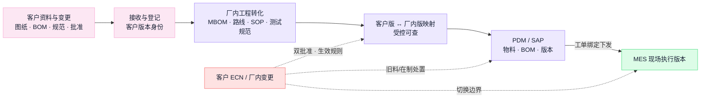

要点：OEM 的这条流比自有产品多一层身份——**客户版本（批准权在客户）与厂内版本（批准权在厂内工程）并存且映射可查**，不允许合并成一个号。变更必须带生效规则（按日期/工单/批次/SN 切换）走完全程，客户批准与厂内批准分别留痕。全栈客户设计未冻结、ECN 频繁（OEM 汇报第 3 页画像），这条流的受控程度直接决定交付质量。**公司现状**：PDM↔SAP 的 BOM/ECN/ECR、PDM→MES 的 ECN/ECR 以及 SAP↔MES 的 BOM 等字段集合在集成图上存在（双向关系的逐字段方向待核实）（IT 材料第 10 页）；客户资料的实际接收通道、客户版本如何登记、ECN 实际流程待核实。原稿"ECN 双轨（试产轻通道走 MES 工单、量产走 SAP）"是候选方案。

**② 订单—供料—执行流：承诺怎么变成交付**

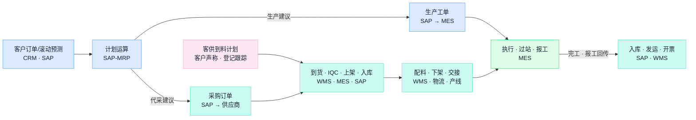

要点：这条流上**每一次交接都应留业务记录；涉及权威账变动的动作才按唯一入口过账**，重复过账和漏过账是账实不符的两大来源；每类事实只能有一个过账入口。OEM 多一条客供料支线：客供料不生成采购建议但占齐套，所有权独立，损耗与对账按合同。**公司现状**：SAP 销售订单→主生产计划→MES 生产计划的主线在作业流程图上存在（IT 材料第 3 页）；但物料段的 15 条痛点全部落在这条流上——到货异常（P01）、客供计划不准（P02）、急料人工传递（P03/P08/P10）、打单与作业脱节（P11—P13）、手工交接（P14/P15）、绕行（P05/P06）。现状明细与候选走法见[流程总览](https://github.com/ink-hz/AI-Manufacturing-Platform/blob/53958c7cede6707c41b99cba7c636402f3c23fe3/docs/workflows/manufacturing-process-overview.md)的现状图与分支表。

**③ 质量—交付—追溯流：问题怎么被拦住、怎么找回去、客户怎么拿到证据**

```mermaid
flowchart LR
    accTitle: OEM 制造数字化系统手册：4. 三条贯穿全厂的数据流（图7）
    accDescr: OEM 制造数字化系统手册中4. 三条贯穿全厂的数据流的关系图，展示来料检验 IQC、MES 质量模块、库存状态、WMS/SAP · Marking 锁定、过程检验 IPQC · 首件、MES、成品测试 · 标定、产测平台 ↔ MES、放行 OQC · 出货校验、MES Marking之间的职责、流转与边界。
    IQC2["来料检验 IQC<br/>MES 质量模块"] -->|"合格/冻结状态"| STK["库存状态<br/>WMS/SAP · Marking 锁定"]
    STK --> IPQC2["过程检验 IPQC · 首件<br/>MES"]
    IPQC2 --> FT["成品测试 · 标定<br/>产测平台 ↔ MES"]
    FT --> REL["放行 OQC · 出货校验<br/>MES Marking"]
    REL --> SHIP["发运 · SN 清单 · 客户数据包"]
    SHIP -.->|"客诉 / 退货 RMA<br/>CRM 退货信息进 MES"| ANA["检测分析 · 8D"]
    ANA -.->|"批次/SN 追溯"| TRACE[("SN/组件/批次履历<br/>MES · 平台聚合")]
    ANA -.->|"纠正措施"| ECN2["工程变更<br/>客户/厂内双批准"]
    class IQC2,IPQC2,FT,REL qa
    class STK flow
    class SHIP cust
    class ANA,ECN2 risk
    class TRACE store
    classDef qa fill:#FEF3C7,stroke:#F59E0B,color:#172033;
    classDef flow fill:#CCFBF1,stroke:#5EEAD4,color:#172033;
    classDef cust fill:#FCE7F3,stroke:#F9A8D4,color:#172033;
    classDef risk fill:#FEE2E2,stroke:#F87171,color:#172033;
    classDef store fill:#F3F4F6,stroke:#9CA3AF,color:#172033;
```

要点：质量状态必须**真实锁住库存与发运**——公司已有 Marking 隔离与出货校验机制（IT 材料第 6 页），OEM 要核实的是锁定与解除的责任及对 OEM 项目的适用；追溯依赖执行逐站留痕，**履历是生产时记出来的，不是出事后补出来的**——公司 MES 已有 SN/组件/发货多级追溯证据（第 8—9、13—14 页），OEM 的增量是客户 SN 映射、原始测试曲线、拆换历史与合同承诺的追溯等级。客户数据包与回传是 OEM 特有的流出口：给客户的数与内部同源同口径，差异只能来自截点。

---

## 第二部分 工作流逐节点（S1—S9）

每节统一结构：**干什么 → 节点流程 → 要懂的知识 → 公司现状与痛点（材料所述，待核实）→ 涉及的系统 → 核心数据对象 → OEM 合同要点 → 常见断点**。按需翻查，不必顺序读。"要懂的知识"是通识参考；"公司现状与痛点"注明材料出处，未经现场复核的保留该状态。

**总览矩阵（翻查入口）**：

| 节点 | 核心产出 | 公司现状主要系统（待核实 OEM 覆盖） | 参与角色 |
| --- | --- | --- | --- |
| S1 承接与交付评审 | 经评审的 OEM 承接，含供料责任、追溯等级与未决条件 | CRM · SAP · OA | 客户项目、计划、工程、质量、制造 |
| S2 工程导入与版本准备 | 客户版/厂内版映射 · MBOM · SOP · 测试规范 · ECN · 试产结论 | PDM · SAP · MES（试产管理）· OA | 客户技术接口、制造工程、质量、生产 |
| S3 需求与供应计划 | 代采/客供分开的供应行动 · 急料清单 · 排产 | SAP-MRP · MES（急料管理，标注深化）·（SRM 规划） | 计划、MC、采购、客户接口 |
| S4 物料与产能准备 | 可用物料（身份/状态/所有权/位置清楚）· 齐套 · 资源就绪 | SAP · WMS · MES（IQC/仓库模块） | 采购、客户接口、仓储、IQC、物流、设备 |
| S5 工单下达与开工检查 | 允许执行的工单（版本绑定）· 配料交接完成 · 首件通过 | SAP · MES · WMS | 计划、生产、工艺、仓储、质量 |
| S6 生产执行与过程质量 | 过站 · 报工 · 实际用料 · 异常与返工记录 | MES（过站/防错/WIP）· PLC | 生产、工艺、质量、设备 |
| S7 测试、标定与质量放行 | 测试与标定证据（关联 SN 与版本）· 放行记录 | 产测平台 · MES（质量/Marking） | 测试、质量、工程、（按约定客户） |
| S8 发运与约定验收 | 箱—SN—客户关联 · 客户数据包 · 验收记录 | WMS · SAP · MES（出货校验）· 客户系统 | 仓储、物流、客户项目、质量 |
| S9 结案、反馈与资产复用 | 代工费结算与客供对账 · 8D · 经验证的复用资产 | SAP · BI · MES · CRM（退货） | 财务、制造、质量、工程、客户接口 |

### 5. S1 承接与交付评审

**干什么**：把客户需求（项目、询价、试产、正式订单）变成一条"做什么、做多少、何时交、供料与验收责任清楚、承诺状态明确"的 OEM 制造承接。输入是客户线索与资料，输出是经评审的承接或立项。

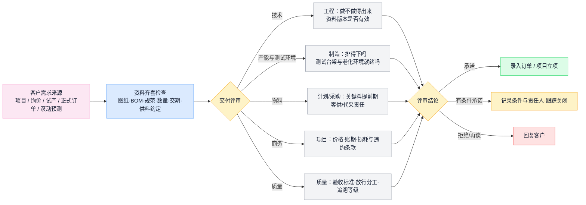

**要懂的知识**

| 概念 | 要点 |
| --- | --- |
| 需求的承诺程度 | 询价 < 预测 < 意向 < 正式订单，承诺程度不同，允许触发的动作不同（询价不触发采购，预测可触发长周期备料需审批）。受理需求 ≠ 批准投产 |
| 订单评审 | 技术、产能、物料、商务、质量五个维度缺一不可；评审结论必须回写并留痕，"有条件承诺"的条件要有人跟踪。**测试环境就绪应作为试产启动的硬性前置评审项**——EX001 老化环境晚 18 天，达成率掉到 84%（OEM 汇报第 5、10 页） |
| 订单分离点（MTS/MTO/ATO/ETO） | 客户订单到达时哪些工作已完成。OEM 整机代工通常接近 MTO，但长周期器件可能按客户预测备料——备料风险归谁写进合同 |
| 交期承诺依据（ATP/CTP） | ATP 按现有库存和已排供应承诺；CTP 进一步核对产能或资源能力。没有这两者，交期就是拍脑袋 |
| OEM / ODM / JDM 与供料模式 | OEM＝按客户设计代工（公司定位，"不碰设计"是对全栈客户的中立承诺——OEM 汇报第 2 页）；ODM/JDM 不做。供料分包工包料（代采）、来料加工（客供）、客户直接带料与混合——它决定采购范围、库存所有权和结算口径，评审时必须写进责任边界 |
| 追溯等级承诺 | 客户要求批次级还是 SN 级追溯是合同条款，接单时裁定；它决定留痕建模颗粒度，上线后升级代价极大 |
| 需求变更 | 改期、增减、取消都要回到本节点重新确认，并评估已触发的采购、客供安排、工单、在制和交付 |

**公司现状与痛点（材料所述，待核实）**

- OEM 汇报给出的目标客户画像：全栈式机器人公司，A/B 轮、百人规模、硬件团队小、BOM 800—900 颗、3D 打印/快速模、设计未冻结、ECN 频繁（第 3 页）——这意味着承接评审必须把**资料完整性**（"只有物料清单？"——第 9 页导入数据包规范动机）和**变更频度**当成常态条件评审，而不是例外。
- EX001 的实战教训（第 5—6 页）：问题沿产线向后累积，三类根因是缺料、测试环境延期、半成品良率低——都对应评审时该问住的前置条件。
- 原稿封面目标（2026 签约 2—3 家、2027 导入 10—12 周、2028 复用率 >70%）是汇报建议，不是已批准承诺。
- 待核实：实际承接与合同评审流程、责任人；首批客户与品类范围（决策项 D01）。

**涉及的系统**

| 系统 | 在本节点干什么 | 现状对照 |
| --- | --- | --- |
| CRM | 商机、询价、客户档案与接口记录 | 在用（CRM+SAP，IT 材料第 1 页） |
| SAP | 正式销售订单、ATP 核查的库存与供应数据 | 在用 |
| OA | 评审会签与特殊条款审批 | 在用 |
| 平台（候选） | 承接条件、责任边界与未决条件的登记跟踪 | 软件已有订单与项目对象（R01） |

**核心数据对象**：客户订单/项目（型号/数量/交期/价格/交付条款）、客户档案、评审记录（结论＋条件＋责任人）、供料责任约定、追溯等级承诺、需求变更记录（原始承诺永久保留）。

**OEM 合同要点**：代工范围、设计与采购责任、供料方式与损耗责任、验收分工与位置、模具治具归属、知识产权与保密、客户数据交付范围——逐项写进责任边界；"不碰设计"的中立承诺同时意味着 DFM 建议只以建议形式输出，设计决策权始终在客户。

**常见断点**：口头承诺不入系统，事后无法对质；评审结论不回写；预测与正式订单重复计算需求；"有条件承诺"的条件无人跟踪；测试环境就绪没进评审，试产后期爆雷。

### 6. S2 工程导入与版本准备

**干什么**：把客户产品定义（图纸、BOM、规范）转化为工厂可执行的制造资料（MBOM、工艺路线、SOP、测试规范），建立客户版本与厂内版本的受控映射；新项目或重大变更走导入试产（NPI），变更走客户与厂内双批准的 ECN 流程。

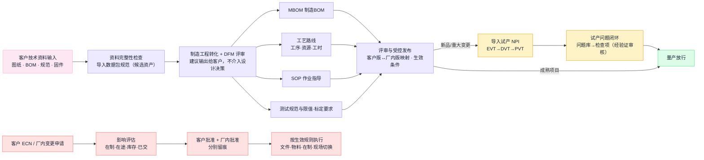

**要懂的知识**

| 概念 | 要点 |
| --- | --- |
| EBOM / MBOM / 工艺路线 / SOP | 四份资料回答四个问题：按设计由什么组成 / 工厂实际准备和装配什么（含包材辅料、虚拟件）/ 工序按什么顺序用哪些资源和工时 / 每道工序具体怎么干。EBOM→MBOM 是受控转换，不是复制后各改各的 |
| 客户版本与厂内版本 | 同一份资料两个受控身份：客户版本（批准权在客户）与厂内版本（批准权在厂内工程），并存且映射可查，不允许合并——客户升版而厂内未切、厂内优化而客户未批，是 OEM 最常见的两类版本事故 |
| 版本的多个轴 | 硬件（BOM 修订）、固件、测试程序与限值、标定参数、工艺文件——任何一轴变动都要评估其他轴要不要联动；机器人整机的电机标定、测试串与固件同样如此（EX001 高风险问题含"电机标定信息异常"） |
| 料号 / 修订 / 批次三层身份 | 料号=哪种东西，修订=哪个受控定义，批次/SN=哪个实物。"系统里当前版本是 B"不代表库房里的实物都是 B |
| NPI 阶段（EVT/DVT/PVT） | 工程验证→设计验证→生产验证。每阶段的转阶段批准要留证据；设计改版后旧验证证据是否仍有效必须有人判断。EX001 处于 DVT（250 台） |
| DFM 评审 | 制造工程对客户设计提出可制造性建议（以 DFM 建议形式输出）；客户保留设计决策权，厂内评审通过不等于客户批准，也不直接修改客户设计 |
| ECR / ECO / ECN | 变更申请 / 指令 / 通知。缩写职责没有跨企业统一边界，先定义本公司与各客户的状态和批准权 |
| 变更影响盘点 | 一次换料至少盘：未执行的计划采购、已收旧料、在途、在制工单、新工单起点、治具、固件与测试限值、客户通知、售后兼容。文件批准完成 ≠ 变更完成 |
| 生效方式 | 按日期 / 按工单 / 按批次 / 按序列号切换；旧料用尽 vs 硬切换 vs 按客户区分。生效边界必须可重现 |
| 替代料与 AVL | 替代要定方向、范围、层级、附加验证；AVL=同一料号下的合格制造商清单。OEM 下替代通常需要客户批准（竞对关节反向纳入 AVL 是商务策略，不改变批准纪律） |

**公司现状与痛点（材料所述，待核实）**

- **EX001 的 89 项问题是本节点最重要的素材**（OEM 汇报第 6 页）：整机装配异常 45 项（物料 21、制程 10、结构 7、工艺 3、其他 4）＋六轴臂试产 44 项（结构 22、物料 9、电子 8、动力 3、硬件 2），含 6 项高风险（关节支架滑牙、螺牙深度 7.0 vs 图纸 7.5mm、老化轴承异响、电机标定信息异常）。管理结论："大多数本可以在导入评审拦截"、"问题重复发生＝经验在人不在体系"。把问题库转化为强制检查项（材料称物料 30 项→来料检验项、结构 29 项→DFM 检查表）是原稿"平台二"的第一张工单——**转化必须逐条经过验证审核，不是整表照搬**。
- 原稿建议的三份标准资产（《客户导入数据包规范》《DFM 评审检查表》《工艺模块库》七类模块）为候选复用资产。
- 现状系统：PDM 在用（研发资料），PDM↔SAP 的 BOM/ECN/ECR、PDM→MES 的 ECN/ECR 及 SAP↔MES 的 BOM 等字段集合有图示关系（双向关系的逐字段方向待核实）（IT 材料第 10 页）；MES 工程&NPI 模块含试产管理与 SOP 电子化（第 2 页）。
- 待核实：客户资料的实际接收与受控通道；客户版本今天登记在哪里；ECN 实际流程与双批准留痕；89 项问题明细尚未取得（原稿汇总不代表明细已获取）。

**涉及的系统**

| 系统 | 在本节点干什么 | 现状对照 |
| --- | --- | --- |
| PDM | 图纸、BOM、版本的受控库 | 在用；客户资料是否入 PDM 待核实 |
| SAP | 物料主数据、MBOM、工艺路线 | 在用；无编码来料（P07）指向建码时效 |
| MES | 接收版本下发、SOP 电子化、试产管理 | 模块存在（IT 材料第 2 页） |
| OA | 工程与质量批准流 | 在用 |
| 平台（候选） | 导入评审、试产问题、资产复用、客户版/厂内版映射 | 软件已实现（R02、R11）；实际权威须与 MES 试产、质量异常及 PDM／OA 逐对象核实，已实现不等于已接管 |

**核心数据对象**：客户资料包（来源、编号、修订、凭据）、客户版/厂内版映射、物料主数据、MBOM、工艺路线、SOP、测试规范与限值、ECN（含影响盘点、客户批准与厂内批准、生效规则）、试产报告与转阶段批准、DFM 评审记录、问题库与检查项资产、AVL/替代料关系。

**OEM 合同要点**：哪些资料客户批、哪些厂内批、客户变更到达后的厂内评估时限；试产的数量、费用与问题处理责任；资料保密与跨客户复用边界（共性进平台、客户专属受原权限保护——原稿第 9 页制度建议）。

**常见断点**：客户改了版、厂内没人同步；现场贴的 SOP 是旧版（发布无回执）；变更只发了文件、旧料在途在制没处置；固件升了版、测试限值没跟着改；客户资料版本与厂内执行版本对不上；试产问题留在个人表格里，下个项目重犯。

### 7. S3 需求与供应计划

**干什么**：把确认的需求展开成"何时买什么（代采）、何时客户该到什么（客供）、何时做什么"的行动，核对产能与测试环境，形成可执行、可追踪的计划；急料与缺口关联到受影响工单和交付。

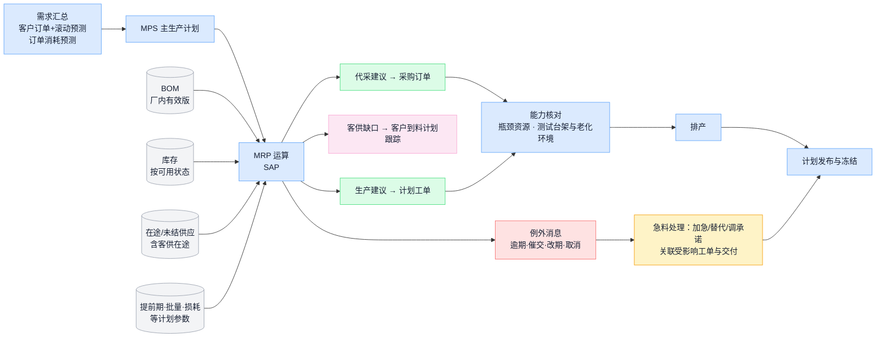

**要懂的知识**

| 概念 | 要点 |
| --- | --- |
| 独立需求 vs 相关需求 | 整机卖多少要预测（独立需求）；物料用多少由 BOM 算出来（相关需求）。MRP 的核心思想：**能算的不要预测** |
| 计划层级 | S&OP（产品族/月度）→ MPS（型号/周）→ MRP（料号/日周）→ 排程（班次/小时）。层级可以合并，决策不能缺位 |
| MRP 的输入与输出 | 四输入：需求、BOM、库存与未结供应、计划参数；三输出：采购建议、生产建议、例外消息。**例外消息是最有价值的输出**——管理的对象是"哪些例外阻止计划实现、谁行动、是否闭环" |
| 净算与倒推 | 毛需求 − 可用库存 − 在途 = 净需求；净需求按提前期倒推"必须下达的时间"。倒推落到过去 = 逾期例外，正确反应是加急/替代/调承诺，不是改日期装没事 |
| 计划参数 | 提前期、MOQ、批量规则、安全库存、损耗率。参数失真的典型后果：提前期虚长＝把缺料藏成库存；状态错的库存参与净算＝整张计划作废 |
| 需求与供给的纪律 | 订单消耗预测，不得两者相加；待验/冻结库存不算可用；部分收货要从在途中扣除 |
| 客供料的计划语义 | 客供料不生成采购建议，但占齐套、占到料计划；客供缺口的催办对象是客户，责任与代采缺口分开（P02 的正解） |
| 物料与产能是两张表 | 料齐了产能未必够；MRP 默认产能无限，必须单独做能力核对。OEM 整机代工还要加一张表：**测试环境**（台架、老化房、治具）是独立约束 |
| 长周期料决策 | 提前期超过客户容忍交期的物料，必须在订单之前按预测/风险备料——押库存的风险归属（客户预测担保 vs 自担）写进合同，升级到经营层拍板 |

**公司现状与痛点（材料所述，待核实）**

- **P02（F4）**：客供料到料计划不准确，人工追踪到料情况。原表建议：客户提供计划、代采通过 SRM 获取——SRM 现为规划状态（OEM 汇报第 8 页"未来补 SRM"），上线前客供计划的登记与跟踪需要明确责任载体。
- **P03（F8）／P08（F19）／P10（F34）**：仓库与 IQC 获取急料信息依赖 MC 人工整理传递；产线不能及时获得入库信息。MES 计划管理模块的"急料管理"恰标注"深化"（IT 材料第 2 页）——IT 侧已有同向判断，深化内容与进度待核实。候选方向：急料关联工单需求与交付影响，状态变化推送到岗位（R04）。
- EX001 根因之一是"缺料（压铸开裂挑料/关键料晚到）"（OEM 汇报第 5 页）。
- 待核实：MRP 实际运行方式与参数维护责任；客供计划的实际来源与更新频率；急料优先级今天怎么判断（设计文档 §28 待决策问题）。

**涉及的系统**

| 系统 | 在本节点干什么 | 现状对照 |
| --- | --- | --- |
| SAP（MRP） | 需求展开、净算、建议与例外 | 在用（生产计划、采购在 SAP） |
| MES | 工单同步、计划排程、急料管理（标注深化） | 模块存在 |
| SRM | 供应商交期确认与协同 | 规划中 |
| Excel／人工 | 现实的急料表与到料追踪 | 材料所述现状（P02/P03）；纳入管理比假装不存在有用 |
| 平台（候选） | 急料与齐套状态跨岗位传递（R04） | 软件部分实现 |

**核心数据对象**：需求计划/滚动预测、MPS、计划订单、采购申请（代采）、客供到料计划（客户声称＋跟踪）、例外消息清单、急料清单（关联工单与交付影响）、排程方案、计划参数表。

**OEM 合同要点**：按预测备料的授权与呆滞风险归属；客供料的到料承诺与延迟责任；长周期器件的备料决策机制。

**常见断点**：库存状态失真让 MRP 全盘算错；建议生成没人执行（计划体外循环）；客供缺口混进自购缺口，催错对象；供应商确认交期只存在于聊天工具里；急料靠人盯，换个人就断。

### 8. S4 物料与产能准备

**干什么**：把计划变成**可用**的物料（到厂、身份清楚、验过、入对地方、能配出来、交接得清）和**可用**的资源（设备、治具、测试环境就绪）。这是 15 条已报告痛点的主场，也是 OEM 候选首期试点（物料闭环）的核心节点。

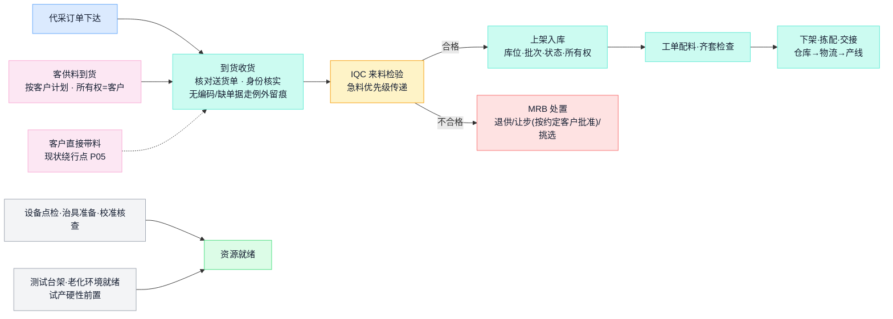

**要懂的知识**

| 概念 | 要点 |
| --- | --- |
| P2P 各步是独立事实 | 订了多少、到了多少、合格多少、开票多少、付了多少——五个数可以不同，必须分别留痕 |
| 三方匹配 | 采购单 × 收货入库 × 发票互相核对，超容差必须有人处理 |
| 库存五维 | 任何一批料同时回答：所有者／所有权（自有/客供等）、实物位置／保管（厂内库位/线边/在途/委外供应商处/隔离区）、质量状态（待验/合格/冻结/让步）、分配状态（可用/已预留/已拣配）、批次身份。"仓库还有 N"回答不了"新工单能领多少" |
| 质量状态流转 | 待验→合格 / 冻结→退供 / 让步（批准限定使用）。状态必须真实锁库存——判了冻结照常发料，等于没有质量控制 |
| 齐套 | 工单所需物料全部到位才叫齐套；齐套检查是开工的前置（S5）。客供料占齐套但不占采购 |
| FIFO 与效期 | 先进先出防旧料沉底；效期物料到期自动冻结、复验或报废 |
| 客供料 | 客户所有权、独立台账、与代采料物理或账务隔离；损耗与不良责任和补料方式按合同；定期与客户对账 |
| 委外在外 | 表达实物位于外协供应商处及相应保管责任，不是所有权类别；自有料、客供料均可委外，原所有者不因委外改变。发料、回货、在外余额按所有者分账并定期对账 |
| 盘点 | 循环盘点优于一年一次大盘；差异重点是查原因，不是调平数字 |
| 呆滞料 | 多来自变更、取消、超买；OEM 下旧料呆滞的处置责任按合同（客户变更导致的旧料归谁） |

**公司现状与痛点（材料所述，待核实）——本节点对应 10 条痛点**

| 痛点 | 原始位置 | 已报告问题 | 原表建议（候选） | 升级为目标前需核实 |
| --- | --- | --- | --- | --- |
| P01 | F3 | 供应商送货地点或单据异常，无法收货 | 规范物流及送货上门 | 实际送货约定与异常处理责任 |
| P02 | F4 | 客供到料计划不准，人工追踪 | 客户提供计划；代采走 SRM | 见 S3 |
| P04 | F9 | 收料待检区没有库位，批量来料找料困难 | 待检区增加库位码 | WMS 库位模型与现场布局 |
| P05 | F10 | 客户带料直接上产线，绕过系统，信息断层 | MES 卡控：未经过仓库物料无法上线 | 卡控位置、例外批准、现场纪律与业务制度 |
| P06 | F11 | 生产直接拿料，不经过仓库 | 与 P05 共用卡控建议 | 同上 |
| P07 | F12 | 来料无物料编码，无法入库，急用时借料生产 | 提前取得物料清单并建码 | SAP 建码流程时效；例外留痕与补账方式 |
| P08 | F19 | IQC 获取急料信息依赖 MC 人工传递 | 欠料传递到急料看板 | 见 S3 |
| P09 | F24 | 原表称库位只能对应一个批次的物料编码，影响找料 | WMS 扩展一库位多物料 | **现有库位/容器/批次模型的实际配置与样本**——原表表述待验证 |
| P10 | F34 | 产线不能及时获得入库信息，靠 MC 通知或反复刷新 | 急料入库提醒 | 见 S3 |
| P11 | F35 | 原表称 SAP 打单即过账，与仓库实际作业脱节 | WMS 先发料，再在 SAP 扣账 | **SAP 实际事务、单据类型与触发点**——先核实再裁定作业与过账关系 |

（P12—P15 属配料与交接，见 S5。）原表流程形状（来料→WMS 收料→送检→MES 检验→WMS 上架→SAP 入库→打单→下架→物流领料→产线接收）与断点图见[流程总览](https://github.com/ink-hz/AI-Manufacturing-Platform/blob/53958c7cede6707c41b99cba7c636402f3c23fe3/docs/workflows/manufacturing-process-overview.md)。候选改进对应需求 R03（到货与身份闭环）、R05（配料与过账核对）、R06（交接确认）、R07（检验状态传递）。

- 现状系统证据：MES 含 IQC 管理与"物料冻结及预警"（IT 材料第 2 页）；Marking 支持风险物料批次锁定（第 6 页）；WMS 承担盘点与库存分析、收发料记账在 SAP（第 1 页）。
- 到货观察（身份核实前先登记包裹、位置、来源，不产生库存与合格量）是平台已实现的候选能力（R03），与 WMS/SAP 权威收货的衔接待接口核实。

**涉及的系统**

| 系统 | 在本节点干什么 | 现状对照 |
| --- | --- | --- |
| SAP | 采购订单、收发料记账、三方匹配 | 在用 |
| WMS | 盘点、库存分析、库位 | 在用；与 MES 仓库模块的分工待核实 |
| MES | IQC、物料冻结预警、线边仓 | 模块存在 |
| SRM | 送货协同 | 规划中 |
| 平台（候选） | 到货观察、急料协同、交接确认 | 软件部分实现（R03/R04/R06） |

**核心数据对象**：采购订单、客供到料计划、到货观察记录（非记账）、收货单、检验单、批次档案（供应商批号收货时留存——事后补不回来）、库位账、备料/齐套检查单、客供料台账、委外发料与回货单。

**OEM 合同要点**：客供料的所有权、不良与损耗责任、余料退还、对账周期；客户带料的例外约定（是否允许、如何留痕、责任归属）；代采料的呆滞风险归属。

**常见断点**：到货不录系统（账上缺料、现场有货）；不良料没锁住被产线领用；线边仓变成账外之地；客供料与代采料混账；带料直接上线造成追溯断层（P05/P06 的后果）。

### 9. S5 工单下达与开工检查

**干什么**：把排产任务落实成一张"数量明确、版本绑定、条件满足才允许执行"的工单，完成配料、下架与交接。这是计划世界和物理世界的交接闸口，P12—P15 四条痛点落在这里的配料交接段。

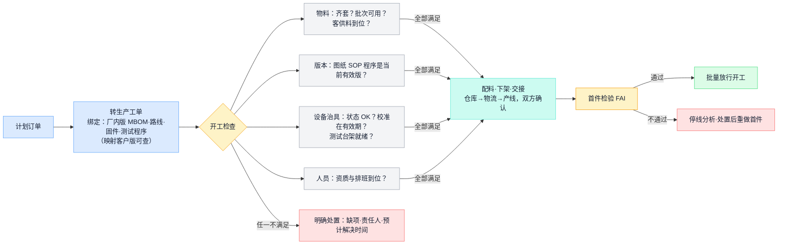

**要懂的知识**

| 概念 | 要点 |
| --- | --- |
| 工单的三重身份 | ① 数量任务（做多少）② 版本快照（按哪一版 BOM/路线/固件/测试程序做——变更管理靠它锚定"边界前后"）③ 成本归集对象（OEM 下按代工费口径归集） |
| 版本快照 vs 重新展开 | 主数据变更后，已下达工单是保持快照还是跟随新版重新展开？必须显式定义 |
| 开工检查清单 | 料齐、版本对、设备好、治具在（且在校准有效期内）、人到位、文件新——任一不满足就不开工，缺项要有责任人和预计时间。**测试环境就绪对试产是硬性前置**（EX001 教训） |
| 首件检验（FAI） | 批量前先做一台按全要求核实；换线、换版本、换批次后同样触发。某些 OEM 客户要求首件客户确认后才能批量 |
| 批次 / SN 的生成与绑定 | 在哪个工序生成 SN、何时与工单/物料批次绑定，决定追溯链从哪里开始。越早绑定，履历越完整 |
| 发料方式 | 按单发料（逐单扫码，账最准）、倒冲（省事但掩盖超耗——必须保留超领/补料/报废显式通道）、线边补给（低值辅料）。配料的四个状态要分开：打印、实物作业、回执、过账 |

**公司现状与痛点（材料所述，待核实）**

| 痛点 | 原始位置 | 已报告问题 | 原表建议（候选） | 升级为目标前需核实 |
| --- | --- | --- | --- | --- |
| P12 | F40 | 仓库依单据人工扫描下架，存在漏下架风险 | WMS 发料与 SAP 扣账衔接 | WMS 下架作业的实际回执与差异识别 |
| P13 | F41 | 工单配料进度不透明，人工跟进 | 与 P12 共用建议 | 配料各状态（打印/作业/回执/过账）的系统载体 |
| P14 | F45 | 手工交接，无法判断物料是否领走 | PDA 扫码交接，同步发料看板 | 交接双方的作业端与设备条件 |
| P15 | F49 | 手工交接，不易定位物料 | 物料与产线工位绑定 | 线边管理责任与工位绑定模型 |

- 现状系统证据：MES 含"线边仓发料退料"与指定批次管理（IT 材料第 2 页）；原表建议均为候选，对应需求 R05/R06。
- 待核实：开工检查今天由谁、按什么清单执行；配料单据从 SAP 打单到产线接收的每一步实际载体。

**涉及的系统**

| 系统 | 在本节点干什么 | 现状对照 |
| --- | --- | --- |
| SAP | 工单创建下达、发料过账 | 在用；打单与作业衔接是 P11—P13 的根 |
| MES | 开工条件校验、版本防错、SN 生成、线边仓 | 模块存在；实际拦截力待核实 |
| WMS | 按工单拣配下架 | 在用 |
| 平台（候选） | 配料状态核对、交接确认 | R05 候选新增／R06 部分实现 |

**核心数据对象**：生产工单（数量＋版本快照＋计划工期）、领料/配料单、下架记录、交接记录（双方、数量、位置、时间）、齐套检查记录、首件记录、SN 池与绑定关系。

**OEM 合同要点**：客户指定的版本/批次要求、客供料占用顺序、客户要求的标识规则、首件或制程变更是否需客户确认。

**常见断点**：没有开工检查、来了料就干；工单没绑版本，出问题说不清按哪版做的；首件流于形式；配料进度黑箱，产线与仓库互相指责（P13 的日常形态）；交接无确认，料"失踪"在仓库与产线之间（P14/P15）。

### 10. S6 生产执行与过程质量

**干什么**：按工艺路线完成装配、过站和过程检查，让每一步都留下真实、及时、可追溯的记录。这是数据密度最高、也最容易失真的节点；公司 MES 在这里已有最完整的现状能力。

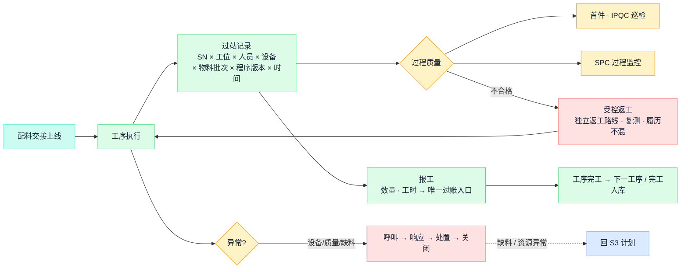

**要懂的知识**

| 概念 | 要点 |
| --- | --- |
| 过站记录绑定什么 | 一次过站至少关联：SN/批次、工位、操作人、设备与治具、投入物料批次、程序/SOP 版本、时间。**履历是生产时记出来的，不是出事后补出来的** |
| 在发生点记录 | 数据在动作发生的时间和地点录入；补录必须区分"发生时间"和"录入时间"两个字段 |
| 报工与唯一过账入口 | 报工只能有一个有效入口，由它单向过账给 SAP；两边都能报＝必然重复记账 |
| 异常闭环 | 呼叫 → 响应（谁、多久）→ 处置 → 关闭 → 统计。异常没人接走，现场就会停止上报 |
| 返工 vs 返修 | 返工＝重做某道工序使其合格；返修＝修复缺陷（可能偏离原工艺，需批准）。两者都走受控路线：独立路线、强制复测、履历保留原始失败记录 |
| 倒冲的边界 | 只适合用量稳定的低值料；超耗、报废、替代必须有显式补录通道 |
| WIP 管理 | 在制数量、停留位置、停留时长要可见；长期滞留的 WIP 往往挂着没人处理的异常 |
| 防错（Poka-yoke） | 优先靠机制防错（扫码校验料号版本、治具不匹配装不进、程序自动核对），少靠"要求员工细心" |
| 组件装配关系 | 父 SN—组件 SN—批次的绑定在装配工序建立；同一组件不能有两个同时有效的安装位置；拆除关闭关系并保留历史 |

**公司现状与痛点（材料所述，待核实）**

- **过站与防错已有成形骨架**（IT 材料第 7 页）：过站校验链含用户账号/权限资质校验、扫描产品、物料校验、队列校验、扣料、合格性判定记录、工序重测校验；防错覆盖产品技术/物料计划/使用/投料/组装包装/成品出库六环节。FT 系列工序编码（FT1B…FT9C）在多页真实截图中互相印证。
- **逐工序履历可查**（第 14 页真实截图）：工序步骤、状态、结果、操作资源（工序_线_序号编码）、秒级时间、测试次数。
- **组件装配扫描留痕**（第 13 页）：组件 SN 关联含操作者工号与秒级扫描时间。
- **WIP 管理标注"深化"**（第 2 页）——与 P13 配料/在制可见性相关，深化内容待核实。
- **绕行是现状的一部分**：P05/P06（带料直接上线、生产直接拿料）说明防错链在物料入口处可被绕过——这是业务制度与系统卡控要一起处理的问题，不能只靠加功能。
- 待核实：哪些防错校验已实际启用；OEM 项目（如机器人装配）是否走这套过站；异常与离线时的处理规程。

**涉及的系统**

| 系统 | 在本节点干什么 | 现状对照 |
| --- | --- | --- |
| MES | 本节点的核心：派工、过站、防错、报工、异常、追溯、线边仓 | 在用（材料界面证据充分） |
| PLC/设备 | 工艺参数、过程数据、设备基础数据及状态的协同 | 双向集成关系与字段集合有图示（IT 材料第 10 页）；逐字段方向待核实 |
| SAP | 完工与报工的业务过账协同 | SAP↔MES 集成字段含完工与报工；逐字段方向及正式过账触发点待核实 |
| WMS | 线边补料、工序间转运 | 分工待核实 |

**核心数据对象**：过站记录、报工单、实际用料记录（含超耗/补料/报废）、异常单（发生—响应—关闭全程时间戳）、返工单、组件装配关系、WIP 台账。

**OEM 合同要点**：客户要求的特定过程记录、制程参数回传或驻厂检验落到过站与检验模板里；机器人等品类的装配路线按实际产品维护，不与其他品类互相照搬。

**常见断点**：纸质流转卡与系统双轨，系统沦为事后抄录；报工滞后数天；返工品绕过复测混回正常流；异常只在微信群喊；装配扫码补扫冒充实时。

### 11. S7 测试、标定与质量放行

**干什么**：用测试和检验证明产品满足要求，标定写入参数并确认回读，处置不合格品，完成制造方放行；按合同满足客户的测试规范、数据回传与放行约定。这是 OEM 汇报认定的差异化所在（"平台三"统一测试标定，投入最重）。

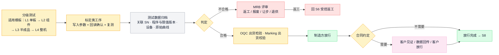

**要懂的知识**

| 概念 | 要点 |
| --- | --- |
| 检测 / 校准 / 调整三分 | 调整＝改变产品（标定写入补偿参数）；检测＝判断产品（写入后复测是否达标——**参数写入成功 ≠ 性能合格**）；校准＝判断测量系统（测试设备自己准不准）。三件事分别记录 |
| 测量系统本身要受控 | 测试/标定设备有计量校准周期和溯源要求；设备超期或漂移时，所有"通过"都不可信——校准有效期要进开工检查（S5）和设备台账 |
| 测试数据存什么 | 五类：对象（SN/批次/工单/关键件）、版本（硬件/固件/测试程序/限值/参数集）、环境资源（时间/工位/设备/治具/环境）、测量（特性、实测值、单位、上下限、原始文件）、结论（原始失败、复测、返工、最终处置）。**只存 PASS/FAIL 会缺少原始测量数据，难以开展趋势和根因分析** |
| 失败记录不可覆盖 | 维修后"再测通过"必须保留此前的失败与拆换记录，否则无法区分制造缺陷、误测与返修掩盖 |
| FPY 与最终良率 | 一次通过率反映过程能力；最终良率反映交付能力。公司 BI 良率报表已区分投入数/一次不良/直通率/最终不良/维修 OK（IT 材料第 12 页口径注释）——复用前核对口径 |
| MRB 与让步 | 处置要有明确评审权限；让步接收必须限定范围和数量、留批准记录，OEM 产品的让步通常需要客户批准 |
| 追溯等级 | 批次级与 SN 级按合同承诺选定；正反两个方向都要走得通 |
| 放行的三种主体 | 制造方放行、质量放行、客户放行是三个独立决定，分别记录；发运须满足制造与质量放行，以及合同适用的客户前置批准（含见证或发运前验收）。合同不要求客户前置批准时记录不适用，不强求客户放行 |
| 测试结构按产品 | 机器人四级测试（L1 单板烧录测试／L2 组件电机线束标零老化／L3 半成品联测／L4 整机测试串＋老化＋标定）与 40 站排布来自 EX001 材料，是**适用模板**；其他 OEM 产品按各自规范，不写死全平台 |

**公司现状与痛点（材料所述，待核实）**

- **产测平台与 MES 双向集成关系**（IT 材料第 10 页）：字段集合含工单、工艺、装配、产品、测试结果与设备状态；图中没有逐字段方向证据，具体方向、原始测试曲线的保存深度及与 SN 档案的关联方式待核实。
- **SFC 履历含测试次数**（第 14 页），BI 良率明细按测试工序统计且口径有定义（第 12 页）——测试统计有现成基础。
- **OEM 汇报的"平台三"方案**（第 10 页）：统一测试执行引擎（读总线/采图像/记曲线/判限/上传，客户差异=配置文件）、台架分级通用化、标定 100% 自研、单台 ≤20min、测试数据 100% 入 SN 档案——均为建设建议与目标值，设备接入、算法与节拍按实际工程验证。"测试环境就绪=试产启动硬性前置"的教训已纳入 S1/S5。
- 当前平台软件：测试计划/运行/曲线/参数/回读核对已实现，但完成运行的来源为人工登记——不能据此声称具备真实设备采集与测试执行引擎（R08）。
- 待核实：现有产测平台的工站、程序与脚本清单、原始数据格式、设备协议、标定参数写入与回读接口（资料权限清单第 5 行）。

**涉及的系统**

| 系统 | 在本节点干什么 | 现状对照 |
| --- | --- | --- |
| 产品测试平台 | 执行测试程序、产出原始数据 | 在用，与 MES 双向集成 |
| MES | 过站判定、测试站防错、不良品流向、Marking 出货校验 | 在用 |
| OA | 让步与处置审批 | 在用（质量流程部分走 OA） |
| 平台（候选） | 测试规范/任务管理、原始证据索引、标定回读核对 | 软件已实现，设备采集待接入 |

**核心数据对象**：测试记录（五类字段）、原始曲线、标定参数档案（含算法版本与回读确认）、不合格单与 MRB 结论、OQC 记录、放行单（三主体分别）、客户测试报告/数据回传包。

**OEM 合同要点**：客户测试规范与限值版本的批准方；数据回传的格式、范围与截点；客户见证站与放行点；让步的客户批准条件。

**常见断点**：测试数据散在设备本地不归档、不关联 SN；测试程序和限值版本不受控，整批误判；维修后旧失败记录被覆盖；设备超校准期无人拦截；标定写入未回读确认。

### 12. S8 发运与约定验收

**干什么**：放行的产品完成包装标识、入库、发运、签收和约定的客户验收，并按合同交付 SN 清单与数据包。放行、入库、发运、签收、验收是**五个独立时点**，分别留证。

**要懂的知识**

| 概念 | 要点 |
| --- | --- |
| 五个时点分开 | 质量放行 ≠ 入库 ≠ 发运 ≠ 签收 ≠ 验收。统计交付、确认收入、启动质保期，各挂在不同时点上 |
| 包装与标识 | 外箱标签、装箱单与箱内实物 SN 必须一致并留电子记录；按客户料号、标签规范、条码规则执行，错标是高频客诉 |
| SN 出货关联 | SN 与订单/客户/发运批的关联在出库时建立，是售后追溯的最后一环 |
| 分批交付 | 订单行支持分批履约；每批独立记录发运与签收，剩余数量不自动关闭 |
| 验收位置 | 合同定在发运前的验收必须成为发运前置条件；到货后验收要跟踪关闭，遗留项有责任人 |
| 客户数据包 | 随货或按约回传：SN 清单、测试报告、数据包——与内部同源同口径，差异只能来自截点 |
| 交付与结算分离 | 发运、开票、收款、质保各自独立推进 |

**公司现状与痛点（材料所述，待核实）**

- **发货追溯层级已有设计**（IT 材料第 8 页）：发货通知→外箱→内箱→SN→模组 SN→原材料批次→奥比批次→供方批次，正向可从销售订单查到供方批次，反向可从供方批次查到销售订单分布。
- **出货校验机制存在**：有 Marking 隔离标识的产品在出货校验管控（第 6 页）。
- **客户系统与海外系统集成连线存在**（第 10 页）：订单信息双向、产品/质量信息输出——具体接口与数据范围待核实。
- 原稿"客户门户（多租户数据汇聚层，不动核心系统）"是 P3 阶段建设建议（OEM 汇报第 8 页），为候选能力。
- 待核实：OEM 客户的实际验收形态与数据包要求；箱单与 SN 关联的实际载体。

**涉及的系统**

| 系统 | 在本节点干什么 | 现状对照 |
| --- | --- | --- |
| WMS | 包装、装箱、拣货出库 | 在用 |
| SAP | 发运单、出库过账、开票、订单行状态 | 在用 |
| MES | SN 出货关联、Marking 出货校验 | 在用 |
| CRM／客户系统 | 交付确认、签收与验收沟通 | 连线存在 |
| 平台（候选） | 交付数据包组织、验收遗留项跟踪 | R10 部分实现：发运、签收、验收及独立结案已有逻辑；数据包清单、组装、冻结、导出及交付回执尚未实现，列为候选新增 |

**核心数据对象**：装箱单（箱—SN 对应）、发运单、出库记录、客户数据包（SN 清单/报告/测试数据）、签收/验收记录（客户声称＋凭据）、订单行状态、交付差异单。

**OEM 合同要点**：客户标签/料号/包装规范；验收位置与方式；随货质量报告或测试数据包的范围与格式；分批与短装的处理约定。

**常见断点**：箱单与实物 SN 不符；未放行品被先行发货；"有条件验收"的遗留项无人跟踪；分批发货后订单行被错误关闭；给客户的数据与内部口径不一致，对数时崩塌。

### 13. S9 结案、质量反馈与资产复用

**干什么**：核对这张工单/这笔订单的实际消耗与产出，按代工费口径结清成本账、与客户对账客供料；处理交付后的质量反馈（客诉、退货），把问题分流回正确的上游节点；**把验证有效的经验沉淀为下个项目的强制检查项**——这是 OEM 体系化打法的扣环（"问题重复发生＝经验在人不在体系"）。

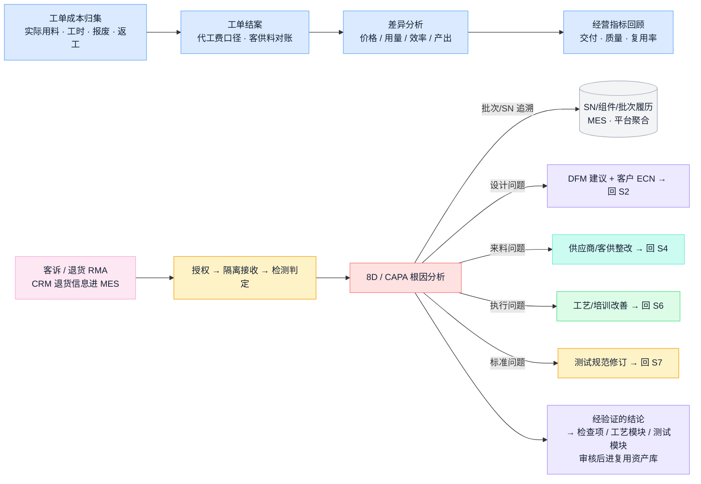

**要懂的知识**

| 概念 | 要点 |
| --- | --- |
| 标准成本与实际成本 | 标准成本＝"应该花多少"（版本变了要重算）；实际成本＝工单归集的真实消耗。差异按价格、用量、效率、产出四类拆解后归因 |
| OEM 结算口径 | 按合同模式结算（包工包料 / 来料加工费）；客供料消耗与损耗按约定对账，不进本厂成本；客诉责任与赔付按合同划分——实际消耗记录共用，核算口径分开 |
| 工单结案 ≠ 质量结案 | 成本结案、质量问题关闭、客户验收、收款是互相独立的状态 |
| 指标口径纪律 | 任何指标先问**分母和口径**：交付率按订单/行/台数/金额算结果不同；良率分首次通过与最终合格；口径变更受控留版本，原始承诺和首次失败记录永久保留 |
| RMA 流程 | 退货授权 → 隔离接收（不混入正常库存）→ 逐台检测 → 分别处置。NTF（检测无故障）留案底观察批次趋势 |
| 8D / CAPA | 围堵 → 根因 → 纠正措施 → 效果验证 → 预防推广。没有"效果验证"一步的 8D 只是文书 |
| 问题→资产的回流 | 已解决且**经验证**的问题才形成检查项、工艺模块或测试模块；资产发布即冻结、适用范围明确；"复盘必答：评审为什么没拦住"（原稿制度建议）；共性进平台、客户专属受原权限保护 |
| 反馈分流 | 根因决定去向：设计问题以 DFM 建议＋客户 ECN 回 S2（设计决策权在客户），来料问题回 S4，执行问题回 S6，标准问题回 S7 |

**公司现状与痛点（材料所述，待核实）**

- CRM→MES 的退货信息连线存在（IT 材料第 10 页）；MES 质量控制模块含售后管理（第 2 页）。
- BI 已有按工序的良率明细与趋势报表（第 12 页），指标复用见第 15 章。
- 原稿建议的考核与组织（平台工程部对复用率考核、结案强制交付资产包进 PM 考核、复用率 ≥70% 等目标值）均为汇报建议，组织决策不在本手册范围。
- 当前平台软件已实现问题→资产→跨项目采用与独立验证链路（R11）。
- 待核实：实际结算与客供料对账流程；8D 今天的载体；RMA 实际流程。

**涉及的系统**

| 系统 | 在本节点干什么 | 现状对照 |
| --- | --- | --- |
| SAP | 成本归集、工单结案、差异报表、应收核销 | 在用 |
| BI | 跨系统经营指标 | 在用 |
| MES | 售后管理、追溯履历（根因分析的证据源） | 在用 |
| CRM | 客诉与退货入口 | 连线存在 |
| 平台（候选） | 8D 组织、问题库、复用资产 | 软件已实现（R11） |

**核心数据对象**：工单成本与差异报告、客供料对账单、指标口径卡、客诉单、RMA 记录、8D 报告、问题库条目、复用资产（检查项/工艺模块/测试模块，带适用范围与验证记录）。

**OEM 合同要点**：代工费与损耗结算口径；客诉责任与赔付划分；质保与 RMA 的费用归属；跨客户资产复用的保密边界。

**常见断点**：指标口径随人随月变；客诉处理不做批次追溯，同批风险产品继续出货；纠正措施没有验证环节；经验留在个人和微信群，下个项目重犯同样的问题（EX001 已付过这笔学费）。

---

## 第三部分 整体集成与平台

### 14. 集成架构：系统之间怎么连

#### 14.1 数据权威：公司对象分工（材料所示＋待核实）

多系统并存的第一裁决是"权威"——每类对象只认一个正式来源和一个修改入口，其他系统只存副本。下表把通用权威原则落到公司现状，**"材料所示"列来自 IT 材料，全部待实际样本核实后才是裁定**（对应决策项 D05/D06）：

| 对象 | 材料所示的现状承载 | 待核实的关键问题 |
| --- | --- | --- |
| 客户订单与承诺交期 | SAP（入口可在 CRM；海外 Netsuite/SAP） | OEM 项目订单的实际录入口径；原始承诺是否保留 |
| 物料主数据 | SAP（主数据管理） | 建码流程与时效（P07 的根）；客户料号与厂内料号映射在哪 |
| 图纸、BOM、版本、变更 | PDM（↔SAP：BOM/ECN/ECR；→MES：ECN/ECR；双向关系的逐字段方向待核实） | 客户资料是否入 PDM；客户版本身份如何登记；ECN 实际流程 |
| MBOM、工艺路线、工时 | SAP（生产主数据）＋MES（工艺建模） | 两处定义的关系与同步；EBOM→MBOM 转换的责任 |
| 计划与排程 | SAP（主生产计划）→MES（生产计划/排程） | MRP 实际运行；排程与承诺的关系 |
| 工单 | SAP 创建，MES 同步执行 | 工单同步的字段与回执；试产工单通道 |
| 过站、用料、报工等执行事实 | MES；SAP↔MES 连线字段含完工与报工，逐字段方向待核实 | 报工的唯一入口、过账触发点；补录与纠错的实际做法 |
| 库位、批次、仓内移动 | WMS（盘点/库存分析）＋MES（线边仓）；收发料记账在 SAP | 三者的实际分工与过账触发点（P11—P13 的根）；库位批次模型（P09） |
| 检验、不合格、隔离、放行 | MES 质量模块（IQC/IPQC/OQC/SPC/Marking）＋OA（部分流程） | 判定、锁定、解除的实际权限；对 OEM 项目的适用 |
| 设备台账、保养、校准 | MES 工程&NPI 模块 | 校准有效期与开工检查的联动 |
| 测试运行、曲线、标定参数 | 产品测试平台（↔MES 双向） | 原始数据保存深度、格式、与 SN 的关联、回读机制 |
| 成本与会计凭证 | SAP 财务 | OEM 代工费口径配置 |
| 指标与报表 | BI（数据层含 SAP 数据集） | 数据模型、口径、刷新与权限 |
| 客户验收、客户数据 | 客户组织（客户系统连线存在） | 接口实际内容；只登记对方声称，不推断对方状态 |
| 工程导入评审、试产与问题 | MES 工程&NPI 已列试产管理，质量模块已列质量异常；PDM／OA 存在相邻资料与审批能力 | 逐对象核实评审、试产工单／轮次、问题、验证与转阶段批准的权威及缺口；平台统筹协同，候选补缺不预先接管 |
| 复用资产、到货观察、急料协同、交付数据包 | 平台候选对象；MES 急料管理标注“深化”，其余材料披露不足不等于无人承载 | 核实实际对象、职责与现有系统可配置范围，再裁定平台新增或集成；软件实现状态另行记录 |

**唯一过账入口**是权威表的执行手段：同一业务事实（如完工入库）只允许从一个系统过账，另一侧禁止手工过账——这是消灭重复记账的根本办法，也是裁定"SAP 打单与 WMS 作业"关系（P11）时的判准。

#### 14.2 已有集成连线与要补齐的契约

IT 材料第 10 页给出的现状连线（MES 居中）。下表保留系统关系与字段集合；双向连线未逐字段标明方向，不能据此分配上下行，方向须逐字段核实（通识推断需另行标识）。HR／CRM／PDM→MES 保留原图明确的单向关系：

| 连线 | 方向 | 材料所示内容 |
| --- | --- | --- |
| SAP ↔ MES | 双向；逐字段方向待核实 | 基础主数据、工单/BOM、排产计划、完工信息、报工数据 |
| SAP ↔ WMS | 双向；逐字段方向待核实 | 库存、物料、收发货、出货、供应商、客户 |
| SAP ↔ PDM | 双向 | BOM、ECN、ECR |
| PDM → MES | 单向 | ECN、ECR |
| WMS ↔ MES | 双向；逐字段方向待核实 | 库存、物料、批次、收发货、退料、完工、产品 |
| OA ↔ MES | 双向 | 审批单据与结果 |
| HR → MES | 单向 | 员工、岗位信息 |
| CRM → MES | 单向 | 退货信息 |
| 产测平台 ↔ MES | 双向；逐字段方向待核实 | 工单、工艺、装配、产品、测试结果、设备状态 |
| 客户系统 ↔ MES | 双向；逐字段方向待核实 | 订单、产品、质量信息 |
| 海外系统 ↔ MES | 双向 | 订单、发货信息 |
| PLC ↔ MES | 双向；逐字段方向待核实 | 工艺参数、过程数据、设备基础数据、设备状态 |

**图示连线不等于已验证运行。** 每条连线进入 OEM 建设前要补齐以下契约维度（按[资料权限清单](https://github.com/ink-hz/AI-Manufacturing-Platform/blob/53958c7cede6707c41b99cba7c636402f3c23fe3/docs/manufacturing-system-information-and-access-request.md)取证）：

| 契约维度 | 要补齐什么 |
| --- | --- |
| 通道形态 | API、消息、受控视图还是文件交换；协议、地址、频率 |
| 调用身份与权限 | 技术账号/应用身份、接口清单、数据范围、有效期、限流 |
| 回执语义 | 返回"成功"代表收到、校验通过还是已过账；业务接受与正式过账分开表达 |
| 异常与恢复 | 幂等、重复、乱序、超时查询、部分完成、补偿 |
| 对账责任 | 谁、按什么周期、比对什么粒度；差异的处置责任 |
| 业务与技术负责人 | 接口坏了谁修、业务积压谁清 |

#### 14.3 接口设计的最小纪律

每条接口是一份**写下来的契约**，至少回答：

| 契约项 | 要回答的问题 |
| --- | --- |
| 业务唯一标识 | 靠什么识别"同一笔业务"（报工单号、收货单号——不是消息 ID） |
| 成功的含义 | 返回"成功"代表收到、校验通过，还是已过账 |
| 幂等与去重 | 同一标识重复到达不重复过账；同标识不同内容显式报错。采用至少一次投递的方案时，接收方须按业务标识持久去重，并使去重记录与业务写入保持一致；不能假定普通网络无条件保证投递 |
| 超时处理 | 超时 ≠ 失败：先查询对方处理结果，再决定重发；盲目重发＝重复过账事故 |
| 顺序 | 冻结/解冻、创建/取消乱序到达怎么办——对象带版本号或业务序号，旧的拒绝 |
| 时间 | 区分事件发生、采集、接收、过账四个时间戳；补传保留原发生时间 |
| 单位与精度 | 换算关系跟物料主数据走；接口写明单位、精度、舍入 |
| 对账 | 按单据/工单定期核对两边合计与明细；"异常队列为空"可能只是错误被静默丢弃 |
| 责任人 | 接口坏了谁修、业务积压谁清 |

两条补充：**没有 API 也要有契约**——与客户、供应商靠邮件 Excel 协同时（客供到料计划的现实形态），同样约定固定模板、唯一批号、回执和对账周期，集成的本质是契约不是技术；**权限最小化**——集成账号按对象和动作分别授权，密钥有生命周期。接口验收至少演练：断连、重复、乱序、越权、过期版本、单位错误、跨期更正。

#### 14.4 设备接入的常用方式（通识参考）

| 方式/协议 | 用在哪 |
| --- | --- |
| OPC UA | 工业设备互操作的主流标准：数据 + 信息建模 + 内置安全。选了它不等于语义自动统一，点位含义仍要逐台确认 |
| Modbus（RTU/TCP） | 老设备最常见的简单读写协议，无安全机制，常经网关接入 |
| PLC 专有协议 | 西门子 S7、三菱 MC、欧姆龙 FINS 等，通常由采集网关转换（公司 MES—PLC 连线的实际协议待核实） |
| MQTT | 轻量发布/订阅协议，设备数据上平台的常用通道 |
| 文件/串口采集 | 老测试设备的兜底方式：解析本地 CSV/报文；要解决文件完整性、时间戳和重复采集 |
| 条码 / RFID | 人与物的身份输入通道——扫码枪也是"设备接入"，且往往是性价比最高的那部分 |

离线与缓存的三条规矩：边缘侧缓存要定上限和磁盘满策略；断网期间允许继续哪些作业由工艺/质量/生产共同裁定并写进规程；恢复后补传必须保留**原发生时间**。

### 15. 数据、BI 与 AI 的位置

#### 15.1 已有 BI 与数据资产：先复用再补

公司 BI 平台已有三层架构（展示/应用/数据，数据层含 SAP 数据集与多维库）和成形的制造报表：按测试工序的良率明细（投入数、一次不良数、直通率、最终不良数、良率、产出数、维修 OK 数——**口径在报表上有明确定义**）、7 天良率趋势、组件正反向追溯查询、SFC 步骤信息、设备状态查询（IT 材料第 11—15 页）。因此数据建设的第一步不是建仓，而是：

1. **核实已有数据模型**：各报表的数据源、取数视图、加工逻辑、刷新机制与权限（资料权限清单 BI 行）；
2. **口径对齐**：已有指标口径与附录 B 口径卡要求一致的直接登记复用；不一致的差异显式记录，不并行两套同名指标；
3. **按需补缺**：OEM 需要而现状没有的（如跨系统单台档案聚合、客户交付数据包、物料链路状态汇总），按数据量、时效、查询与运维要求选取聚合、缓存、索引或存储方式——**不预设必须新建完整数据仓库**，产品选型不在本手册锁定。

#### 15.2 平台数据与智能层（目标结构）

业务系统之上的数据与智能层，自下而上：

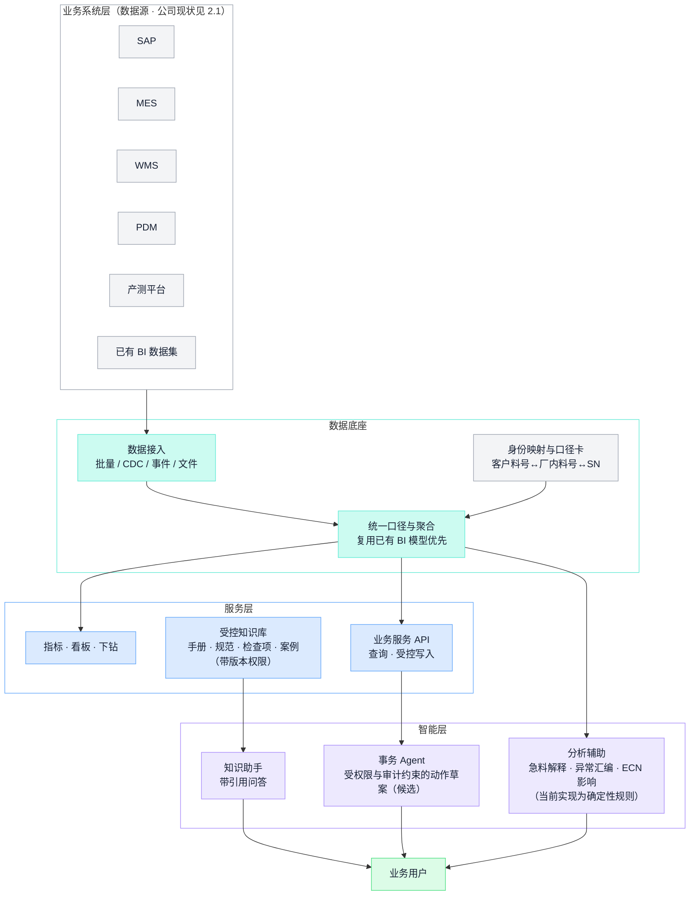

#### 15.3 AI 的能力分层、当前状态与候选场景

**当前实现状态（代码事实）**：平台的辅助分析是**确定性规则实现，没有大模型调用**；输出带对象引用与来源，信息不足明确标识未知，无模型调用时不宣称 AI 生成。以下四层是目标框架：

| 层 | 典型任务 | 上线前必须建立的边界 |
| --- | --- | --- |
| 知识助手 | 带引用的制度/工艺问答、术语解释 | 文档权限、版本与生效性校验；无证据明确说"未知" |
| 分析辅助 | 急料原因归纳、质量异常汇编、ECN 影响清单、指标口径解释 | 标注来源与截点；计算交给工具；事实与推断分开 |
| 事务 Agent | 创建待审申请、按授权起草业务动作 | 身份、权限、参数校验、确认、幂等、回执与审计；停在草案态 |
| 工业 AI 与闭环控制 | 视觉检测、预测性维护、工艺优化 | 另立专业工程项目：测量与控制要求、失效策略、现场安全责任 |

**OEM 候选 AI 场景**（源自 OEM 汇报第 11 页六个 Agent 场景与设计文档 §10，均需数据、知识、工具与效果评估后确定范围；原稿"Copilot 不做 Autopilot、输出带证据出处、人签核"的原则采纳）：

| 场景 | 依赖 | 业务核验 |
| --- | --- | --- |
| 导入评审辅助（比对问题库与 DFM 表） | 89 项问题库经验证建库、客户资料受控 | 工程确认适用性；客户设计决策权保留 |
| 急料与交付影响分析（"物料侦探"） | 工单需求、到料、IQC、可用量的权威数据（批次一产出） | 用规则计算的缺口与正式状态；缺失明确列出 |
| ECN 影响分析 | 版本映射、BOM、在制与已交关联 | 工程与业务责任人核对范围 |
| 测试归因辅助 | 原始曲线入档案、历史同类可检索（批次三产出） | 区分相关性、推断与已验证原因 |
| 工艺问答（扫码工位即问） | 受控 SOP 与规范、版本与权限 | 答案带出处；过期资料不作为现行依据 |
| 8D 复盘辅助 | 问题、围堵、措施与验证的留痕 | 经验证的结论才发布为复用资产 |

四条不可逾越的边界：**检索到的文字 ≠ 有效指令**（回答"这批按哪个工艺做"需要工单快照的适用版本）；**模型判断 ≠ 服务端授权**；**确定性计算与 AI 解释分工**（缺口、齐套、限值判定由规则计算且可复现，AI 不"猜数"）；**超时 ≠ 失败、回答 ≠ 过账**。AI 效果按固定业务样本评估（引用有效性、计算、缺项识别、人工纠正成本对比），"3 个月跑通两个场景"等原稿节奏是建议不是承诺。

### 16. 建设次序：先修哪里

#### 16.1 通识依赖链（参考）

数字化建设的通用依赖，不能跳步：

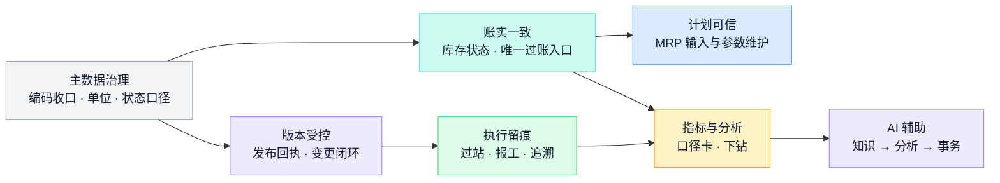

#### 16.2 OEM 候选建设路线

公司现状改变了通用依赖链的起点：执行留痕与追溯已有 MES 承担，最痛的断点在物料链路与跨岗位传递。候选路线（与[总体架构附录 B](/ai-notes/intelligent-manufacturing/manufacturing-platform-architecture)一致，**待决策确认后才是计划**，不设固定工期与未经基线的数字目标）：

| 批次 | 工作重点 | 可评审交付物 | 进入下一批的条件 |
| --- | --- | --- | --- |
| 零：现状核实 | 按[资料权限清单](https://github.com/ink-hz/AI-Manufacturing-Platform/blob/53958c7cede6707c41b99cba7c636402f3c23fe3/docs/manufacturing-system-information-and-access-request.md)逐系统取证；用实际样本核对 OEM 覆盖；痛点逐条确认 | 能力覆盖表、痛点台账（签认）、对象权威与接口清单 | 试点项目、问题、责任、数据来源及办理路径明确 |
| 一：物料闭环试点（候选首期） | 围绕一个实际 OEM 工单贯通到货→检验→配料→交接→接收，与 SAP/WMS/MES 对账 | 对象关联、执行记录、异常和对账结果、业务基线 | 现场人员完成含异常的实际走查，数据及责任闭环 |
| 二：版本—工程导入—质量 | 客户版/厂内版映射、导入评审、试产问题闭环、与 MES 追溯对接；89 项问题库经验证转检查项 | 生效边界可重现的真实变更、拦截到真实问题的评审、跨系统一致的 SN 档案 | 覆盖关键客户要求，与现有系统职责相容 |
| 三：测试标定与客户交付 | 测试规范/任务与执行端分工、原始曲线与标定入档案、SN 出货关联、客户数据包 | 真实 SN 的完整测试标定证据链、真实发运链路、客诉定位样本 | 设备接入与数据深度达到合同承诺的追溯等级 |
| 四：数据底座与指标 | 口径卡、下钻、快照；复用已有 BI 模型 | 任一指标可下钻到单据；口径变更留版本 | 留痕可信、口径无未声明分歧 |
| 五：知识与 AI | 问答→分析→事务逐级解锁 | 评估集、工具调用证据、业务效果对比 | 引用、权限、计算和业务效果达到已确认标准 |

阶段可按依赖交叠；缺乏真实接口的环节继续明确其人工或文件来源，持续标识。

#### 16.3 配套要点（翻查用）

- **现状评估**：按能力清单盘点，每项保留四态——已购未用 / 已用但绕行 / 无系统但有效 / 确实缺失；为物料链路画一张"步骤 × 记录载体 × 录入人 × 断点"的泳道表（流程总览现状图是起点），断点即建设候选项。
- **问题分类**：同一现象七种病根，药不同——流程规则不清（开会裁定即可）、数据错误、参数失当、权限不足、系统缺陷、集成断点、能力缺失（最后才轮到新建）。P05/P06 的绕行是典型的"制度＋卡控"复合问题。
- **试点**：限定客户项目/工单范围，含真实交接与异常，预写扩展条件与停止条件。
- **选型与扩展**：配置已有 / 集成 / 扩展（受厂商与许可约束）/ 新建四条路径，比较规则稳定性、差异化程度、接口开放性、长期维护；涉及 MES/WMS 深化的，先取得开发扩展许可与厂商支持边界（资料权限清单附件二）。
- **闸口**：范围签认 → 数据就绪 → 方案边界 → 端到端含异常测试 → 用户实操 → 切换回退安排 → 试点业务验收；双轨期必须有退出日。
- **验收三层**：数据正确（可复现）→ 流程闭环（含异常场景）→ 业务改善（同口径基线对比）——前两层不能替代第三层；软件隔离验收、现场实操与真实接口分别记录。
- **上线后 90 天**盯三件事：绕行率、补录延迟、人工对账工作量。
- **影子 Excel**：承认（纳入台账）→ 收编（版本、责任人、唯一数据源）→ 替换（宣布退役）；急料表与到料追踪表是第一批收编对象。

---

## 附录 A 车间行话速查

**物料与库存**

| 行话 | 意思 |
| --- | --- |
| 料号 | 物料的身份证号。名称可以叫错，料号不能错 |
| BOM / 展开 | 产品用料清单；"展开"指按 BOM 逐层算出每种料需要多少 |
| 齐套 | 工单所需物料全部到位。缺一颗螺丝也叫不齐套 |
| 欠料 / 缺料 | 需求已确定但料不够。缺料表是 MC 每天的核心作业 |
| 急料 | 影响工单开工或交付的紧急缺料；急料信息传递是公司已报告痛点（P03/P08/P10） |
| 提前期（L/T） | 从下单到可用要等多久。采购、生产提前期分开维护 |
| MOQ | 最小起订量 |
| 安全库存 | 为应对波动刻意多备的量。多了呆滞，少了白备 |
| 呆滞料 | 长期无需求消耗的库存，多来自变更、取消、超买 |
| 在途 | 已下单未到货的量。算供应要带上，但别重复算 |
| 客供料 | 客户提供的物料。不是本厂资产，但要替客户管好账 |
| 带料 | 客户直接送料到现场。绕过收货检验即上线是已报告断点（P05） |
| 线边仓 | 产线旁小库存区，最易变成账外之地 |
| 备料 / 发料 / 退料 | 按工单配料、发线、退回，三个动作都要留账 |
| 批次（Lot）/ SN | 一批料 / 一台产品的身份，追溯全靠它们 |
| 待验 / 冻结 / 让步接收 | 未检验 / 禁用 / 批准限定使用（特采） |
| 盘点 / 盘盈盘亏 | 数实物对账；重点查原因，不是调平 |
| 委外在外 | 发给外协厂的物料，表达位置与保管责任；自有或客供的原所有权不因委外改变 |
| MC | Material Controller 物料控制员，需求与供料的跟踪责任岗 |

**生产与执行**

| 行话 | 意思 |
| --- | --- |
| 工单（WO/MO） | 一次生产任务：做什么、做多少、按哪个版本 |
| 排产 / 派工 | 哪条线哪天做哪张工单 / 任务到工位和人 |
| 插单 / 飞单 | 紧急订单强行插队 |
| 过站 / 跳站 | 工序完成并记录 / 未按顺序，多为违规或异常 |
| 报工 | 向系统报完成数量和工时 |
| 倒冲 | 完工按 BOM 反推扣料。省事，但掩盖超耗 |
| 节拍 | 每多少时间产出一台；瓶颈节拍决定整线产出 |
| 换线 / 换型 | 产品切换，耗时易错，排产要计入 |
| 治具 / 工装 | 生产测试的专用辅助器具，版本错则结果不可信 |
| SOP / 作业指导书 | 工位作业的受控文件 |
| WIP / 在制 | 投料未完工的半成品 |
| 首件（FAI） | 批量前先做一台全要求确认 |
| 返工 / 返修 | 不合格品重新加工/修复，须走受控路线留独立记录 |
| 直通率 / FPY | 一次通过不返工的比例；口径区分见附录 B |
| 委外 / 外协 | 工序或部件交外厂，账与料跨厂跟踪 |
| 流转卡 | 跟实物走的纸卡；许多工厂的"真系统" |
| 安灯（Andon） | 现场异常呼叫与响应机制 |
| 达成率 | 计划数量的实际完成比例；EX001 用它暴露了问题沿产线累积 |

**质量与变更**

| 行话 | 意思 |
| --- | --- |
| IQC / IPQC / OQC / FQC | 来料 / 制程 / 出货 / 最终检验 |
| SQE | 供应商质量工程师 |
| 全检 / 抽检 | 每台检 / 抽样判整批；抽检合格≠每台合格 |
| MRB | 不合格品处置评审（报废/返工/让步/退供谁拍板） |
| Marking | 公司 MES 的品质隔离机制：SN 号段/工单/物料批次/工序锁定与出货校验 |
| ECR / ECO / ECN | 变更申请 / 指令 / 通知 |
| 8D / CAPA | 结构化质量问题解决 / 纠正预防措施 |
| RMA | 客户退货授权，独立流程不混正常库存 |
| NTF | 退货检测无故障；留案底观察趋势 |
| FAI | 首件检验 |
| AVL | 合格制造商/供应商清单 |
| DFM | Design for Manufacturability 可制造性设计评审；OEM 下以建议形式输出，设计决策权在客户 |
| 翻新 | 退回品修复后再流通；翻新身份必须显式保留并体现在标识与质保上，不能当新机 |

---

## 附录 B 常用指标速查

只给含义和口径要点。**读任何指标，先问分母和口径，再看数字**；口径写进受控的"口径卡"（用途、粒度、公式、截点、排除项、来源、责任人），改口径要留版本，原始承诺与首次失败记录永久保留。公司 BI 已有良率明细报表且口径有定义（IT 材料第 12 页）——复用前逐项核对口径，同名指标不并行两套算法。

| 指标 | 回答什么 | 口径要点（翻查必看） |
| --- | --- | --- |
| OTD 准时交付率 | 交付承诺是否兑现 | 按订单 / 订单行 / 台数 / 金额，四种算法结果不同；比"原始承诺日"还是"最新承诺日"结果不同（只看最新承诺＝自欺）；"交付"指发运还是客户签收要定死 |
| OTIF 准时足量率 | 准时**且**足量 | 部分交付不计分，比 OTD 严，更接近客户感受 |
| FPY 一次通过率 | 过程能力 | 不经返工返修直接通过的比例；返工后合格不算。公司 BI 的"一次不良数"定义（时间段内第一次发生不良，段前发生过的不计）是时间段口径，与按对象全程的 FPY 不同——两种口径并存时显式区分 |
| 最终良率 | 交付能力 | 最终合格 ÷ 投入；返工负荷在这里不可见——和 FPY 一起看 |
| 直通率 RTY | 整线一次通过 | 必须追踪**同一批对象**穿过全部工序；各工序本月通过率直接相乘是经典错误 |
| 达成率 | 计划完成度 | 分母是哪一版计划的数量；按工序统计时注意前段 100% 不代表后段无风险（EX001：后段掉到 84%） |
| OEE 设备综合效率 | 设备利用质量 | 可用率 × 性能率 × 质量率（相乘，不是平均）；时间模型必须事先约定 |
| 库存周转 / 库存天数 | 资金效率 | 销货成本 ÷ 平均库存；客供料不计本厂库存资金，分开表达 |
| 库存准确率 | 账实一致 | 粒度固定为物料＋库位＋批次＋状态；正负差不得抵消 |
| 齐套率 | 开工条件满足度 | 按工单全料齐套计，缺一项即不齐套；客供料缺口单列责任 |
| 计划达成率 | 计划可信度 | 必须写明和**哪一版**计划比 |
| 异常关闭时长 | 现场响应能力 | 发生、响应、关闭三个时间戳分开统计 |
| 急料响应时长 | 急料处理能力 | 从明确急料需求到适用合格数量可分配；分解到货、身份、检验、仓配各段等待（候选指标，基线待建立——原稿"急料响应 ≤2h"是建议目标） |
| 客诉率 / 退货率 | 市场质量 | 分母（出货量、期间）和缺陷定义固定；NTF 单独统计 |
| 复用率 | 体系沉淀效果 | 原稿建议对"资产复用率"考核；分母（适用场景数还是项目数）、资产粒度与验证口径先定义再统计，无基线不设目标值 |

指标防粉饰的七种常见手法（识破用）：改承诺日、换分母、剔除"特殊情况"、挪库存（移仓不减量）、截时点（月底突击发货报工）、选样本、换口径后直接同比。对策三件：口径卡受控、汇总可下钻到单据、原始事实不可改写。

## 附录 C 常见工艺环节速查

帮助看懂工艺路线和车间话题。**具体产品的工序、参数、判定以各产品的工艺文件和控制计划为准，不同产品不能互相照搬。** 前表为电子/光学类通用环节（保留为通用参考——深度模组等感知部件仍适用）；机器人整机的装配与测试环节见后表（依据 EX001 材料，适用模板性质）。公司现状的工序大类为"模组、点胶、测试、组装包装"（IT 材料第 3 页），FT 系列工序编码在用。

**电子/光学类通用环节（通用参考）**

| 工艺环节 | 干什么 | 质量与数据关注点 |
| --- | --- | --- |
| SMT 贴片 | 锡膏印刷 → 贴装 → 回流焊 | 钢网状态、锡膏效期与回温、炉温曲线、SPI/AOI 检查、批次与程序版本 |
| THT / DIP 插件 | 通孔插装 + 波峰焊/手焊 | 焊点质量、防错与极性方向 |
| ICT 在线测试 | 针床电测元件与连通 | 治具状态、测试程序版本 |
| 烧录 | 写入固件/程序 | 固件版本防错、写入校验、与测试限值联动 |
| FCT 功能测试 | 半成品/整机功能验证 | 测试程序与限值版本、数据关联 SN |
| 点胶 / 灌封 | 粘接、密封、加固 | 胶水效期与储存条件、胶量、固化温湿度与时间 |
| AA 主动对准 | 光学器件通电实时对位后固定 | 对位精度、UV 固化能量、设备标定状态 |
| 标定 / 校准工序 | 逐台测偏差、写入补偿参数并复测 | 靶标与设备的量值溯源、参数档案关联 SN、写入成功≠性能合格 |
| 老化 Burn-in | 通电运行筛除早期失效 | 时长与温度条件、老化前后数据对比 |
| 气密 / 环境测试 | 密封性与环境耐受验证 | 方法与判定标准版本、设备校准 |
| 镭雕 / 丝印 | 打标识（SN、Logo、客户标识） | 可读性、与系统 SN 一致、按客户标识规范 |
| 装配 / 装调 | 结构与模组组装、机械调整 | 扭力等关键参数、防错、过站绑定批次 |
| 包装 | 成品保护与标识 | 箱单与 SN 一致、ESD/防潮要求、客户包装规范 |

**机器人整机装配与测试环节（适用模板，依据 EX001 材料，逐项目核实）**

| 环节 | 干什么 | 质量与数据关注点 |
| --- | --- | --- |
| L1 单板级 | 烧录与单板测试 | 固件版本、测试程序版本、原稿节拍（烧录 3min/测试 20min）为参考值 |
| L2 组件级 | 电机/线束测试、标零、组件老化 | 电机标定信息（EX001 高风险问题）、线束防错、老化条件 |
| 部件组装 | 头胸/立柱/底盘等组件装配 | 扭力与紧固（关节支架滑牙、螺牙深度是 EX001 实例）、组件 SN 绑定 |
| L3 半成品级 | 组件联测 | 联测覆盖与半成品良率（EX001 根因之一） |
| 整机装壳 | 结构合装 | 结构干涉与配合（EX001 结构类问题 29 项） |
| L4 整机级 | 整机测试串 + 老化 + 标定 | 测试串版本、老化时长与环境（老化房就绪是硬性前置）、标定写入与回读、轴承异响类老化异常 |
| 包装入库 | 成品包装与标识 | 箱—SN 一致、客户标签规范 |

---

（完。本手册为 OEM 制造业务与系统的统筹参考：通识知识、公司现状（材料所述）、候选方案与待核实项按前言约定分别标注。节点编号与[《OEM 制造业务流程总览》](https://github.com/ink-hz/AI-Manufacturing-Platform/blob/53958c7cede6707c41b99cba7c636402f3c23fe3/docs/workflows/manufacturing-process-overview.md)一致；结构与契约语义见[《OEM 制造系统总体架构设计》](/ai-notes/intelligent-manufacturing/manufacturing-platform-architecture)；整体设计见[OEM AI 制造平台设计](/ai-notes/intelligent-manufacturing/oem-ai-manufacturing-platform)。各节点的实际单据、角色、系统覆盖以现场核实为准，按流程总览"下一轮细化顺序"逐节点补充公司事实。）
