> 收录身份：完整目标方案 v1.1。第2章系统现状依据 2026-10 公司材料；第4章代码资产、77动作/34对象与 11月9日补充为 **2026-11-09 当时实施快照**，不代表收录日现状。本文既定主模式为代料，客供为例外；具体项目的供料、所有权与损耗结算仍按合同裁定，不由文稿间表述差异改变已确认业务决定。

版本：v1.1（设计文档）

日期：2026-11-04

定位：本文是 OEM AI 制造平台的当前完整设计文档，覆盖现状分析、需求分析、架构设计（平台／现有系统／AI 层）与场景工作流，供制造负责人、业务、IT、产品和技术据此统筹与推进建设。**本文止步于业务语义层**：接口字段、数据库表、设备协议由后续实施规格承接。文中标注"候选／待核实／待决策"的事项，以评审和现场核实结果为准更新。

配套文档：[《OEM 制造数字化系统手册》](/ai-notes/manufacturing-processes/manufacturing-system-handbook)（业务与系统知识正文）、[《OEM 制造系统总体架构设计》](/ai-notes/intelligent-manufacturing/manufacturing-platform-architecture)（架构不变式与契约语义）、[《OEM 制造业务流程总览》](https://github.com/ink-hz/AI-Manufacturing-Platform/blob/53958c7cede6707c41b99cba7c636402f3c23fe3/docs/workflows/manufacturing-process-overview.md)（流程底稿）、[产品设计 v0.8](https://github.com/ink-hz/AI-Manufacturing-Platform/blob/53958c7cede6707c41b99cba7c636402f3c23fe3/docs/manufacturing-workbench-product-design.md)（工作台产品形态）。本文给出贯通四者的整体设计。

表达约定：**已确认**＝业务已拍板的决定；**现状**＝公司当前的系统与流程事实（上线范围与运行细节待现场核实的，随文标注）；**候选**＝本设计提出、待评审；**待核实／待决策**＝需实际样本或责任人确认。文中英文缩写见文末附录。

配色约定（全部图一致）：蓝＝经营与计划，紫＝工程与 AI，青＝物料与数据流转，绿＝执行与平台，琥珀＝质量与判定，红＝异常与界外，粉＝客户触点，灰＝数据与中性。

## 目录

- **第一部分 现状分析**：1 业务定位与范围 · 2 公司系统现状 · 3 现状业务流程与断点 · 4 已有软件资产 · 5 现状小结
- **第二部分 需求分析**：6 建设目标 · 7 角色与结果 · 8 从痛点到需求 · 9 候选需求清单 R01—R13 · 10 AI 需求 · 11 需求边界
- **第三部分 架构设计**：12 设计原则与四契约 · 13 总体架构（全景分层 · 场景分域 · 工作流划分）· 14 系统职责地图 · 15 平台逻辑模块 · 16 AI 层 · 17 数据组织 · 18 权限与客户边界
- **第四部分 场景与工作流**：19 S1—S9 主工作流 · 20 场景 A 急料到线 · 21 场景 B 客户工程变更 · 22 场景 C 测试失败到复用资产 · 23 场景 D AI 辅助的工作方式 · 24 场景 E 客诉追溯
- **第五部分 建设路线与验收**：25 分阶段路线 · 26 首期试点 · 27 验收与指标 · 28 待决策问题 D01—D12 · 29 资料与权限依赖
- **附录**：英文缩写与术语表

---

## 第一部分 现状分析

### 1. 业务定位与范围

#### 1.1 已确认的业务决定

**我们做的是 OEM 代工代料：客户提供产品定义，我们承接制造，并负责物料采购。** 这句话定下三条边界：

- **设计权在客户**：客户的设计决策与批准、我们的 DFM 建议、厂内制造批准、质量放行分别表达。"不碰设计"是对客户的中立承诺，也是本设计里批准权建模的硬边界。
- **代料是主模式**：物料需求计算、采购、收货、库存与损耗核算默认由我方负责。客供料与客户直接带料是合同约定的例外形态——系统必须支持，但按例外通道处理：所有权独立记账、损耗责任按合同、带料必须经身份核实留痕后才能上线。
- **原自有相机与 3D 打印机业务不再作为并列业务入口**，相关软件能力转为复用资产评估。

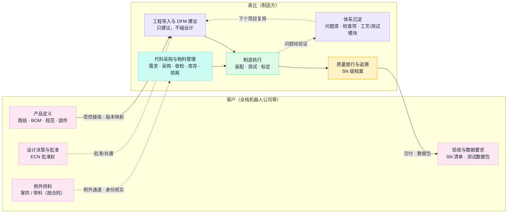

#### 1.2 目标客户画像与业务判断

机器人是当前的主要业务案例；是否只做机器人、首批客户及产线尚未确定（决策项 D01）。我们对目标客户与竞争位置的判断：

| 维度 | 判断 | 对设计的含义 |
| --- | --- | --- |
| 客户画像 | 全栈机器人公司：A/B 轮融资、百人规模、硬件团队小、BOM 800—900 颗、大量 3D 打印与快速模、设计未冻结、变更频繁 | **版本与变更管理按常态能力设计，不按例外处理**；客户资料完整性靠模板引导补齐；画像与变更频次按实际项目样本持续校准 |
| 竞争位置 | 传统 3C 代工的 MES 以批次为主键，难以提供单台机器人档案；我们的壁垒＝SN 级数据档案＋标定能力＋可复制的导入体系 | 单台档案、测试标定数据与导入体系是差异化方向；注意我们自己的 MES 已具备 SN 级追溯基础（§2.3），差异化建立在"补齐与贯通"上，不是从零再造 |
| 时间窗口 | 客户正处量产前夜，小批量阶段锁定客户、放量时切换成本已立起 | 建设节奏求"下一个试产项目就能用"，不求全 |

#### 1.3 EX001 试产的实战教训

EX001 DVT 试产 250 台，是现状问题最硬的证据：

- **问题沿产线向后累积**：前段组件与组装达成率 100%，半成品测试 98.4%，整机装壳 88%，成品测试 86.4%，整机入库只有 84%——最终缺口 40 台。
- **三类根因**：缺料（压铸开裂挑料、关键料晚到）、测试环境延期（老化环境晚就绪 18 天）、半成品良率低。
- **89 项问题**：整机装配异常 45 项（物料 21、制程 10、结构 7、工艺 3、其他 4）＋六轴臂试产 44 项（结构 22、物料 9、电子 8、动力 3、硬件 2），含 6 项高风险（关节支架滑牙、螺牙深度实测 7.0 对图纸 7.5mm、老化轴承异响、电机标定信息异常）。
- **管理结论**：这些问题的大多数本可以在导入评审拦截；**问题重复发生＝经验在人不在体系**。

89 项问题的逐条明细与 40 站测试定义尚未整理入库，是体系建设的第一批素材（场景 C、批次二）。

### 2. 公司系统现状

#### 2.1 系统格局（现状，上线范围待现场核实）

公司已有按业务域划分的多系统格局。与通用教科书模型最重要的差别：**质量执行、线边仓储、设备管理、追溯是 MES 内的模块，不是独立系统**；WMS 承担盘点与库存分析，收发料记账在 SAP；独立的 APS、SRM、IIoT 平台、数据仓库在材料中未列出，实际部署待核实（SRM 在原材料规划中）。

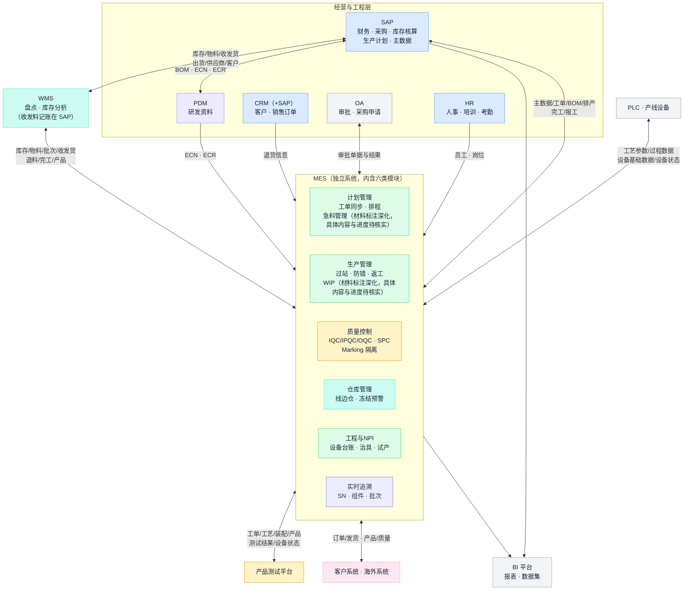

读图说明：连线表示现有集成关系，**每条接口的实际运行、字段与回执仍需逐条核实**（§14.4）；双向连线不逐字段分配方向。MES 的"急料管理""WIP 管理"材料标注深化，具体内容与进度待核实——恰好对应物料痛点最密集的两处，说明 IT 侧已有同向判断。**OEM 业务在各系统中的实际覆盖是最重要的待核实项**：实际账号、模块启用、工单样本与现场操作，区分未上线、未启用、绕行和接口问题（决策项 D05）。

#### 2.2 已具备的系统能力

以下能力已建成在用，OEM 项目的适用范围待核实：

| 能力 | 现状 | OEM 待核实 |
| --- | --- | --- |
| 检验建模与标准维护 | 按工序＋物料维护检验项（含上下限与量具绑定）；检验计划支持按数量、时间、事件触发 | 客户要求的检验标准是否已维护；触发与判定的实际联动 |
| Marking 品质隔离 | 支持 SN 号段、工单锁 SN、风险物料批次、工序四类锁定，出货校验管控；材料中有大量历史记录/界面证据；连续运行与适用范围待核实 | 四类锁定的实际使用、解除权限、OEM 项目适用 |
| 过站校验与防错 | 过站链含账号资质校验、扫描、物料校验、队列校验、扣料、合格判定、重测校验；防错覆盖六个环节 | 哪些校验已启用；异常与离线处理 |
| SN 与组件追溯 | 工单→SN→部件 SN→原材料批次→本厂批次→供方批次的组件级正反向追溯，记录操作者与秒级时间 | 数据深度（原始测试曲线）、拆换历史、多层递归、OEM 覆盖 |
| 逐工序履历 | SFC 步骤含工序、状态、结果、操作资源、时间、测试次数 | 失败、返工、跳站的统计口径 |
| BI 与良率报表 | 三层架构（展示/应用/数据），按测试工序的良率明细（投入、一次不良、直通率、最终不良、维修合格）口径有定义 | 数据模型、公式、刷新与权限 |
| 设备状态 | 按工序—资源岗位—设备三级编码，统计开机/待机/故障/停机四类时间 | 数据时效与采集方式 |

#### 2.3 必须修正的一个旧思路

早期方案曾按"MES 只有批次主键，需要在其上叠一层 SN 档案"来规划建设。**这个前提不成立**：我们的 MES 已具备 SN 级与组件级追溯能力。正确的问题不是"从批次升到 SN"，而是：**已有追溯对 OEM 业务还缺什么**——原始测试曲线、标定参数、拆换历史、多层递归、客户 SN 映射、OEM 项目覆盖——用实际样本核对后逐项裁定（§14.5）。界面能查 SN 也不代表数据结构满足全部合同承诺，这是样本核对要回答的问题。

### 3. 现状业务流程与断点

#### 3.1 物料链路现状（待现场逐条核对）

物料链路的现状流程形状与 15 条已报告问题的位置（P01—P15 编号沿用，未经业务责任人共同签认与现场复核）：

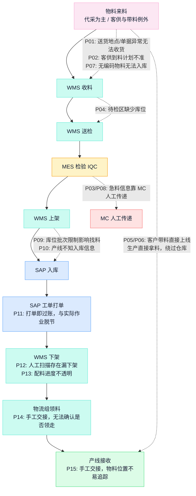

#### 3.2 痛点清单 P01—P15

15 条已报告问题，编号贯穿全文；改善建议为候选方式，需检查业务对象、系统配置和例外机制后才能升级为目标规范：

| 编号 | 已报告问题 | 候选改善方向 | 需求关联 |
| --- | --- | --- | --- |
| P01 | 供应商送货地点或单据异常，导致无法收货 | 规范物流及送货约定 | R03 |
| P02 | 客供料到料计划不准确，人工追踪到料情况 | 客户提供计划并登记跟踪；代采经 SRM 获取在途 | R03、R04 |
| P03 | 仓库获取急料信息依赖 MC 人工整理传递 | 欠料信息系统化传递到仓库任务 | R04 |
| P04 | 收料待检区没有库位，批量来料时找料困难 | 待检区增加库位码 | R03、R05 |
| P05 | 客户带料直接上产线，绕过系统，信息断层 | 卡控＋例外批准：未经身份核实的物料不上线 | R03、R06 |
| P06 | 生产直接拿料，不经过仓库 | 同上，卡控与制度一起定 | R03、R06 |
| P07 | 来料无物料编码，无法入库，急用时借料生产 | 提前取得客户物料清单并建码；紧急用料走例外留痕 | R02、R03、R06 |
| P08 | IQC 获取急料信息依赖 MC 人工整理传递 | 欠料信息传递到检验任务优先级 | R04、R07 |
| P09 | 库位只能对应一个批次的物料编码，影响仓库找料 | 库位模型按实际配置核实后扩展 | R05 |
| P10 | 产线不能及时获得入库信息，靠 MC 通知或反复刷新 | 急料入库状态推送 | R04、R05 |
| P11 | SAP 打单即过账，与仓库实际作业脱节 | 核实实际事务与触发点后，裁定作业与过账的衔接方式 | R05 |
| P12 | 仓库依单据人工扫描下架，存在漏下架风险 | 下架作业回执与过账核对 | R05 |
| P13 | 工单配料进度不透明，人工跟进 | 配料四状态（打印/作业/回执/过账）分开呈现 | R04、R05 |
| P14 | 手工交接，无法判断物料是否领走 | 扫码交接与接收确认 | R06 |
| P15 | 手工交接，不易定位物料 | 物料与产线工位绑定 | R06、R09 |

#### 3.3 现象、原因和改善方式分开讨论

1. "OEM 要上 MES"需核实为覆盖、配置、接口、权限或执行纪律中的具体问题——公司有 MES 不等于 OEM 已覆盖，MES 有急料模块也不等于急料信息已传递到岗位。
2. "库位限制"（P09）需结合现有库位、容器和批次模型检查，"一库位多物料"不直接等于最终设计。
3. "SAP 打单即过账"（P11）需核实实际事务、单据类型、触发点及业务配置，再裁定 WMS 作业与 SAP 过账的关系。
4. 物流不规范、客户资料缺失和现场绕行（P01/P05/P06）涉及业务制度与责任，**只加系统卡控不定制度，绕行会换一个出口**。
5. 急料提醒需要明确对象、数量、时效、责任人和闭环条件；仅增加消息不能证明问题得到处理。

#### 3.4 尚需补充的痛点领域

以下是访谈范围，不作为已证实问题：客户资料完整性与版本、承接及 DFM 评审、ECN 与在制品处置、测试环境和程序准备、标定数据及设备回读、质量与客户放行、发运及数据包交付、RMA 与 CAPA、客供料损耗与项目结案、跨客户资产复用。每个新增痛点记录项目样本、发生过程、影响、频率、当前处理方式、责任人和证据位置，再形成候选需求。

### 4. 已有软件资产（当前仓库，代码事实）

平台工作台已有一轮软件实现（隔离验收通过，未接真实系统），按 OEM 对象评估复用。下表不把隔离验收当作真实生产运行证据：

| 软件资产 | 当前可检查的实现 | 进入真实业务前需明确 |
| --- | --- | --- |
| 订单、工程、供应、执行、质量及交付 | 持久化对象、命令、状态及约束；注册 77 项业务动作和 34 类业务对象；交付含发运、签收、验收及结案，数据包组装与交付回执尚未实现 | 与既有系统对应对象的归属及同步关系；交付数据包为候选新增，范围及格式按合同确认 |
| 工程导入与复用资产 | 评审、试产、问题验证、批准及跨项目资产采用 | 真实检查项、客户批准及试产证据来源 |
| 到货与物料 | 到货观察、匹配、收货、检验、需求和预留逻辑；人工交接含指定接收人确认、差异处理及不可覆盖历史 | WMS／MES／SAP 的权威状态和实际数量回执；交接当前为本地人工闭环，不产生库存、IQC、预留、耗料或过账，扫码设备接入待核实 |
| 测试与标定 | 计划、运行、曲线、参数、算法版本及回读一致性校验；采集结果要求人工登记来源 | 现场执行端、设备采集、真实算法及参数写入证明 |
| 单台履历与组件拆换 | 客户序列号映射、组件安装和拆除历史 | 与 MES 装配记录的统一身份；追溯查询尚未纳入组件关系的多层递归遍历 |
| 系统责任与交换 | 责任登记及核实、请求意图、回执、重试和对账逻辑；外部适配器默认仅在演示／测试模式启用模拟实现 | 生产适配器、接口权限及联调；责任登记不等于接通 |
| 辅助分析 | 当前为确定性规则分析，没有大模型调用 | AI 所需知识、数据、工具、评估和授权 |
| 权限及一致性 | 项目授权、只读、并发版本检查、操作幂等和审计 | 客户组织、外部身份及跨项目资料边界；项目隔离不自动等同于客户门户完整隔离 |

代表性代码入口：[业务命令](https://github.com/ink-hz/AI-Manufacturing-Platform/blob/53958c7cede6707c41b99cba7c636402f3c23fe3/src/manufacturing_platform/workflow/commands.py)、[业务服务](https://github.com/ink-hz/AI-Manufacturing-Platform/blob/53958c7cede6707c41b99cba7c636402f3c23fe3/src/manufacturing_platform/workflow/service.py)、[交换服务](https://github.com/ink-hz/AI-Manufacturing-Platform/blob/53958c7cede6707c41b99cba7c636402f3c23fe3/src/manufacturing_platform/workflow/exchanges.py)、[测试模型](https://github.com/ink-hz/AI-Manufacturing-Platform/blob/53958c7cede6707c41b99cba7c636402f3c23fe3/src/manufacturing_platform/workflow/laboratory_models.py)、[导入与资产](https://github.com/ink-hz/AI-Manufacturing-Platform/blob/53958c7cede6707c41b99cba7c636402f3c23fe3/src/manufacturing_platform/workflow/introduction.py)、[追溯](https://github.com/ink-hz/AI-Manufacturing-Platform/blob/53958c7cede6707c41b99cba7c636402f3c23fe3/src/manufacturing_platform/workflow/trace.py)、[规则分析](https://github.com/ink-hz/AI-Manufacturing-Platform/blob/53958c7cede6707c41b99cba7c636402f3c23fe3/src/manufacturing_platform/workflow/assistance.py)、[权限](https://github.com/ink-hz/AI-Manufacturing-Platform/blob/53958c7cede6707c41b99cba7c636402f3c23fe3/src/manufacturing_platform/workflow/authorization.py)。

### 5. 现状小结：三类事实

| 类别 | 内容 |
| --- | --- |
| 已具备的能力 | SAP／MES／WMS／PDM／产测／BI 格局在用；MES 的过站防错、质量检验、Marking 隔离、SN 与组件追溯已建成；BI 有口径明确的良率报表；平台软件有 77 项业务动作的实现底座 |
| 已报告的问题 | 物料链路 15 条痛点（人工传递、绕行、打单脱节、手工交接）；EX001 后段达成率 84%、89 项问题、测试环境延期；经验在人不在体系 |
| 未知与待核实 | OEM 在各系统的实际覆盖与绕行；SAP 过账与 WMS 作业的实际关系；库位批次模型；追溯数据深度；客户资料通道与 ECN 流程；测试平台原始数据与设备接口（§28、§29） |

**设计的出发点：问题不在"没有系统"，而在"系统之间、系统与岗位之间的业务闭环没有建立"**——信息靠人传、责任靠人记、经验靠人带。平台的价值位置是补这个闭环，不是再造一套执行系统。

---

## 第二部分 需求分析

### 6. 建设目标

1. **承接条件清楚**：客户资料、技术要求、供料责任、测试和验收条件有明确版本及责任人。
2. **制造准备可判断**：版本、物料、设备、治具、人员和测试条件的缺项能够关联到受影响工单及交付。
3. **执行状态可传递**：到货、检验、配料、交接、生产和放行事实能在相关岗位间及时传递——急料不再靠 MC 人工整理。
4. **单台及批次可追问**：版本、关键件、工序、测试、标定、异常、放行和交付能够关联查询，满足合同承诺的追溯等级。
5. **项目经验可复用**：经过验证的问题、检查项、工艺及测试模块形成受控资产——EX001 的 89 项问题不在下个项目重犯。
6. **AI 价值可验证**：围绕具体工作减少资料查找、人工追踪及分析整理时间，并保留事实来源和人工决定。

目标暂不设数值承诺：先取得业务基线，再由责任人确认指标、目标和观察周期。

### 7. 角色与需要得到的结果

| 角色 | 平台应帮助完成的工作 |
| --- | --- |
| 制造负责人／OEM 项目负责人 | 识别交付阻断，明确责任及处理时限，核对准备和交付条件 |
| 客户接口人 | 接收资料和变更，确认供料、批准、验收及交付数据要求 |
| 工程／工艺 | 组织导入及 DFM 评审，发布适用版本，处理变更，验证问题并复用资产 |
| 计划／MC／采购 | 核对需求、采购、到货、检验及配料状态，处理急料与交期影响 |
| 仓储／物流／产线物料人员 | 收料定位、配料、交接和接收，确认实物位置与数量 |
| 生产／测试／设备人员 | 核对适用准备条件，执行工序和测试，处理异常并提供真实采集证据 |
| IQC／质量 | 安排检验，形成处置及放行结论，管理隔离和影响范围 |
| IT／系统负责人 | 明确对象权威、配置与接口、权限、运行状态及异常处理责任 |
| 客户用户（目标能力） | 在授权范围查询本客户项目、交付资料和约定数据，确认相应业务事项 |

### 8. 从痛点到需求的推导

15 条痛点先归并为六组业务问题，再推导为候选需求；工程、测试、交付侧的需求来自 EX001 教训与客户要求。**推导链全程保留编号追溯**：

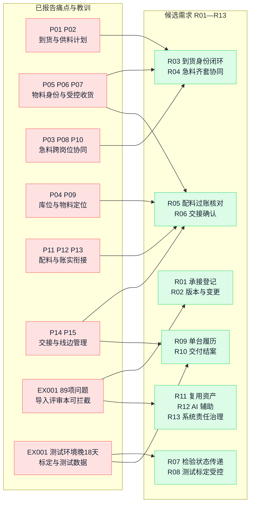

六组业务问题要厘清的业务结果，以及每组问题今天落在哪些系统（或系统之外）：

| 问题领域 | 对应痛点 | 需要厘清的业务结果 | 现状载体（待核实） |
| --- | --- | --- | --- |
| 到货与供料计划 | P01、P02 | 谁应在何时把哪些料送到哪里，缺什么单据，异常由谁处理 | 代采在途在 SAP；客供到料计划靠人工追踪（SRM 规划中） |
| 物料身份与受控收货 | P05、P06、P07 | 物料在正式编码不足或紧急情况下如何留痕、完成身份核实及适用批准 | 建码在 SAP 主数据；收料在 WMS；IQC 在 MES——无编码与带料的实际发生在三者之外（绕行） |
| 急料及跨岗位协同 | P03、P08、P10 | 缺料影响哪个工单；目前卡在哪一步；下一岗位何时收到可执行任务 | MC 人工表格与口头传递；MES 急料模块在材料中标注深化，具体内容、进度及到岗情况待核实 |
| 库位及物料定位 | P04、P09 | 待检、已上架和线边物料在哪，系统如何区分物料、批次及容器 | 库位在 WMS（模型待核实）；线边仓在 MES；待检区缺库位是已报告问题 |
| 配料与账实衔接 | P11、P12、P13 | 申请、打印、拣配、下架、交接和业务过账分别完成到哪一步 | 打单与过账在 SAP，下架作业在 WMS——两者衔接是 P11 的根；配料进度无统一视图 |
| 交接与线边管理 | P14、P15 | 谁交给谁、多少数量、何时接收、放在哪里及关联哪个工单／工位 | 手工交接，系统外；候选为扫码交接＋发料任务视图 |

2026-11-09 近期开发口径：急料采用在办责任待办、IQC 读侧标记及发料四状态事实；检验完成与 WMS 入库上架分别验收。尚未连接的 SAP/WMS/MES 等外部系统以类型化 mock 补齐数据流，平台启动真实服务以 socket HTTP 验证，来源持续标注 mock。该轮验证不把“已检验”称作“已上架”，不把 SAP 代采在途称作客户供料计划已接通，不接管源系统写入权。详见[开发启动计划](https://github.com/ink-hz/AI-Manufacturing-Platform/blob/53958c7cede6707c41b99cba7c636402f3c23fe3/docs/platform-development-launch-plan-2026-11.md)。

### 9. 候选需求清单 R01—R13

需求编号贯穿痛点、产品和架构。验收描述是后续准备真实样本的依据；具体范围、目标及责任人需评审确认。各需求在当前软件中的实现状态见[产品设计 v0.8 对照表](https://github.com/ink-hz/AI-Manufacturing-Platform/blob/53958c7cede6707c41b99cba7c636402f3c23fe3/docs/manufacturing-workbench-product-design.md)。**"涉及系统与分工"列是每条需求的系统落位**——权威动作归现有系统，平台承担协同与候选缺口（§14），全部分工待批次零核实：

| 编号 | 候选需求 | 涉及系统与分工（候选） | 验收方式 |
| --- | --- | --- | --- |
| R01 | 客户项目、承接范围、交付承诺及责任统一登记 | CRM／SAP（订单与客户权威）＋OA（评审会签）＋平台（承接条件、责任边界与未决条件登记） | 一个实际项目可查明客户要求、承诺、供料及验收责任；变更保留历史 |
| R02 | 工程资料、物料身份、客户／厂内版本及变更关联 | 客户（资料与批准）→PDM（设计资料/ECN）→SAP（主数据/MBOM）→MES（现场版本接收）；平台（双版本映射、导入评审、变更影响组织） | 一次资料发布或 ECN 能定位适用版本、工单及处置；客户批准与厂内批准分开 |
| R03 | 到货计划、实物观察、收货及身份核实闭环（代采为主，客供／带料例外留痕） | SAP（采购与收货过账）＋WMS（收料上架）＋MES（IQC）＋平台（到货观察、身份核实协同、例外留痕） | 无正式编码或单据异常的来料能够留痕和分派处理；观察记录不自动成为库存或合格量 |
| R04 | 急料及齐套状态关联到工单、岗位和交付影响 | SAP（MRP 缺口与例外）＋MES（急料模块，材料标注深化，具体内容与进度待核实）＋平台（跨岗位传递、工单与交付影响）；SRM 上线后接代采在途，客供计划先按登记跟踪 | 一次急料从识别、处理到可用状态变化可追踪；各岗位看到来源、数量、更新时间及下一动作 |
| R05 | 配料、库位、拣配、发料与 SAP 过账状态可核对 | SAP（打单/扣账）＋WMS（下架拣配作业与回执）＋平台（打印/作业/回执/过账四状态核对与差异识别） | 一次实际配料能区分打印、实物作业、回执和过账；漏扫、部分完成和数量差异可被识别 |
| R06 | 仓库、物流和产线之间的物料交接可确认 | WMS／MES 作业端（扫码设备接入待核实）＋平台（交接确认、差异处理与不可覆盖历史；当前为本地人工闭环，不产生库存/IQC/预留/过账） | 一次交接可追问交接双方、交出与实收数量、位置、可选工单及时间；指定且当前有权的接收人确认，差异处理保留原事实，同批分笔不冒充整批唯一位置 |
| R07 | 检验、冻结、处置和放行状态按权威结果传递 | MES（IQC/IPQC/OQC、Marking 隔离与出货校验、放行）＋OA（让步等审批）＋平台（状态传递、阻断展示、影响范围关联） | 一次实际待检或冻结物料不能被当作可用；一次解除及出货校验能查到有效依据 |
| R08 | 测试准备、实际运行、原始数据和标定参数受控关联 | 产测平台（测试执行与结果）＋MES（过站判定与测试次数）＋平台（规范任务管理、原始证据索引、标定回读核对）；设备与台架按采集契约（D08） | 一台实际 SN 可关联规范、程序／算法版本、原始证据及有效判定；标定写入另有匹配回读 |
| R09 | 单台、组件、批次、过程和交付形成可查询履历 | MES（SFC 履历、组件正反向追溯——原始事实权威）＋产测（曲线）＋SAP/WMS（单据与位置）＋平台（只读聚合档案、客户 SN 映射、拆换有效段，§14.5） | 用实际 SN 及异常批次完成正反向走查；拆换历史、客户编号映射和数据覆盖边界明确 |
| R10 | 发运、客户数据包、签收、约定验收、遗留项及结案关联 | SAP（发运/开票/订单行）＋WMS（出库装箱）＋MES（出货校验）＋客户系统（按约定）＋平台（数据包组织、验收与遗留项跟踪——数据包为候选新增） | 一批实发 SN 与客户、箱单、报告、数据及验收状态相符；交付数量及物料消耗可对账，履约、质量和成本结案分别确认 |
| R11 | 试产／质量问题经验证形成受控复用资产 | 平台（问题→验证→资产→跨项目采用全链）；证据引用 MES（试产/质量异常模块待核实）与产测（复测） | 一个已验证问题形成资产，并在第二项目按适用条件采用及独立验证；源客户资料权限保持 |
| R12 | 以知识、事实和工具支撑 OEM 工作中的 AI 辅助 | 平台知识底座与数据底座（数据源：SAP/MES/WMS/产测/BI 经接入契约）；AI 不直连各系统库，经授权工具访问（§16.3） | 在固定业务样本中核对引用、计算、未知项及建议质量，测量人工处理时间和纠正工作量 |
| R13 | 系统责任、接口、权限、数据来源及异常对账统一管理 | 覆盖 §14.4 全部集成连线（SAP/MES/WMS/PDM/产测/OA/CRM/HR/客户系统/PLC）；复用现有集成设施，按登记→核实→连接三态推进 | 一条真实接口可说明身份、对象范围、成功含义、幂等、异常处理及责任；越权和重复调用结果可验证 |

本轮已优先落实 P14／P15 对应的 R06 人工交接；这不表示 P05—P07 的绕库、身份或急料全链路问题已经解决，也不表示已批准全链路试点。范围与验证见[本轮迭代记录](https://github.com/ink-hz/AI-Manufacturing-Platform/blob/53958c7cede6707c41b99cba7c636402f3c23fe3/docs/oem-material-handoff-iteration-2026-11-03.md)。

对物料数量、齐套、限值判定、库存可用量和交付剩余量等确定性结论，**先约定规则和权威输入，再计算并保留依据**。AI 解释引用这些结果，不代替计算。

### 10. AI 需求

当前软件的辅助分析是确定性规则实现。以下为真实 AI 能力的候选需求，需完成数据、知识、工具和效果评估后确定范围：

| 场景 | 输入及依赖 | 预期输出 | 业务核验 |
| --- | --- | --- | --- |
| 客户资料及导入评审辅助 | 客户受控资料、资料清单、适用检查项及验证案例（89 项问题经验证建库） | 缺项、冲突、待确认问题和评审草案，关联准确资料版本 | 工程确认适用性及结论；客户设计决策和批准保留原责任 |
| 急料及交付影响分析 | 工单需求、计划到料、收货、IQC、可用量及配料状态 | 当前阻断、受影响对象、责任岗位和下一步建议 | 使用规则计算的缺口及正式状态；信息缺失明确列出 |
| ECN 影响分析 | 新旧版本差异、BOM、库存、工单、SN、程序及已交产品关联 | 影响范围草案、待核对清单及处置材料 | 工程和业务责任人核对范围及生效边界 |
| 测试异常辅助分析 | 同产品及适用版本的运行、测量、曲线、环境和处置历史 | 异常归纳、可比较案例及需要验证的原因假设 | 区分相关性、推断和已验证原因，依据真实复测确认 |
| 工程及现场知识问答 | 当前授权且适用的 SOP、规范、手册和审核资产 | 带版本、来源和适用条件的回答 | 能返回原文依据，过期或不适用资料不作为现行执行依据 |
| 问题复盘及 8D 材料辅助 | 已登记的问题、围堵、原因、措施及验证证据 | 已知事实整理、证据引用、缺项和材料草稿 | 经验证的结论才能发布为复用资产 |

每个场景的事实来源系统（AI 不直连各系统数据库，经数据底座与授权工具访问）：导入评审←客户资料／PDM 版本／平台问题库与 DFM 检查表；急料分析←SAP 缺口／WMS 收料库位／MES 检验冻结／平台到货观察与配料状态；ECN 影响←PDM 新旧版本／SAP 在途库存／MES 在制与 SN／平台版本映射；测试归因←产测运行曲线／MES 过站与测试次数；知识问答←平台受控知识库；8D 复盘←平台问题库／MES 履历／CRM 退货。

落地原则：**AI 辅助起草、人工签核，不自动执行**——输出带证据出处；知识库先行（问题建库就是训练场）；AI 输出出现在具体业务对象中（项目、工单、变更、问题），独立问答入口用于探索，办理回到业务对象与授权身份。

### 11. 需求边界（不做什么）

- **不碰设计**：DFM 以建议输出，设计决策与批准权在客户。
- **不重建执行系统**：MES／WMS／SAP 承担的能力经核实后沿用、配置、集成或扩展；平台只新建核实后确实无人承担的对象（§14）。
- **不预设品类与客户范围**：机器人四级测试、40 站排布是适用模板；品类、首批客户、产线是决策项 D01。
- **供料以代料为主、例外受控**：客供与带料按合同以所有权与责任字段承载，不分叉流程。
- **不设无基线的数字目标**：历史提出的目标值（急料响应时长、复用率、标定节拍等）作为讨论参考，基线建立并经责任人确认后才进指标。
- **AI 不直接过账**：停在草案态，动作经与人相同的授权、幂等与审计路径。

---

## 第三部分 架构设计

### 12. 设计原则

1. **落在现状基线上**：目标结构建立在 §2 的系统现状之上；现状已有的沿用或集成，核实的缺口由平台承担，动已有系统的改造单独论证。
2. **唯一权威与唯一过账入口**：每类业务对象只认一个正式来源和一个修改入口；同一业务事实只从一个入口过账，其余系统存副本并对账。
3. **事实不可变、更正留痕**：已发生的业务事实只增不改；更正以反向事实表达；补录区分发生时间与录入时间。
4. **客户／厂内双身份**：客户版本与厂内版本、客户料号与厂内料号、客户 SN 与厂内 SN 并存映射，批准权各归其主，不合并身份。
5. **登记≠核实≠连接**：系统协同关系三态递进，页面永远展示真实状态；对方声称（客户签收、供应商出厂报告、客供计划）登记为声称，不升级为本方核实。
6. **AI 是加速层不是决策层**：知识问答→分析辅助→事务草案逐级解锁，代入发起人权限，答案带来源与截点。

#### 12.1 四个必须成立的契约

四条契约是全部建设与验收的底线依据：任何实现，不论由哪个系统承担，必须逐条给出满足证据。它们贯穿第四部分的全部场景：

| 契约 | 必须保证的内容 | 不满足时 |
| --- | --- | --- |
| 版本生效 | 任何开工、过站、测试动作携带其适用的资料修订（客户版／厂内版映射可查）；变更携带可重现的生效边界与影响处置 | **版本不明不开工**；边界不可重现的变更不生效；执行中的工单不被静默换版 |
| 库存事实 | 每次实物变化成为一条不可变事实，带数量、质量状态、所有者与关联单据；更正以反向事实表达（红冲） | 状态不明的数量不参与计划与齐套；**被冻结的实物不可领用**；直接改余额视为违约 |
| 执行留痕 | 过站与报工绑定真实主体、设备、料批、程序版本与双时间；同一业务事实只有一个过账入口 | 同身份同内容重放返回原回执，冲突重复拒绝；迟到事实按业务规则接纳，保留双时间并重评受影响结论；无留痕的完工不进入履历与指标 |
| 质量放行 | 判定绑定标准修订；判定、处置、解冻、放行分权留痕；制造与质量放行分责记录，客户批准／放行按合同触发并独立记录 | **首次失败不可覆盖**；无权处置不生效；未满足制造、质量及合同适用客户前置批准的产品不得发运，不适用须明确记录 |

完整的不变式推导、契约语义与对象目录见[总体架构](/ai-notes/intelligent-manufacturing/manufacturing-platform-architecture)；本文给出结构与分工。

### 13. 总体架构

总体架构用两张互补的图表达：**全景分层图**回答"整个体系有什么、谁负责、层级关系怎么立"；**场景分域图**回答"各系统怎么在业务场景里穿插、工作流怎么流转"。两张图里现有系统都逐个立约、各带职责与所辖工作流节点——不存在一个笼统的"现有系统"。

#### 全景分层图

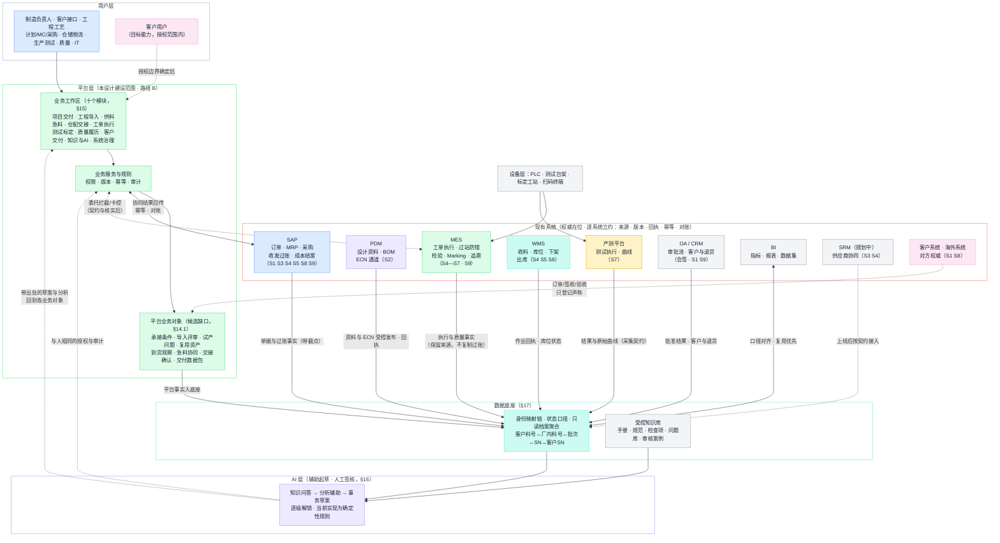

全景图读图要点：

1. **五层各司其职**：用户层供给判断与现场事实；平台层只建候选缺口对象并组织协同；AI 层只起草不决策；数据底座只映射与聚合、不产生业务事实；现有系统是各类权威事实的产生地。
2. **现有系统带着自己的职责与工作流节点出现**（节点内标注 S1—S9 归属），每个系统与平台之间是具名的契约边，不存在笼统的"对接现有系统"。
3. **写路径只有两条**：人经平台业务服务对平台自己的对象过账；对现有系统的动作经"协同回传／委托"契约边，带幂等与对账。AI 的草案也走同一入口（虚线），人工签核后才生效。
4. **设备不旁路**：PLC、台架、扫码终端经 MES／产测或采集契约进入，不直达数据底座与履历。

#### 场景分域图

**同一个体系换一个切面看：现有系统分别站在各业务场景里的具体角色。** 下图按五个业务场景域组织：每个域里放该场景实际使用的现有系统与平台补位的协同对象，工作流（S1—S9）在域间流转；数据底座与 AI 层横贯全局：

```mermaid
flowchart LR
    accTitle: OEM AI 制造平台设计：场景分域图（图6）
    accDescr: OEM AI 制造平台设计中场景分域图的关系图，展示① 客户承接域（S1）、CRM / SAP、客户 · 销售订单、客户需求与合同、平台：承接条件登记、供料责任 · 追溯等级 · 评审跟踪、② 工程与版本域（S2）之间的职责、流转与边界。
    subgraph SC1["① 客户承接域（S1）"]
        direction TB
        CRM1["CRM / SAP<br/>客户 · 销售订单"]
        CU1["客户需求与合同"]
        P1["平台：承接条件登记<br/>供料责任 · 追溯等级 · 评审跟踪"]
    end
    subgraph SC2["② 工程与版本域（S2）"]
        direction TB
        PDM1["PDM<br/>设计资料 · ECN"]
        CU2["客户设计批准"]
        P2["平台：导入评审 · DFM<br/>客户版/厂内版映射 · 问题库"]
    end
    subgraph SC3["③ 物料与仓配域（S3—S5）"]
        direction TB
        SAP3["SAP<br/>MRP · 采购 · 收发过账"]
        WMS1["WMS<br/>收料 · 库位 · 下架"]
        MESQ1["MES<br/>IQC · 冻结预警"]
        P3["平台：到货观察 · 急料协同<br/>配料核对 · 交接确认"]
    end
    subgraph SC4["④ 生产与质量域（S5—S7）"]
        direction TB
        MESX1["MES<br/>开工校验 · 过站防错<br/>Marking · 放行 · 履历"]
        TP1["产测平台<br/>测试执行 · 曲线"]
        DEV1["PLC · 台架 · 标定工站"]
        P4["平台：测试任务<br/>证据索引 · 放行留痕"]
    end
    subgraph SC5["⑤ 交付与结案域（S8—S9）"]
        direction TB
        SAP5["SAP<br/>发运 · 开票 · 结案"]
        WMS5["WMS<br/>出库 · 装箱"]
        CU5["客户签收 · 验收"]
        P5["平台：交付数据包 · 验收跟踪<br/>8D · 问题库 · 复用资产"]
    end
    SC1 ==>|"S1→S2 承接条件与资料"| SC2
    SC2 ==>|"S2→S3 有效版本与清单"| SC3
    SC3 ==>|"S5 齐套与配料交接"| SC4
    SC4 ==>|"S7→S8 放行产品与证据"| SC5
    SC5 -.->|"ECN / 质量反馈 回 S2"| SC2
    SC4 -.->|"缺料 / 异常 回 S3"| SC3
    SC5 -.->|"经验证问题 → 复用资产 → 下个导入"| SC2
    subgraph BASE["数据底座（横贯全域）"]
        direction LR
        MAPD1["身份映射：客户料号↔厂内料号↔批次↔SN↔客户SN"]
        MAPD2["状态口径 · 来源索引 · 只读档案聚合"]
    end
    subgraph AIL["AI 层（辅助起草 · 人工签核 · 横贯全域）"]
        direction LR
        AG1["知识问答"]
        AG2["分析辅助：急料 · ECN 影响 · 测试归因<br/>（当前为确定性规则）"]
        AG3["事务草案（候选）<br/>人批准后才进业务入口"]
    end
    SC1 & SC2 & SC3 & SC4 & SC5 -->|"事实接入（契约：来源·版本·回执）"| BASE
    BASE --> AIL
    AIL -.->|"带出处的草案与分析<br/>回到各域业务对象"| SC3
    AIL -.-> SC2
    AIL -.-> SC4
    class CU1,CU2,CU5 cust
    class CRM1,SAP3,SAP5 biz
    class PDM1 eng
    class WMS1,WMS5 flow
    class MESQ1,TP1,DEV1 qa
    class MESX1 exec
    class P1,P2,P3,P4,P5 exec
    class MAPD1,MAPD2 flow
    class AG1,AG2,AG3 eng
    style SC1 fill:#FFFFFF,stroke:#F9A8D4
    style SC2 fill:#FFFFFF,stroke:#A78BFA
    style SC3 fill:#FFFFFF,stroke:#5EEAD4
    style SC4 fill:#FFFFFF,stroke:#F59E0B
    style SC5 fill:#FFFFFF,stroke:#60A5FA
    style BASE fill:#FFFFFF,stroke:#5EEAD4
    style AIL fill:#FFFFFF,stroke:#A78BFA
    classDef cust fill:#FCE7F3,stroke:#F9A8D4,color:#172033;
    classDef biz fill:#DBEAFE,stroke:#60A5FA,color:#172033;
    classDef eng fill:#EDE9FE,stroke:#A78BFA,color:#172033;
    classDef flow fill:#CCFBF1,stroke:#5EEAD4,color:#172033;
    classDef qa fill:#FEF3C7,stroke:#F59E0B,color:#172033;
    classDef exec fill:#DCFCE7,stroke:#4ADE80,color:#172033;
```

场景图读图要点：

1. **同一个系统在不同场景里是不同角色**：SAP 在③是 MRP 与过账、在⑤是发运与结案；MES 在③是 IQC 与冻结、在④是执行中枢；WMS 在③收料下架、在⑤出库装箱。按场景看职责，不按系统名圈地盘。
2. **平台节点挂在每个域的交接与断点处**（绿色），不在主链上抢位置——这是"补闭环、不再造执行系统"的图形表达。
3. **粗箭头是工作流主链（S1→S9），虚线是反馈边**——缺料回计划、变更与质量反馈回工程、经验证问题回流下个导入。
4. **数据底座只做身份映射与只读聚合**，各域事实按契约接入（来源、版本、回执）；**AI 层只从数据底座与知识库取事实，输出带出处的草案回到各域业务对象，人工签核后才进业务入口**。
5. 每个系统的完整职责卡见 §14.2，S1—S9 逐节点的系统分工矩阵与泳道图见 §13.3。

#### 13.1 三种建设路径与本设计的选择

| 路径 | 主要范围 | 适用性与代价 |
| --- | --- | --- |
| A：统一查询与 AI 入口 | 聚合现有状态、报表及知识 | 可较快验证查询价值；物料交接、状态闭环和执行控制仍由原流程处理 |
| B：跨系统协同与明确缺口建设（**本设计采用**） | 在查询基础上增加准备评审、责任协同、异常处理、客户交付及复用资产，按契约委托权威系统执行 | 能对应当前痛点并复用软件资产；依赖明确对象归属、接口及岗位责任 |
| C：分阶段整合或重构特定执行能力 | 对被证明确实不足的执行领域进行系统改造、替换或新建 | 需承担现场作业、设备、迁移和持续运维责任，按领域单独论证 |

本设计按 B 构建；对确有必要的领域（如测试执行引擎、WMS 作业深化）再按 C 逐领域论证。整体平台的管理范围及底层演进授权见决策项 D02。

#### 13.2 分层职责与承诺

每一层（含逐个系统）拥有什么、向上承诺什么、向下要求什么——越界即是违反 §12 原则的信号：

| 层／系统 | 拥有什么 | 向上承诺 | 向下要求 |
| --- | --- | --- | --- |
| 用户层 | 业务判断与现场动作 | 在发生点如实供给事实，不代录不补签 | 系统给出真实状态与可执行的拒绝原因 |
| 平台层 | 候选业务对象（§14.1）、跨系统协同、档案聚合、数据底座 | 登记的都是真实操作；核对≠批准、登记≠连接；只对自己承担的对象过账 | 各现有系统提供有效契约与回执；授权模型可代入 |
| AI 层 | 知识索引、分析、动作草案 | 回答带来源与截点；动作停草案态、人工签核 | 知识受控、数据底座可信、发起人授权可代入 |
| SAP | 订单、采购、MRP、库存账、过账、成本、主数据 | 经营账一致，过账回执语义明确 | 平台回传带幂等身份；对账差异为显式对象 |
| PDM | 设计资料、BOM、版本、ECN 通道 | 受控发布，发布即冻结 | 下游接收回执留痕（客户资料是否入 PDM 待核实） |
| MES | 工单执行、过站防错、检验、Marking 隔离、SFC 履历、组件追溯、线边仓、设备台账 | 执行与质量事实真实、拦截有效 | 版本与任务输入明确；委托动作带契约与核实 |
| WMS | 库位、盘点、下架拣配作业 | 作业回执与实物位置真实 | 配料与交接的任务输入明确（与 MES 仓库模块分工待核实） |
| 产测平台 | 测试执行、结果与曲线 | 结果关联 SN 与程序版本 | 规范与任务输入；原始数据按采集契约交付 |
| BI | 指标、报表、数据集 | 口径有定义、数据可溯源 | 同名指标口径对齐，不并行两套算法 |
| OA／CRM | 审批流／客户与退货入口 | 批准结果与客户信息可引用 | 流程状态可查询，身份可对应 |
| 客户系统 | 对方权威（订单、验收、数据要求） | —（对方组织，只登记声称） | 交付数据同源同口径、带截点 |
| 设备层 | PLC、台架、标定工站、扫码终端的原始采集 | 带设备身份与发生时间 | 经 MES／产测或采集契约进入，不旁路 |

#### 13.3 工作流在系统间的划分

S1—S9 每个节点由哪些系统承担、平台补什么。矩阵（●＝主要承担，○＝参与，现有系统列待批次零核实）：

| 节点 | SAP | PDM | MES | WMS | 产测 | OA/CRM | 平台（协同与候选缺口） | 客户 |
| --- | --- | --- | --- | --- | --- | --- | --- | --- |
| S1 承接评审 | ●订单 | | | | | ○CRM 入口·OA 会签 | ●承接条件·责任·追溯等级登记 | ○需求与合同 |
| S2 工程导入 | ○主数据/MBOM | ●设计资料·ECN | ○版本接收·试产（待核实） | | | ○批准流 | ●导入评审·DFM·双版本映射·问题库 | ●设计批准 |
| S3 供应计划 | ●MRP·采购 | | ○急料模块（材料标注深化，具体内容与进度待核实） | | | | ●急料跨岗位协同·客供计划跟踪 | ○客供到料计划（例外） |
| S4 物料准备 | ●收发过账 | | ●IQC·冻结预警 | ●收料·上架·库位 | | | ●到货观察·身份核实协同 | ○带料（例外留痕） |
| S5 工单开工 | ●工单下达 | | ●开工校验·SN 绑定 | ●下架·拣配 | | | ●配料四状态核对·交接确认 | |
| S6 生产执行 | ○报工接收 | | ●过站·防错·用料·WIP | ○线边补料（分工待核实） | | | ○执行状态汇总·异常协同 | |
| S7 测试放行 | | | ●质量判定·Marking·放行 | | ●测试执行·曲线 | ○让步审批 | ●测试任务·证据索引·放行留痕 | ○见证/放行（按合同） |
| S8 发运验收 | ●发运·开票·订单行 | | ○出货校验 | ●出库·装箱 | | ○客户系统对接 | ●交付数据包·验收与遗留项跟踪 | ●签收·验收 |
| S9 结案反馈 | ●成本结案 | ○ECN 承接 | ○履历证据·售后 | | ○复测证据 | ○CRM 退货 | ●8D·问题库·复用资产·对账协同 | ○RMA·反馈 |

同一条主线的泳道视图——每个系统一条泳道，工作流在泳道间穿插流转（实线＝主链交接，虚线＝协同与例外）：

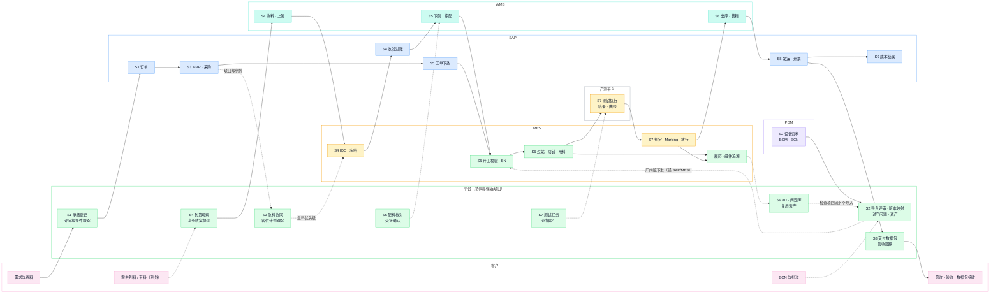

泳道图读法：**主链（实线）大部分时间在现有系统之间流转**（SAP→WMS→MES→产测→SAP），平台泳道的节点几乎全部通过虚线挂在主链的交接处——这就是路径 B 的形状。唯一的例外是 S2 工程导入与 S9 资产回流，这两段的业务对象（评审、问题、资产）在当前材料中未明确承载及覆盖，平台候选承担经核实的缺口。

### 14. 系统职责地图：各系统的定位、作用与归属

#### 14.1 执行能力三分

**不默认整套 MES／WMS／质量执行由平台重建。** 每类业务对象落入三类之一，裁定是决策项（D06），未裁定前平台只登记不接管：

| 类别 | 判据 | 当前判断（候选，待批次零核实） |
| --- | --- | --- |
| 现有系统承担（沿用/配置/集成/扩展） | 经实际样本核实已有系统在用且满足或可配置满足 OEM | MES 过站防错、Marking 隔离、SFC 履历、检验标准维护；WMS 盘点库位；SAP 订单/采购/过账；PDM 设计资料；产测平台测试执行；BI 报表 |
| 平台候选承担的缺口 | 逐对象核实已有承载、可配置范围及责任后，确认仍需新增的对象 | 承接条件登记、工程导入评审与 DFM、试产问题闭环、复用资产、到货观察、急料跨岗位协同、交接确认、客户版/厂内版映射、跨系统单台档案聚合、客户交付数据包、系统责任治理；MES 已有试产与质量异常模块，不预判为平台缺口 |
| 需单独论证的改造（路径 C） | 确有不足且必须动已有系统或新建执行能力 | 统一测试执行引擎与台架、MES 急料/WIP 深化、WMS 作业扩展（如一库位多物料）、客户门户 |

以上归属核实不缩小平台统筹 OEM 全流程的目标。平台统一组织业务与责任、关联状态和证据；对象的权威写入与执行方依实际样本裁定，**没写进文档不等于无人承载，已有平台软件对象也不自动获得生产权威**。

三分是对象级结论；做结论用的检查方法是逐能力五路判断——每项能力先问"现状里谁在管这个对象"（§2.1），再问"OEM 业务用它缺什么"：

| 路径 | 含义 | 适用判据 |
| --- | --- | --- |
| 沿用 | 已有系统该能力在用且满足 OEM 业务 | 实际样本核对通过（功能在用＋数据可信＋覆盖 OEM 对象） |
| 配置 | 已有系统具备该能力，需开启模块、配主数据或调规则 | 能力存在但未启用或未按 OEM 配置（如 Marking 锁定类型、检验计划触发） |
| 集成 | 能力在用但信息到不了需要的人或系统 | 断点在传递不在能力（如急料信息靠 MC 人工传递） |
| 扩展 | 已有系统承载，但需二次开发或厂商深化 | 能力有骨架缺细节（如材料标注深化的急料与 WIP 管理，具体内容与进度待核实），受开发许可与厂商支持约束 |
| 新建 | 核实后确实无人承担的对象 | 任何已有系统都不管这个对象；新建对象不得与已有系统争权威 |

以能力最密集的 MES 为例，逐能力对照（其他系统的能力清单见[手册 3.2](/ai-notes/manufacturing-processes/manufacturing-system-handbook)）：

| 能力 | 公司 MES 现状 | OEM 待核实 | 初步判断（候选） |
| --- | --- | --- | --- |
| 工单与派工 | 工单同步、计划排程、指定批次管理 | 开工检查的实际检查项与拦截力 | 沿用／配置 |
| 过站与路由 | 过站校验含账号资质/物料/队列校验；WIP 材料标注深化，具体内容与进度待核实 | 哪些校验已启用；WIP 可见性（P13 关联） | 沿用＋扩展（WIP） |
| 物料防错 | 防错覆盖六环节；线边仓发料退料 | 实际启用范围；带料绕行（P05/P06）说明入口可被绕过 | 配置＋制度（卡控与例外批准一起定） |
| 质量执行 | IQC/IPQC/OQC、SPC、质量异常管理、售后 | 客户检验标准维护；维修与返工履历口径 | 沿用／配置 |
| 隔离与拦截 | Marking 四类锁定＋出货校验，存在历史记录/界面证据，连续运行与适用范围待核实 | 实际拦截位置、解除权限、OEM 适用 | 沿用／配置 |
| 追溯 | SN/组件/批次/工序/发货多维追溯 | 多层递归、拆换历史、原始曲线、OEM 覆盖 | 沿用＋平台聚合补维度（§14.5） |
| 急料与异常 | 急料管理材料标注深化，具体内容与进度待核实；五类预警 | 急料信息今天如何传递到岗位 | 集成＋扩展（平台承担跨岗位传递） |
| 设备管理 | 台账、点检、保养、夹治具 | 校准有效期与开工检查联动 | 沿用／配置 |
| 试产管理 | 工程与 NPI 模块已列试产 | 试产工单通道、轮次与转阶段记录的实际形态 | 先核实再定（不预判为平台缺口） |

#### 14.2 各系统职责卡

每个系统一张卡：定位、权威对象、在工作流中的作用、**不承担什么**（防止对象被悄悄挪权威）、与平台的交换。全部现状描述待批次零核实：

| 系统 | 定位与权威对象 | 在工作流中的作用 | 不承担什么 | 与平台的交换 |
| --- | --- | --- | --- | --- |
| **SAP** | 经营账本：客户订单、采购、MRP、库存账（会计口径）、生产计划、主数据、成本与结算 | S1 订单承接；S3 需求展开与采购；S4 收发过账；S5 工单下达；S8 发运开票；S9 结案 | 现场过站与检验、实物位置细粒度、客户版本映射、客户数据包 | 平台读取单据/计划/过账事实（带截点），回传协同结果（幂等），对账差异为显式对象 |
| **PDM** | 设计资料权威：图纸、BOM、版本、ECN 通道（客户资料是否入 PDM 待核实） | S2 设计资料发布与变更；S9 的 ECN 承接 | 制造现场版本执行、客户批准（权在客户）、工艺与测试规范的现场下发 | 受控发布进平台版本映射，接收回执留痕 |
| **MES** | 执行中枢（六类模块）：工单执行、过站防错、检验、Marking 隔离、线边仓、设备台账、SFC 履历与组件追溯 | S4 检验与冻结；S5 开工校验与 SN 绑定；S6 主场；S7 判定与放行；S9 履历证据源 | 会计过账（在 SAP）、客户数据包、跨系统档案聚合、工程导入评审与复用资产（候选在平台，待核实） | 执行与质量事实接入平台（保留来源、不复制过账）；拦截/卡控类动作经契约委托；急料与 WIP 深化为路径 C 论证项 |
| **WMS** | 仓储作业：库位、盘点、库存分析、下架拣配（收发料记账在 SAP，与 MES 仓库模块分工待核实） | S4 收料上架；S5 下架配料；S8 出库装箱 | 质量判定（在 MES）、业务过账（在 SAP）、交接确认（平台候选） | 作业回执与库位状态进平台；配料四状态核对；库位批次模型（P09）按实际配置核实 |
| **产测平台** | 测试执行与结果权威（与 MES 双向集成） | S7 测试执行、结果与曲线产出 | 质量放行（在 MES/质量）、测试规范与任务管理（平台候选）、标定算法归属（D08） | 结果与原始曲线按采集契约入平台档案；规范与任务由平台组织（候选） |
| **BI** | 指标与报表（非记账权威） | S9 与全程经营可见 | 业务写入、权威判定 | 口径对齐、复用优先；同名指标不并行两套算法（§17.1） |
| **OA** | 审批流：采购申请、部分质量流程、通用批准 | 各节点批准留痕（评审会签、让步、处置） | 业务对象权威 | 批准结果被平台引用，不复制流程 |
| **CRM** | 客户与订单入口、退货信息 | S1 商机与客户档案；S9 RMA 入口 | 制造事实 | 客户档案与退货信息进协同 |
| **SRM（规划中）** | 供应商协同（原材料规划中，实际部署待核实） | S3/S4 代采在途与交期确认（上线后） | — | 上线前客供计划按平台登记跟踪（声称），上线后按契约接入 |
| **客户系统／海外系统** | 对方权威：订单、验收、数据要求 | S1 输入；S8 交付数据与验收 | —（不推断对方状态） | 只登记声称与凭据；交付数据同源同口径 |
| **设备层**（PLC/台架/标定工站/扫码终端） | 原始采集 | S6 过程数据；S7 测试与标定采集 | 业务判定、直写履历 | 经 MES／产测或采集契约进入，带设备身份与发生时间 |

平台自身的职责（候选对象清单见 §14.1，模块划分见 §15）与 AI 层的职责（§16）不在此表重复——它们的纪律是：**只承担表中各系统"不承担什么"里被核实确认的空位**。

#### 14.3 数据与动作归属（候选分工，按对象逐项确认）

| 对象／动作 | 需要核实的正式来源或执行方 | 平台候选职责 |
| --- | --- | --- |
| 客户订单、采购、会计库存及业务过账 | SAP 及相关业务入口 | 关联身份、承诺和执行回执，处理协同与对账差异 |
| 设计资料、BOM 和客户批准 | 客户组织及受控 PDM／资料流程 | 管理资料接收、客户／厂内版本映射及导入评审 |
| 工单、过站、用料及装配关系 | SAP 与 MES 按实际分工确认 | 展示准备与执行条件，关联履历，明确缺口后再承担相应动作 |
| 实物收发、库位、批次及仓内交接 | WMS 及实际作业系统（MES 仓库模块分工待核实） | 急料及责任协同、缺口交接能力、状态汇总及差异跟踪 |
| 检验、冻结、处置及质量放行 | MES 质量模块（Marking）及 OA 流程 | 关联权威结果、证据及影响范围，显示阻断和待确认 |
| 测试运行及标定原始事实 | 产测平台、现场执行端及适用 MES 记录 | 管理规范和任务、原始证据索引及版本关联 |
| 项目准备、工程导入及试产 | MES 工程与 NPI 模块已列试产，PDM／OA 有相邻资料与审批能力；评审、轮次及转阶段批准逐对象核实 | 统筹准备与导入，引用已有权威；确认缺口后候选承担相应业务事实及审核记录 |
| 试产／质量问题、验证及复用资产 | MES 已列试产与质量异常管理；问题处置、验证和资产发布的实际来源与边界待样本核实 | 关联问题及验证证据、组织复用；已核实的缺口候选新增，不重复已有问题账 |
| 指标、报表及履历聚合 | 已确认的 BI 数据模型、源系统及指标责任人 | 跨对象查询和解释，保留计算口径、来源及时间截点 |
| 客户签收与验收 | 客户方正式依据及约定流程 | 登记对方凭据、数量及遗留事项，不代替客户确认 |

#### 14.4 已有集成连线清单（现状，批次零核实底稿）

现有集成连线（MES 居中），是 R13 与批次零逐条核实的工作底稿——**连线存在不等于已验证运行**：

| 连线 | 方向 | 传递内容 |
| --- | --- | --- |
| SAP ↔ MES | 双向 | 主数据、工单/BOM、排产计划；完工信息、报工数据 |
| SAP ↔ WMS | 双向 | 库存、物料、收发货；出货、供应商、客户 |
| SAP ↔ PDM | 双向 | BOM、ECN、ECR |
| PDM → MES | 单向 | ECN、ECR |
| WMS ↔ MES | 双向 | 库存/物料/批次/收发货；退料/完工/产品 |
| OA ↔ MES | 双向 | 审批单据与结果 |
| HR → MES | 单向 | 员工、岗位信息 |
| CRM → MES | 单向 | 退货信息 |
| 产测平台 ↔ MES | 双向 | 工单/工艺/装配/产品；测试结果、设备状态 |
| 客户系统 ↔ MES | 双向 | 订单信息；产品、质量信息 |
| 海外系统 ↔ MES | 双向 | 订单、发货信息 |
| PLC ↔ MES | 双向 | 工艺参数、过程数据；设备基础数据、设备状态（逐项待核实） |

双向连线不逐字段分配上下行方向。每条连线进入建设前，按 §17.4 的契约维度补齐取证（通道形态、调用身份、回执语义、异常恢复、对账责任、负责人），资料与权限按[对接清单](https://github.com/ink-hz/AI-Manufacturing-Platform/blob/53958c7cede6707c41b99cba7c636402f3c23fe3/docs/manufacturing-system-information-and-access-request.md)落实。

#### 14.5 已有 MES 追溯与平台单台档案的关系

**平台的"单台档案"是只读聚合视图，不是第二套履历**：MES 承担的原始事实（过站、装配扫描、批次绑定）继续由 MES 产生，平台按契约接入并保留来源；平台补齐 MES 之外的维度——客户 SN 映射、工程修订引用、原始测试曲线与标定参数、拆换历史的有效段表达、跨系统（SAP 单据、WMS 位置、客户交付）关联。缺口（多层递归深度、原始数据保存、返修拆换完整性、OEM 覆盖）用实际样本裁定，见[总体架构 §7.5](/ai-notes/intelligent-manufacturing/manufacturing-platform-architecture)。

### 15. 平台逻辑模块

模块表示业务职责，具体导航及页面结构在需求确认后细化；仓库、工位及扫码作业入口需结合现有 WMS／MES 确定。

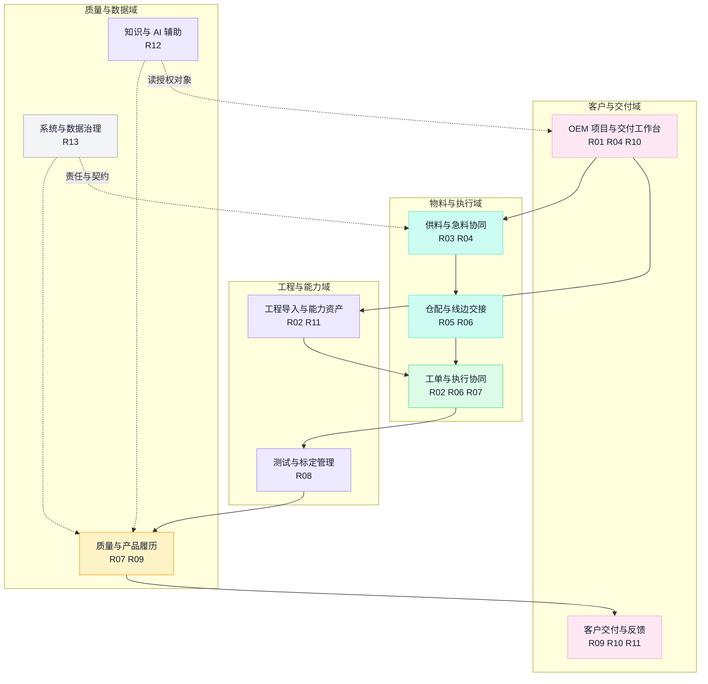

| 模块 | 核心内容 | 与现有系统的衔接 |
| --- | --- | --- |
| OEM 项目与交付工作台 | 客户、项目、承诺、准备、阻断、责任及遗留项 | 引用 SAP 订单和 MES 执行状态，维护平台承担的协同事项 |
| 工程导入与能力资产 | 资料清单、修订、客户版/厂内版映射、评审、试产问题、批准及资产采用 | 引用客户受控资料、PDM 版本、MES 试产及质量证据 |
| 供料与急料协同 | 到货计划、异常到货观察、欠料影响、IQC 及配料协同 | 对接 SAP（MRP/采购）、WMS 收料及 MES 检验；SRM 上线后接协同 |
| 仓配与线边交接 | 库位定位、配料进度、交接、接收及异常 | 优先复用 WMS／MES 作业端及权威记录，补齐已核实缺口 |
| 工单与执行协同 | 适用版本、开工条件、执行状态、异常及变更影响 | 关联 SAP 工单、MES 过站用料及设备状态 |
| 测试与标定管理 | 测试准备、规范、计划、运行、曲线、参数及回读 | 与产测平台和 MES 分工，关联实际采集结果 |
| 质量与产品履历 | 检验、冻结、处置、返工、放行及 SN／组件关系 | 聚合 MES 质量与装配事实，支持影响范围核查 |
| 客户交付与反馈 | 箱单、SN、报告、数据包、签收、验收、结案和 RMA/CAPA | 关联 SAP/WMS 发运与批准，按客户约定交付数据及对账 |
| 知识与 AI 辅助 | 受控资料问答、缺项检查、影响分析和材料起草 | 复用授权知识、业务查询、规则和工具服务 |
| 系统与数据治理 | 系统责任、接口、身份、映射、口径和对账 | 复用现有集成设施及企业身份体系 |

### 16. AI 层设计

#### 16.1 三级能力，逐级解锁

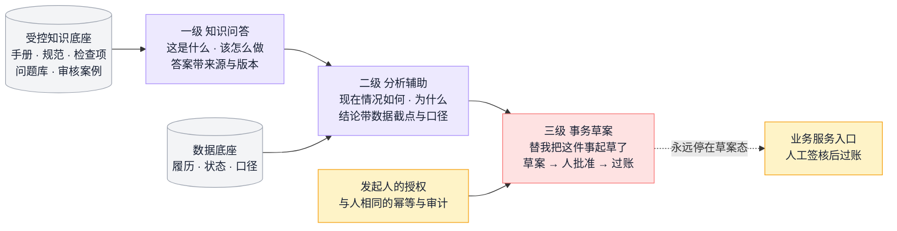

**解锁顺序不可跳**：问答的价值依赖知识受控，分析的价值依赖留痕与口径可信，事务的安全依赖前两级已经证明可靠。数据底座就绪之前不上事务能力。当前实现状态：辅助分析为确定性规则、无模型调用——它是二级能力的规则前身，真实模型能力按评估集验证后替换或叠加。

#### 16.2 六个候选场景与业务对象的结合

§10 的六个场景不做独立聊天应用，而是出现在具体业务对象中：导入评审辅助挂在导入评审对象上（比对问题库与 DFM 表，输出带出处的评审草案）；急料分析挂在急料与工单对象上（主动提示"料到未建档/缺口将阻塞"）；ECN 分析挂在变更对象上（影响清单草案）；测试归因挂在测试运行对象上（历史同类检索与原因假设）；工艺问答在工位扫码即问（答案带出处）；8D 复盘挂在问题对象上（起草归因初稿，经验证后回流问题库）。各场景的事实来源系统见 §10。

#### 16.3 四条不可逾越的边界

1. **检索到的文字 ≠ 有效指令**：回答"这批按哪个工艺做"需要工单快照的适用版本，索引权限跟随源文档权限。
2. **模型判断 ≠ 服务端授权**：权限与参数校验由业务服务执行边界承担；AI 代入发起人身份，不拥有独立权限。
3. **确定性计算与 AI 解释分工**：缺口、齐套、限值判定、可用量由规则计算且可复现，AI 收集条件、调用工具、解释结果，不"猜数"。
4. **超时 ≠ 失败、回答 ≠ 过账**：事务动作复用业务唯一标识，回复区分草案已生成／已提交／已批准／已过账。

#### 16.4 知识底座与数据积累

资料索引同时保存版本、适用范围和访问权限；源文档更新或权限撤销后同步更新检索可见性。**客户专属原始资料和通用审核资产保持各自边界**——"每个项目让知识库厚一层"只对经审核脱敏的通用内容成立，源项目与客户材料仍受原权限保护。AI 验证方法：固定业务样本评估集，分别评估检索、引用有效性、对象关联、工具计算、缺项识别、建议可执行性和未知处理；对比相同工作在原方式和 AI 辅助下的处理时间、遗漏、错误及人工纠正成本。

### 17. 数据组织与集成契约

#### 17.1 三类数据与身份映射链

平台区分三类内容：**源系统事实及其引用**（带来源、版本、回执）、**平台自己负责的业务事实**（承接、评审、问题、资产、观察、协同）、**派生视图**（档案聚合、指标、快照）。贯穿三类内容的是一条受控身份映射链：

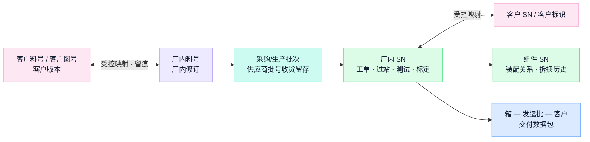

导入文件和人工登记保留实际来源及采集方式。现有 BI、接口平台和数据资源先评估复用；是否需要独立数据仓库、原始曲线存储、知识索引或消息设施，由数据量、时效、查询及运维要求决定，本文不预先锁定产品选型。

#### 17.2 三条贯穿数据流：数据在系统间怎么流转

架构图是静态的，真正要盯住的是三条动态数据流——每一跳写明承载系统，跨部门断点几乎都发生在跳与跳之间：

**① 客户资料与版本流：客户的设计怎么变成车间能执行的资料**

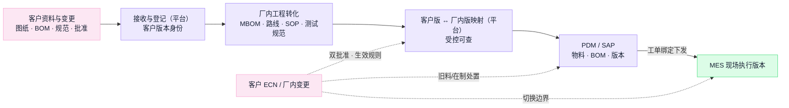

要点：**客户版本（批准权在客户）与厂内版本（批准权在厂内工程）并存且映射可查，不合并成一个号**。现状：PDM→SAP→MES 的 BOM/ECN 连线存在（§14.4）；客户资料的实际接收通道、客户版本今天登记在哪、ECN 实际流程待核实。

**② 订单—供料—执行流：承诺怎么变成交付**

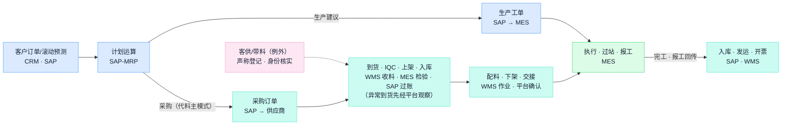

要点：**这条流上每次交接都应留不可覆盖业务记录，涉及权威账变动的动作才按唯一入口过账**，重复过账和漏过账是账实不符的两大来源。代料是主模式；客供料不生成采购建议但占齐套、所有者独立记账。现状：15 条痛点全部落在这条流的物料段（§3.1），SAP 打单与 WMS 作业的衔接（P11—P13）是裁定"作业与过账关系"的核心核实项。

**③ 质量—交付—追溯流：问题怎么被拦住、怎么找回去、客户怎么拿到证据**

```mermaid
flowchart LR
    accTitle: OEM AI 制造平台设计：17.2 三条贯穿数据流：数据在系统间怎么流转（图13）
    accDescr: OEM AI 制造平台设计中17.2 三条贯穿数据流：数据在系统间怎么流转的关系图，展示来料检验 IQC、MES 质量模块、库存状态、WMS/SAP · MES Marking 锁定、过程检验 · 首件、MES、成品测试 · 标定、产测平台 ↔ MES、放行 · 出货校验、MES Marking之间的职责、流转与边界。
    IQC5["来料检验 IQC<br/>MES 质量模块"] -->|"合格/冻结状态"| STK["库存状态<br/>WMS/SAP · MES Marking 锁定"]
    STK --> IPQC5["过程检验 · 首件<br/>MES"]
    IPQC5 --> FT5["成品测试 · 标定<br/>产测平台 ↔ MES"]
    FT5 --> REL["放行 · 出货校验<br/>MES Marking"]
    REL --> SHIP5["发运 · SN 清单 · 客户数据包<br/>WMS/SAP · 平台组织"]
    SHIP5 -.->|"客诉 / 退货 RMA<br/>CRM 入口"| ANA["检测分析 · 8D（平台组织）"]
    ANA -.->|"批次/SN 追溯"| TR5[("SN/组件/批次履历<br/>MES 原始事实 · 平台聚合")]
    ANA -.->|"纠正措施"| ECN6["工程变更<br/>客户/厂内双批准"]
    class IQC5,IPQC5,FT5,REL qa
    class STK flow
    class SHIP5 cust
    class ANA,ECN6 risk
    class TR5 store
    classDef qa fill:#FEF3C7,stroke:#F59E0B,color:#172033;
    classDef flow fill:#CCFBF1,stroke:#5EEAD4,color:#172033;
    classDef cust fill:#FCE7F3,stroke:#F9A8D4,color:#172033;
    classDef risk fill:#FEE2E2,stroke:#F87171,color:#172033;
    classDef store fill:#F3F4F6,stroke:#9CA3AF,color:#172033;
```

要点：**质量状态必须真实锁住库存与发运**——已有 Marking 隔离与出货校验机制，要核实的是锁定与解除的责任及项目适用；**履历是生产时记出来的，不是出事后补出来的**——MES 已有多级追溯，平台补客户 SN 映射、原始曲线、拆换历史与合同追溯等级（§14.5）。给客户的数据与内部同源同口径，差异只能来自截点。

#### 17.3 核心数据语义（设计规则）

跨系统组织数据时，以下语义在全平台一致，任何来源的数据接入与展示都按它表达：

- **三层实物身份不可互代**：料号回答"是哪种东西"，修订回答"按哪一版定义"，批次／SN 回答"是哪个实物"——任何一层不代理另一层（用料号领料不记批次，追溯就断在仓库门口）。供应商批号在收货时留存，与厂内批次保留映射；客户侧身份经 §17.1 映射链受控关联。
- **库存数量永远带五维**：所有者（本厂／客户等；代料为主，自有与客供均可委外，委外不改变原所有者）、实物位置／保管（库位、线边、在途、委外在外）、质量状态（待验／合格／冻结／让步——互斥枚举，待验不因放久了自动变合格）、分配状态（可用／已预留／已拣配）、批次身份。"仓库还有 N"回答不了"这张工单能领多少"。
- **双时间贯穿全部事实**：每条事实带发生时刻（业务声明）与录入时刻（系统记录）——追溯按发生时刻排列，审计按录入时刻排列，补录质量＝两者差距的分布。
- **余额是推导，永远不可直写**：余额＝该身份维度下全部不可变事实的代数和。缓存错了修缓存，事实错了红冲事实；盘点产生的是带单据与确认的盘盈／盘亏事实。

#### 17.4 每条接口的契约维度

| 契约项 | 需要写清的内容 |
| --- | --- |
| 对象及身份 | 哪个系统、哪个业务对象、项目范围和唯一业务编号 |
| 版本与时间 | 数据或状态版本，发生、采集、接收及过账时间 |
| 数量与状态 | 单位、精度、所有者、实物位置／保管、待验／合格／冻结等口径 |
| 成功与回执 | 收到、校验通过、业务接受和正式过账分别如何表达 |
| 异常与恢复 | 幂等、重复、乱序、超时查询、部分完成和补偿 |
| 权限与责任 | 调用身份、动作及数据范围、日志、业务和技术负责人 |
| 对账 | 比较对象、明细和合计口径、周期及差异处理 |

即时业务接入优先以现有正式接口和受控机制落实。**没有 API 也要有契约**：阶段性文件交换或人工录入同样需要固定模板、来源、唯一身份和回执，并明确后续演进安排。

### 18. 权限与客户边界

公司内部管理身份、项目成员、客户用户和技术调用身份分别建模。已有项目授权机制作为复用基础；**多客户隔离收敛到授权范围与数据边界，不按客户分叉系统**——A 客户项目的角色不能操作 B 客户项目的对象，客户专属资料不因资产复用进入公共范围。客户访问（目标能力）需明确组织归属、项目、文档、原始数据和导出范围；共享资产的采用权限与源客户资料访问权限分别判断。

开工、用料、冻结、放行、发运和标定写入等动作，由承担该动作的业务服务或现场系统校验权限和业务条件。网络中断、补录和离线作业规则由生产、工艺、质量及 IT 共同明确，并保留原始发生时间和更正历史。

---

## 第四部分 场景与工作流

### 19. S1—S9 主工作流

OEM 制造主线沿 S1—S9 展开（编号与手册、流程总览一致），客户触点贯穿全程，异常与变更沿反馈边回流：

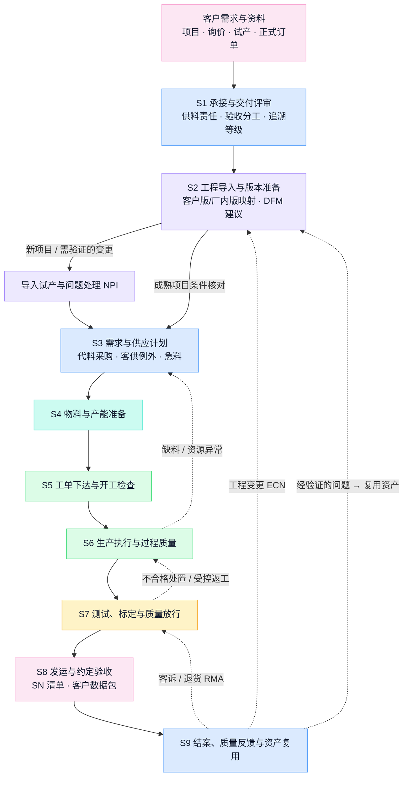

| 节点 | 平台承担的协同 | 权威事实来自 |
| --- | --- | --- |
| S1 承接与评审 | 承接条件、责任边界与未决条件登记跟踪 | SAP/CRM 订单；合同条款 |
| S2 工程导入 | 导入评审、DFM、试产问题、版本映射、复用资产 | 客户资料；PDM；MES 试产 |
| S3 供应计划 | 急料与齐套状态跨岗位传递、客供计划跟踪（例外） | SAP-MRP；客供声称 |
| S4 物料准备 | 到货观察、身份核实协同、检验状态传递 | WMS/MES/SAP 收货检验过账 |
| S5 工单开工 | 开工条件核对、配料状态核对、交接确认 | SAP 工单；MES 校验；WMS 下架 |
| S6 执行 | 执行状态汇总、异常协同、变更影响传递 | MES 过站/防错/报工 |
| S7 测试放行 | 测试规范任务管理、原始证据索引、放行留痕 | 产测平台；MES 质量/Marking |
| S8 交付验收 | 客户数据包、验收与遗留项跟踪 | WMS/SAP 发运；客户凭据 |
| S9 结案反馈 | 8D 组织、问题库、复用资产、结案核对 | SAP 成本；MES 履历；CRM 退货 |

各节点的知识与断点详见[手册第 5—13 章](/ai-notes/manufacturing-processes/manufacturing-system-handbook)。**以下五个场景是对设计的端到端检验——每个场景都应当能在上面的结构里走通，走不通就是设计要修的信号。**

### 20. 场景 A：一件急料从到厂到产线可用

对应 P01—P15 的主战场，也是首期试点（§26）的验收场景。代料采购为主线，客供与带料按例外通道覆盖。

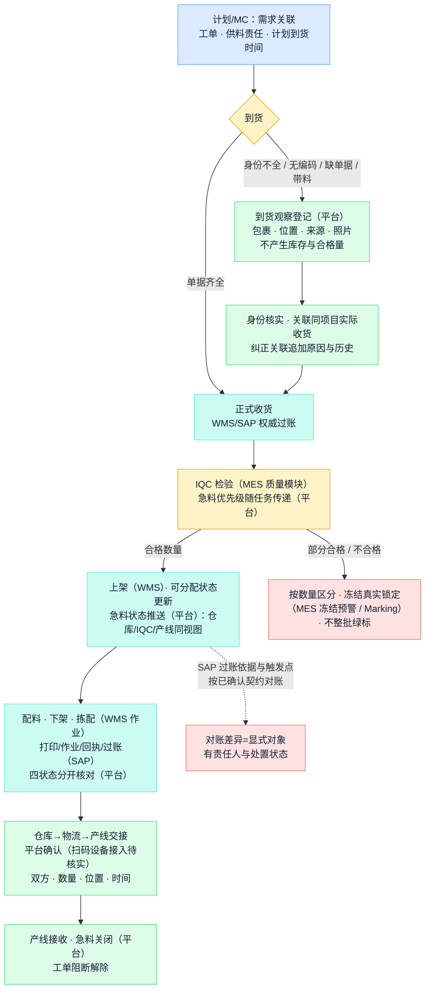

必须覆盖的异常：无编码（P07）、缺单据（P01）、客户直接带料（P05——先观察登记再核实，例外批准留痕）、部分合格、数量差异、漏扫（P12）、重复扫码、接口超时、人工例外及更正。**正确性判准**：每一步的事实、数量、来源与时间可查；观察与关联不产生库存、IQC 合格量或预留；急料从识别到可用的全程时间可分解（到货/身份/检验/仓配各段等待）。

### 21. 场景 B：一次客户工程变更影响到制造现场

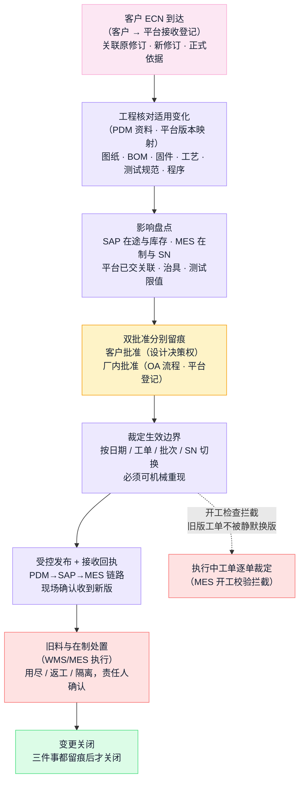

必须覆盖的异常：试产期紧急变更（高频变更作为候选压力场景，实际频次按项目样本确认，生效边界始终受控）、客户口头要求（登记为待正式依据，不先执行）、版本不一致（客户升版厂内未切）、部分切换、历史产品返修时的旧版本适用。**正确性判准**：事后问"这次变更切在哪一台"，答案可机械重现；履历中每台产品引用它实际适用的修订。

### 22. 场景 C：一次测试失败变成下个项目的强制检查项

体系沉淀的核心回路——EX001 的 89 项问题走的就是这条路（原材料报告复用与沉淀不足；实际已有问题、验证与资产机制仍需按样本核实）。

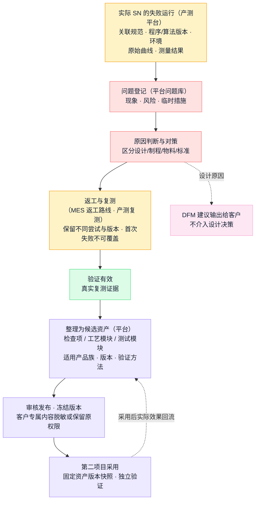

必须覆盖的异常：采集缺失、无效运行、设备校准过期、参数回读不一致、原因尚未验证（不得发布为资产）、客户资料不可共享（资产脱敏边界）。**正确性判准**：测试结论与质量放行分别记录；未经验证的个案不升级为资产；第二项目采用不获得源项目访问权。

### 23. 场景 D：AI 辅助的工作方式（候选）

以导入评审为例，展示 AI 层与业务对象、权威数据的协作方式——其余五个场景同构：

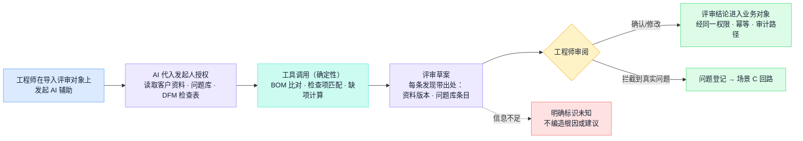

**正确性判准**：每条 AI 发现可打开依据原文；计算来自确定性工具而非模型生成；**人工签核后才成为业务结论**；规则实现与模型实现持续标识（无模型调用时不宣称 AI 生成）。

### 24. 场景 E：客诉追溯与影响圈定

典型时刻：客户客诉一台三个月前交付的整机，问同批还有多少台在外面。

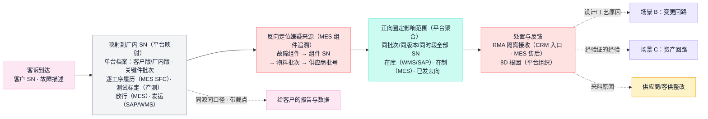

1. 凭客户 SN 经映射找到厂内 SN，调出单台档案：适用版本、关键件批次、逐工序履历、测试与标定证据、放行与发运记录。
2. 反向定位嫌疑来源：故障组件 → 组件 SN → 物料批次 → 供应商批号。
3. 正向圈定影响范围：同批次/同版本/同工序时段的全部 SN 及其当前去向（在库/在制/已发哪个客户哪一批）。
4. 处置与反馈：RMA 隔离接收、8D 根因、按根因分流（场景 B 变更／场景 C 资产／供应商整改），给客户的数据与内部同源同口径。

**正确性判准**：范围一次圈准（不靠印象、不被迫全量召回）；返修拆换历史完整（换过的板有自己的去向）；给客户的报告可回放到单据。现状依据：MES 已有组件级正反向追溯，缺口按 §14.5 样本核对。

---

## 第五部分 建设路线与验收

### 25. 分阶段建设路线（候选）

**现状核实先行，物料闭环作为首期候选试点。** 批次范围与先后须经决策确认（D04/D05）后才是计划；未确认人力、接口及现场条件前，不给出固定工期和成效数字。

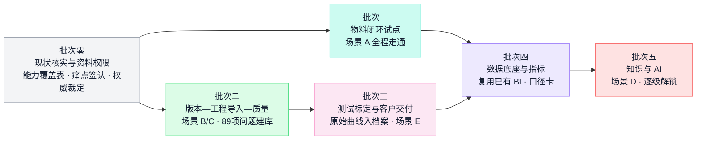

| 阶段 | 工作重点 | 可评审交付物 | 进入下一阶段的条件 |
| --- | --- | --- | --- |
| 零：现状核实 | 逐系统获取资料与权限，核对 OEM 实际流程和问题样本 | 能力覆盖表、痛点台账（签认）、对象权威及接口清单 | 试点项目、问题、责任、数据来源及办理路径明确 |
| 一：物料闭环试点 | 围绕一项实际 OEM 工单，贯通到货、检验、配料、交接及产线接收 | 对象关联、执行记录、异常和对账结果、业务基线 | 现场人员完成含异常的实际走查，数据及责任闭环 |
| 二：版本—导入—质量 | 导入评审、版本映射、变更生效边界、问题库转检查项、与 MES 追溯对接 | 可重现的真实变更、拦截到真实问题的评审、跨系统一致的 SN 档案 | 覆盖关键客户要求，验证与现有系统职责相容 |
| 三：测试标定与交付 | 测试规范任务与执行端分工、曲线与标定入档案、SN 出货关联、客户数据包 | 真实 SN 的完整证据链、真实发运链路、客诉定位样本 | 设备接入与数据深度达到合同承诺的追溯等级 |
| 四：数据底座与指标 | 口径卡、下钻、快照；复用已有 BI 模型 | 任一指标可下钻到单据；口径变更留版本 | 留痕可信、与已有 BI 同名指标无未声明分歧 |
| 五：知识与 AI | 问答→分析→事务逐级解锁 | 评估集、工具调用证据和业务效果对比 | 引用、权限、计算和业务效果达到已确认标准 |

阶段可按依赖交叠：知识整理、评估集准备可与现状核实并行；批次二的工程导入部分不依赖批次一；缺乏真实接口的业务闭环继续明确其人工或文件来源并持续标识。

#### 25.1 实施治理要点（各批次通用纪律）

- **现状盘点四态**：每项能力保留四态——已购未用／已用但绕行／无系统但有效（人工表格也是现状能力）／确实缺失。批次零的能力覆盖表按此记录，不把"已购"直接写成"在用"。
- **问题七分类**：同一现象七种病根，药不同——流程规则不清（开会裁定即可）、数据错误、参数失当、权限不足、系统缺陷、集成断点、能力缺失（最后才轮到新建）。P05/P06 的绕行是典型的"制度＋卡控"复合问题。
- **双轨期必须有退出日**：试点期间新旧两套（系统＋人工表格）并行要定退出日期；"再并行一阵"没有尽头。
- **上线后 90 天盯三个行为指标**：绕行率在降吗、补录延迟在收敛吗、人工对账工作量在减吗——这三条曲线比产量更早说明系统活没活。
- **影子表格三步收编**：承认（纳入台账）→收编（版本、责任人、唯一数据源）→替换（宣布退役）。急料表与到料追踪表是第一批收编对象；直接禁用只会把表格赶进更深的文件夹。
- **每张私建表格当设计缺陷处理**：回潮的原因永远是系统比表格难用——修系统，别怪人。

### 26. 首期试点：急料到线闭环

优先物料闭环的理由：已有 15 条具体问题及可定位流程，可覆盖 MC、客户接口、采购、仓库、IQC、物流和产线的真实交接，并最早暴露与 SAP/WMS/MES 的真实接口条件。

试点先选定一个客户项目、一类产品或一个明确工单范围（D04），确认物料身份、数量、位置、状态和交接责任。**用同一组单据核对 WMS、MES 和 SAP 的记录**，确认当前哪些能力已具备、哪些需配置或集成、哪些需要新增。至少覆盖场景 A 列出的全部异常；选定哪些异常适用于本项目，由业务责任人确认。

### 27. 验收与业务指标

#### 27.1 三层验收

1. **数据与接口正确**：身份、字段、数量、状态、版本及时间可核对；重复、乱序和超时有明确结果。
2. **现场流程闭环**：真实业务角色完成交接及异常处置，实际系统或现场控制与界面结果一致。
3. **业务效果改善**：按一致的范围和口径比较基线，确认人工追踪、处理时长、错误和交付表现的变化。

仓库测试、模拟适配和人工证据验证分别记录其覆盖范围。员工实操、真实接口、设备及业务改善需要相应的现场证据。

#### 27.2 候选指标

| 指标 | 需确认的口径及数据 |
| --- | --- |
| 到料计划偏差 | 计划到货与实际到货的时差；区分代采及客供、已确认／未确认计划 |
| 急料到可用时长 | 从明确急料需求到适用合格数量可分配，分解到货、身份、检验和仓配等待 |
| 物料状态可查覆盖 | 纳入范围的实物中，身份、状态、位置和更新时间均可核实的占比；分母通过实际盘点或样本确定 |
| 配料与交接完整性 | 应完成的工单配料或交接中，步骤、数量、双方及回执完整的占比；部分完成单独表达 |
| 账实及单据差异 | 相同截点、物料、批次及单位下，作业记录与正式业务单据的差异及处置时长 |
| SN 履历覆盖 | 抽查实际 SN 中，具备客户约定必需履历和数据的占比，缺失项逐项列明 |
| 客户交付达成 | 按客户确认的交付要求统计准时及足量情况，原始承诺与变更后承诺分别保留 |
| 问题复发与资产复用 | 以同类问题及适用项目定义复发和复用，记录资产采用后实际验证结果 |
| AI 辅助工作效果 | 固定样本下处理时间、遗漏、错误、引用有效性及人工纠正工作量 |

各指标需补齐负责人、粒度、统计周期、数据源、基线、目标和排除项，再进入试点评审。**消息发送数、页面访问量和问题条目数不能单独证明业务效果。** 历史提出的目标值（如急料响应时长）作为讨论参考，经基线确认后才生效。指标防粉饰：设计口径卡时先列常见操纵手法再逐条封堵——改承诺日、换分母、剔除"特殊情况"、挪库存、截时点、选样本、换口径后直接同比；对策三件：口径卡受控留版本、任何汇总可下钻到单据、原始事实不可改写（§17.3）。

### 28. 待决策问题 D01—D12

| 编号 | 决策问题 | 当前建议或待补充内容 |
| --- | --- | --- |
| D01 | OEM 的产品及客户范围是什么？ | 已确认只做 OEM 代工代料；机器人专属或多品类、首批客户和产线待确认 |
| D02 | 平台统筹范围及底层演进路径如何确定？ | 本设计按路径 B 展开（§13.1）；系统替换或特定执行能力建设逐项论证 |
| D03 | P01—P15 的有效范围和确认状态如何界定？ | 补充项目、时间、责任人和实际样本；保留原问题及候选建议 |
| D04 | 物料闭环是否作为首期试点？ | 本设计建议是（§26）；选定客户项目、工单范围、参与岗位和适用异常 |
| D05 | OEM 当前在哪些系统和模块中运行？ | 逐项确认未覆盖、未启用、绕行、集成断点或能力缺失（批次零） |
| D06 | 哪类对象由哪个系统负责？ | 按 §14 三分法对工单、物料状态、预留、配料、交接、检验、放行及发运逐项确认 |
| D07 | 到货、身份不全、紧急用料及过账按什么规则办理？ | 明确例外批准、状态、数量、实物动作及正式单据的关系（场景 A 的规则底座） |
| D08 | 测试标定平台承担哪些实际执行能力？ | 明确规范管理、引擎、设备适配、采集、算法、写入及回读的责任（路径 C 论证项） |
| D09 | 客户访问和资产共享的边界是什么？ | 确认外部身份、客户数据包、资料权限及可复用资产审核（§18） |
| D10 | 首批 AI 场景和成效如何选择？ | 依据可取得数据、明确工作样本及可衡量收益选择，补齐评估集（§16） |
| D11 | 现有软件哪些能力保留、调整或转接？ | 以 R01—R13 及对象权威为依据评估（产品设计 v0.8 状态表），历史数据迁移单独安排 |
| D12 | 项目如何组织和验收？ | 明确业务负责人、产品、IT、原系统负责人、现场执行及供应商支持，确认基线和推广条件 |

首次评审建议形成四项结果：**OEM 范围及平台定位、首批经确认的痛点与需求、系统分工及资料权限责任清单、试点范围与验收口径**。后续据此细化产品需求和接口／实施规格。

### 29. 资料与权限依赖

按[系统资料与权限对接清单](https://github.com/ink-hz/AI-Manufacturing-Platform/blob/53958c7cede6707c41b99cba7c636402f3c23fe3/docs/manufacturing-system-information-and-access-request.md)组织交付，重点落实：当前版本系统及开发手册、数据字典、接口及鉴权文档、测试环境、业务查询和导出、测试接口读写、生产接口查询、网络接入、样例及排障日志。系统业务账号、API 应用或技术身份及客户用户身份分别确认。资料不足、接口不可用、许可限制及厂商实施条件均进入依赖清单，保留负责人和预计完成时间。

---

## 附录 英文缩写与术语表

按文中出现整理；完整的车间行话、指标口径与工艺环节速查见[手册附录 A／B／C](/ai-notes/manufacturing-processes/manufacturing-system-handbook)。

### 系统类

| 缩写 | 英文全称 | 说明 |
| --- | --- | --- |
| ERP | Enterprise Resource Planning | 企业资源计划：订单、采购、库存账、成本、财务一体记账的"总账本"。本公司由 SAP 承担 |
| SAP | （公司名，德国思爱普） | 公司在用的 ERP 产品，承担订单、采购、MRP、库存核算、生产计划、主数据与成本 |
| MRP | Material Requirements Planning | 物料需求计划：按 BOM 和提前期把需求算成"何时买/做什么"，是 ERP 的核心模块 |
| MES | Manufacturing Execution System | 制造执行系统：车间执行中枢——工单、过站、防错、用料、检验、隔离、追溯 |
| WMS | Warehouse Management System | 仓储管理系统：库位、盘点、收发、下架拣配等仓内作业 |
| PDM | Product Data Management | 产品数据管理：图纸、BOM、版本与工程变更的受控库 |
| PLM | Product Lifecycle Management | 产品生命周期管理：PDM 的扩展范畴，覆盖产品定义全生命周期 |
| SRM | Supplier Relationship Management | 供应商关系管理：供应商准入、询报价、交期协同（原材料规划中，实际部署待核实） |
| CRM | Customer Relationship Management | 客户关系管理：客户档案、商机、订单入口与退货信息 |
| OA | Office Automation | 办公自动化／审批流：会签、采购申请、让步等批准流程 |
| BI | Business Intelligence | 商业智能：跨系统指标的报表、看板与下钻（非记账权威） |
| HR | Human Resources | 人力资源系统：员工、岗位、培训资格、班次考勤 |
| PLC | Programmable Logic Controller | 可编程逻辑控制器：设备级实时控制，向 MES 供给工艺参数与过程数据 |
| SFC | Shop Floor Control | 车间作业控制：MES 的逐工序过站履历（本公司 MES 的过站查询以此命名） |
| API | Application Programming Interface | 应用程序接口：系统间程序化调用的通道 |

### 业务与质量类

| 缩写 | 英文全称 | 说明 |
| --- | --- | --- |
| OEM | Original Equipment Manufacturer | 按客户设计代工制造。本设计定位"代工代料"：制造＋物料采购，不碰设计 |
| BOM | Bill of Materials | 物料清单：产品由哪些物料构成；EBOM（设计 BOM）与 MBOM（制造 BOM，含包材辅料）是受控转换的两份 |
| ECN / ECR | Engineering Change Notice / Request | 工程变更通知／申请：变更的正式依据；职责边界按公司与客户约定定义 |
| NPI | New Product Introduction | 新产品导入：从客户资料到可量产的导入过程 |
| EVT / DVT / PVT | Engineering / Design / Production Validation Test | 导入三阶段验证：工程验证→设计验证→生产验证。EX001 处于 DVT |
| DFM | Design for Manufacturability | 可制造性设计评审：制造方对客户设计提出的建议，设计决策权在客户 |
| IQC / IPQC / OQC | Incoming / In-Process / Outgoing Quality Control | 来料检验／制程检验／出货检验 |
| SPC | Statistical Process Control | 统计过程控制：用控制图监控过程稳定性（公司在 MES 质量模块内） |
| SN | Serial Number | 序列号：单台产品的唯一身份；组件 SN 即部件级序列号 |
| WIP | Work in Process | 在制品：已投料未完工的半成品 |
| FAI | First Article Inspection | 首件检验：批量前按全要求核实第一台 |
| MC | Material Controller | 物料控制员：需求与供料的跟踪责任岗 |
| RMA | Return Material Authorization | 退货授权：客户退回的受控流程，隔离接收不混正常库存 |
| 8D | Eight Disciplines | 八步法质量问题解决：围堵→根因→措施→效果验证→预防推广 |
| CAPA | Corrective and Preventive Action | 纠正与预防措施 |
| COA | Certificate of Analysis | 供应商出厂检验报告：登记为对方声称，不等于本厂免检 |
| SOP | Standard Operating Procedure | 标准作业指导书：工位作业的受控文件 |
| AI | Artificial Intelligence | 人工智能：本设计中定位为辅助起草与分析，人工签核后才生效 |

### 本文专用

| 术语 | 说明 |
| --- | --- |
| 代工代料 | 客户出设计、我方制造并负责物料采购的业务模式（本设计的主模式）；客供料与客户带料为合同例外 |
| Marking | 公司 MES 的品质隔离机制：SN 号段／工单锁 SN／物料批次／工序四类锁定与出货校验 |
| 过账 | 业务事实进入正式账目的动作；同一事实只有唯一过账入口 |
| 幂等 | 同一业务标识重复提交不产生第二条事实，返回原回执 |
| 红冲 | 以反向事实表达更正，原记录保留——"曾经错过"本身是管理信号 |
| 双时间 | 每条事实的发生时刻与录入时刻分开记录（§17.3） |
| 齐套 | 工单所需物料全部到位；缺一项即不齐套，客供料占齐套不占采购 |
| 口径卡 | 指标的受控定义：分母、截点、排除项、责任人、版本 |
| P01—P15 / R01—R13 / D01—D12 | 本设计的痛点、候选需求、待决策项编号，贯穿全文与配套文档 |
