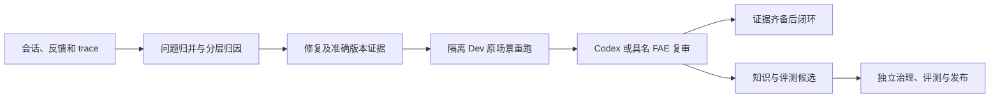

# 数据飞轮核心逻辑

本次按用户要求抽取现有规则和职责，供后续维护共用。范围是核心逻辑说明与实现入口，不创建第二套状态机，不改变在线闭环门禁。

## 核心是什么

核心是把真实使用中的失败转成有证据、可复验的改进：

现行闭环实现还要求先有已核验的 merge/deployment 证据，再接受同一 deployment SHA、晚于该发布证据的 Dev 重跑；图中“准确版本证据”包含这个门禁。重跑发生在 Dev，不通过生产问答跑评测。工程发布前测试与反馈事项最终闭环复验是不同阶段，不应混为一次验收。

## 八条核心规则

1. **归属明确。** 事实按 Agent、Session、turn 绑定。同一 turn 只有一个 active primary issue；归并不能跨 Agent、形成 canonical 环或随意迁移已有复跑证据。
2. **先归因再修复。** failure layer、root cause、owner 不完整时保持待归因；使用现行工作流分层，不按单个问题关键词修补。
3. **状态由证据推导。** 非空回答、手工 `fixed`、一个 commit 或一次发布都不能单独证明 closed；不提供绕过门禁的强制关闭。
4. **版本可核对。** 修复、发布、重跑绑定准确 SHA 和可验 manifest；发布版本需要包含修复。现有 merge verifier 单独只证明 commit 存在，不能把它夸大为已证明主线合并。
5. **输入条件可追溯。** 当前重跑输入保留原问题、前序问题和附件，前序答案由 Dev 重新生成；校验的是本次 Dev 配置与 Provider 模型回显。尚未逐字复刻原前序答案或原 turn 模型配置，不能将当前复跑称为历史运行的完全复现。缺附件时明确 blocked，不把删减场景后的成功冒充原题通过。
6. **运行与质量分开验收。** 运行门检查 Dev 目标、build、trace、模型回显、fallback、截断和协议失败；质量由独立 Codex 或具名 FAE 判断，并保留身份和理由。
7. **最新失败不能被历史成功覆盖。** 每个 active linked turn 的最新复跑都需要过门，新的失败可以重新打开事项。页面可展示“最近有效成功答案”，但这个展示选择不能拿来代替闭环状态计算。
8. **沉淀先形成候选。** 知识任务、QA 和评测候选先经过独立治理，不因事项 closed 就直接改在线知识或正式评测集。当前尚无 closed 后自动晋升的实现。

## 唯一规则入口与适配职责

| 职责 | 当前实现 | 边界 |
|---|---|---|
| 领域数据、状态门禁 | `backend/app/review/models.py`、`state.py` | `calculate_progress(issue, links)` 只根据证据推导状态 |
| 详情到门禁证据 | `review/progress_projection.py` | `progress_from_detail(detail)` 汇总最新有效版本/重跑及复审；云副本也复用 |
| 用例编排 | `review/service.py` | 来源、权限、复审身份与调用顺序 |
| 持久化和一致性 | `review/repository.py`、反馈迁移 | SQL、并发锁、幂等、唯一归属和不可变审计 |
| 原场景重跑 | `review/replay.py` | Dev 目标、附件、上下文、HTTP/SSE 和运行门 |
| 版本及发布交接 | `review/evidence.py`、`handoff.py`；FAE `src/feedback_closure/` | Git、manifest、批次、outbox、单事务导入 |
| 知识和评测候选 | FAE `src/storage/review_center.py` | 候选构造、导出、独立评审；平台只投影来源已提供的内容 |
| 统计与展示 | `fleet/`、`operations/`、`cloud_sync/`、`cloud_replica/`、WebUI | 采集、传输、统计、运维告警与页面，不决定反馈事项是否闭环 |

`PsycopgFlywheelRepository` 名称中虽然含 Flywheel，职责实际上是 usage 统计。本次 SQL 超时和恢复徽标属于外围读模型/展示修复，不应塞进反馈闭环规则。

## 后续代码抽取的最小边界

现有状态核已经独立，优先复用。若继续做物理代码抽取，先把 replay runner 的纯运行门及对应类型与 HTTP 适配分离，再把仓储中原问题组装的纯规则与 SQL 分离；保持 `ReviewService` 为用例入口。锁、事务、幂等和审计继续在仓储层，不为了“纯核心”而搬离其一致性边界。

`planned_capabilities/coverage` 保留为诊断字段，不新增为 closed gate。云副本中未提供的候选统计保持“不可用”，不把 `None`/空投影解释成“没有待办”。本批不实现自动修复执行或知识自动晋升。

严格历史复现还需要原模型配置与前序答案快照及明确的重放契约；这是当前实现边界，未包含在本批统计修复或文档抽取中。
