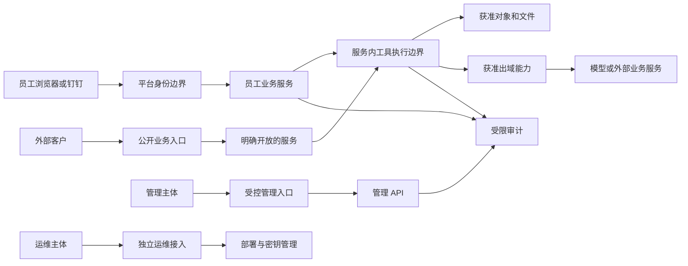

# 平台整体安全架构设计 v1 评审稿

日期：2026-10-23。状态：总体方向和跨仓范围已讨论认可；本文为第一版架构、责任与验收设计。2026-10-29 已执行备份恢复、PHP应急更新、证书续期首批，第二批在继续实施；各控制的实际状态以对应执行记录为准，不能由设计条目推断已经上线。

执行记录：[首批](../../operations/2026-10-29-security-first-batch-results.md)、[第二批](../../operations/2026-10-29-security-second-batch.md)。行政主体绑定已有独立线上修复、旧主线遗漏，第二批先保存该修复并验证；SSH接入仍待独立救援路径信息，未变更现行登录方式。

## 1. 任务范围与最新裁定

2026-10-30：DAQ运行身份/文件边界已完成生产切换和只读验收，见[发布记录及活动路径](../../operations/2026-10-30-daq-security-release.md)。DB-01、真实员工/浏览器/自然trace及通用断连生命周期分别保留，不由容器降权推定完成。

用户要求重视整个 Agent 平台底座、上层服务、Agent 和服务器访问的安全架构，避免发生事故后逐点补救。
总体方向为：员工通过统一身份使用；外部客户仅访问明确开放的服务；管理与运维通过受控入口访问。
具体是否使用 VPN、堡垒机或其他受控接入方式，需要根据实际网络与运维需求设计，不能将方向认可视为生产变更授权。

**2026-10-23 用户补充：FAE 相关问题已由另一条工作线开始修复，本任务只保留验收项，不重复开发。**
FAE 匿名使用或客户登录策略尚未确定；本专项不改变现行业务模式，也不以该问题阻塞其他安全边界设计。

用户已认可同时覆盖同级业务仓。跨仓表示统一契约、各仓独立落地与整体验收；
不建立跨仓源码导入、可编辑安装或软链接，不将分仓本身视为安全隔离，不接管其他工作线的未完成改动。

## 2. 当前认识与证据边界

分析起点为平台主线 `d0956a3a043e338f59f8b872ef0f3a9587a526d7`。
初步核查的实际平台 API 镜像标签为 `a3cac583e40f30256ace6a6a26075e4a8afec771`，
FAE 发布制品标识为 `978f851cdc89bc2337497f0b21b06130b0d2de6e`。
这些是核查时的基线，不代表其他服务版本或后续修复版本。

已有钉钉身份、角色和对象授权、会话与 CSRF 防护、附件权限、签名与加密等设计及实现；
部分平台和 VOC 容器已有非 root、只读根目录及能力移除等加固。
各独立服务的保护程度不同，统一入口的保护不能直接覆盖旧入口或内部接口。
现有分散设计需要形成跨服务的安全契约和可验收基线。

初步核查还发现服务器 SSH 认证与服务运行权限需要复核；
主机防火墙状态不能单独证明公网暴露程度，云安全组、实际路径和其他网络规则仍需核验。
本轮结果不构成完整安全审计，也不能证明没有入侵或数据泄露。
FAE 已发现问题的后续状态只按第 6 节收取验收证据。

## 3. 推荐的信任边界

| 区域 | 对象 | 目标边界 |
| --- | --- | --- |
| 对外服务区 | 明确开放给外部客户的服务 | 只获得指定业务能力，不持有平台管理或运维权限 |
| 员工业务区 | 行政、HR、VOC、SDK 等员工服务 | 统一身份，按操作及具体数据对象授权 |
| 平台管理区 | 授权、诊断、配置与审计 | 独立管理权限；敏感读取与变更可追溯 |
| 运维执行区 | SSH、发布、数据库维护、密钥管理 | 独立运维身份和受控接入；业务 Agent 无法借用凭据 |

分区需要落实为服务身份、接口校验、网络路径、数据库角色、文件权限和凭据分配。
独立仓库或进程不能单独作为安全隔离证明；同机部署也必须明确单个服务失陷后的影响范围。

模型继续负责规划、判断和工具选择；实际执行组件独立校验当前主体、任务、对象和操作权限。
读取材料不赋予执行其中指令的权限；已有使用授权不自动扩展为全部数据访问权。
普通获准操作直接执行，敏感授权绑定准确目标与参数，并处理过期、撤销和重复使用。
不通过堆叠关键词拒答、隐藏重试或移除必要业务能力替代执行边界。

## 4. 公共责任与服务责任

| 责任范围 | 应交付的内容 |
| --- | --- |
| 平台公共安全 | 身份和授权契约、服务间身份传递、附件与共享资源边界、公共审计规范 |
| 各业务服务和 Agent | 本服务全部入口鉴权、对象归属、工具文件和网络范围、运行身份与数据处理规则 |
| 基础设施与运维 | 公网与内网入口、SSH 和发布身份、数据库和备份权限、密钥轮换、隔离与恢复 |
| 跨服务验收 | 直连接口与旧入口、跨用户/跨服务越权、撤权后的继续执行、审计和应急链路 |

公共认证不替代服务端授权。业务 Agent、后台服务及开发运维 Agent 的能力和身份分别登记，不能共享默认运维权限。

## 5. 设计交付范围

1. 按实际部署列出服务、域名、端口、进程、数据存储、模型供应方和维护身份，并标注版本及证据。
2. 绘制入口、数据流和信任边界，列出提示注入、工具滥用、越权、横向访问、外传和资源消耗等威胁及影响。
3. 建立主体—操作—对象权限矩阵，明确授权生产方、执行校验方及撤权后的行为。
4. 制定网络、进程、容器、凭据、依赖与发布的最低安全基线和例外记录机制。
5. 明确数据分类、允许的模型端点、上下文最小化、日志脱敏、保存期、擦除和备份恢复要求。
6. 定义安全事件、告警责任、快速撤权与隔离、证据保全和恢复演练。
7. 将威胁转化为真实接口和执行边界测试，同时保留正常业务完整任务的正确性、质量、耗时与成本验收。

本版的事实与版本依据见[跨仓初步盘点](../../security/2026-10-23-cross-repository-inventory.md)，
架构契约、威胁与验收、分批顺序见第 8–13 节。不表示这些控制均已实现或验证。
各批具体迁移、配置值、故障停止条件和回滚步骤需在对应实施任务中固定。
不以统一安全专项名义自动恢复历史停用方案，或改变 HR 当前执行、材料和模型处理政策。

## 6. FAE 外部修复验收项

- [ ] **SEC-FAE-01：接收并核验 FAE 工作线的修复交付。** 状态为“用户确认修复中，尚未验收”。
  验收须绑定实际部署版本和覆盖入口：匿名、错误身份及无权限身份不能读取或修改管理数据；
  文档读取只能访问获准知识资源，覆盖相对路径、绝对路径与符号链接越界；
  正常知识读取及获准管理操作仍可完成。工程/API、实际部署与必要真实模型验证分别报告，
  未执行项目明确列出。无需读取生产密钥或破坏性写入来证明边界；不以页面入口关闭代替接口验证。
  本专项记录交付证据和剩余风险，不重复实现，也不将“修复中”记为通过。

## 7. 验证方式与参考

接口优先；页面验收由用户负责。默认在一次性数据和隔离进程上验证；
生产配置、业务调用、密钥及网络变更按具体任务授权执行。
共享生产 Nginx 验证遵守根目录 AGENTS.md，禁止在生产机测试独立配置。
本次仅记录讨论范围和验收要求，未修改服务、Agent 执行行为或生产配置，未新增真实模型调用。

## 8. 方案选择与适用边界

采用“公共安全契约 + 服务本地强制执行 + 基础设施隔离”的组合。
平台提供稳定身份、授权事实及公共资源契约；服务负责请求和具体对象的最终校验；
网络、操作系统和数据库限制进程受损后的访问范围。契约以文档、协议样例与测试向量共享，各仓独立实现。

其他方案的取舍：

- 各仓自行补洞：可以短期处理明确风险，但无法保证旧入口、撤权和共享数据规则一致，不作为长期方案。
- 全量迁入同一运行时、共享安全 SDK 或服务网格：迁移大、增加公共故障点，且与部分现行仓库约束冲突，不作为本版前提。
- 本版组合：复用现有身份/票据/签名与执行边界，按真实差距改进；接受有记录的阶段性限制，避免宣称已经全部隔离。

本版假设基础设施管理员及宿主内核可信，重点限制匿名者、低权限用户、被诱导模型和被攻破业务进程。
同宿主共享内核不能抵御宿主 root 或内核失陷。若需保护 HR 数据免受宿主管理员访问，须另设主机/账号/密钥信任域；
容器、应用加密或独立数据库角色不能被当成该目标的充分证明。
开发/运维 Agent 与业务 Agent 使用不同身份和凭据，人工管理账户也不作为业务运行身份。

## 9. 数据流与允许连接

图表示能力类别，不授予任意服务之间的连接权限。每条实际连接登记调用主体、目的服务/端口、协议、凭据、数据级别和维护归属。
业务服务不能借经平台转发获得运维身份；模型供应方和公网页面属于外部信任域。
浏览器同源部署不等于各业务之间互信；Origin/CSRF、可信代理与对象授权分别校验。
独立域名、IP 直连、路径别名、旧管理路由、私有回调、机器人和 Worker 都纳入入口清单。

## 10. 最低安全契约

### 10.1 身份、授权和撤销

- **ID-01 主体来源**：服务从现有可信身份接口或已验证服务协议取得稳定主体；浏览器提交的 user_id、显示名、角色和 owner_id 不能成为授权依据。
- **ID-02 对象权限**：每个入口声明所需身份、操作与对象范围；列表、详情、历史、工具、提交、下载和恢复都复核。登录成功不自动取得管理权，管理角色也不自动获得所有业务正文。
- **ID-03 撤销时效**：每条身份/授权链明确缓存、令牌、流式执行和租约的最长有效窗口，并测量停权后的实际效果。不能对有缓存的服务承诺即时撤权；高风险提交在执行前按当前有效策略重验。
- **ID-04 服务身份**：区分当前用户和调用服务。受众、环境、用途和授权范围匹配；禁止凭借来源 IP 单独取得用户权限。保留现有 loopback、Bearer 或签名契约，逐条验证消费者，不强制全部更换协议。
- **ID-05 敏感授权**：已有明确任务授权内的普通操作直接执行。高影响动作的授权绑定当前主体、准确目标/参数和有效期；需要单次授权的动作原子消费。模型生成的 confirmed=true 不构成证明；重放策略和业务幂等分别定义。

平台管理权与行政、HR、SDK 等业务管理权分别登记。显示名仅用于展示；停用、目录变更、只读限制及对象删除不得通过会话恢复或历史摘要绕过。

### 10.2 工具、文件、上下文和网络

- **TOOL-01 注册能力**：每个工具声明读写类型、对象、文件、网络、凭据和预算；执行组件验证参数及当前权限。未知工具和无权限请求明确拒绝，错误回执可见，不自动修补授权或敏感参数。
- **FILE-01 文件范围**：按任务和主体绑定获准资源；验证最终目标落在允许范围内，覆盖绝对路径、相对路径、符号链接、替换竞态和归档展开。扩展名过滤不能替代路径与权限；凭据目录不进入模型可读范围。
- **CTX-01 上下文范围**：文档、附件、网页、工具回执和其他 Agent 结果都保留来源及对象范围，作为证据而非新增指令权。历史、记忆、笔记及摘要继承权限，撤权后重新选择获准内容；不能用混合摘要携带其他对象资料。
- **NET-01 网络目的地**：固定业务/模型连接使用明确配置的端点；确需搜索或任意公网页面读取的能力保留，并限制协议、端口、大小、时间、重定向和解析后的目的地址。覆盖 IPv4/IPv6、内网、回环、链路本地、云元数据及 DNS 重绑定；获准内部连接独立登记，不借公共 fetch 绕行。
- **NET-02 出域数据**：目的地址可访问不表示可向其发送任何内容。模型请求、搜索 query、URL/path/query/body 和外部消息都受数据分类、用途及接收方约束；敏感资料不得经搜索词、日志或通用工具间接外传。
- **RUN-01 资源边界**：按用户/Agent/任务设置并发、队列、文件、解析进程、模型用量与时长上限；取消和撤权后终止后续副作用。运行态、成本与业务完成分别记录，预算不能充当故障修复。

这些控制不要求把所有内容交给第二个模型判断；已明确的授权、地址、类型和资源限制由确定性执行边界实现。
模型决定任务路径和工具组合，正常任务仍按正确性、内容质量、耗时与输入/输出成本验收。

### 10.3 主机、服务、数据库与密钥

- **HOST-01 运行身份**：业务进程使用独立非 root 身份；可写目录最小化，配置/代码只读。保留第三方程序必须的启动与写入行为，验证实际子进程，而非只检查容器 User 字段。
- **HOST-02 隔离网络**：公网仅保留登记入口；管理、数据和运维路径按调用关系收敛。回环服务仍需请求授权；容器 internal 网络不等于同网成员互不访问，逐条验证跨服务拒绝。
- **DB-01 数据职责**：登记每个实际 DSN 角色和可执行函数权限，区分业务、管理读取、审计、维护与迁移。search_path 和应用 owner 条件不构成独立数据库隔离；共享角色阶段性限制须有明确影响与验收记录。
- **KEY-01 凭据分配**：按服务、环境和用途分配最小凭据，业务模型不可读取 SSH、发布和数据库维护密钥；运行配置以受限文件或等效受控机制注入，禁止进入提示、普通日志、构建上下文和命令参数。
- **KEY-02 轮换撤销**：记录凭据的消费者、有效版本、轮换顺序和撤销结果。先验证新通道，再撤旧通道；故障时不通过复制管理员密钥或共享长期凭据恢复表面可用。
- **OPS-01 运维接入**：目标为具名身份、受控网络入口和可追溯提权，业务 Agent 不持有运维凭据。SSH/防火墙调整前必须验证独立恢复路径，避免锁死维护；访问、发布和应急恢复分别授权。

本版不直接执行 HR 新角色迁移、mTLS/签名代理或共享 SDK。HR 当前同角色限制保留登记；任何调整先给出兼容、数据/密文不丢失、消费者切换、故障停止及回滚设计。
数据库、API 或容器中的加密保护不等于抵御持有相同解密密钥的宿主 root，不能扩大安全声明。

### 10.4 数据、发布与安全运营

| 数据级别 | 处理原则 |
| --- | --- |
| 公开资料 | 可用于公开业务；仍验证来源完整性和工具权限 |
| 内部业务资料 | 仅获准员工、服务和供应方处理，禁止默认流入公开问答或外部搜索 |
| 个人/客户/研发敏感资料 | 对象级授权、明确用途和已批准供应方；派生笔记、摘要、索引与成果继承限制 |
| 凭据与控制秘密 | 不进入业务模型上下文和普通日志，使用专门运维与密钥通道 |

- **DATA-01 处理策略**：为数据类型配置允许的接收方、传输要求、区域/训练使用/供应方留存政策、诊断权限与删除规则。未批准真实个人材料处理时保持现行拒绝；本设计不开放该权限。
- **DATA-02 生命周期**：分别规定原件、正文、索引、上下文、模型请求响应、成果、日志和备份的保存期与删除方式；有 TTL 或 cleanup 函数不等于定时清理已运行。删除覆盖派生物和对象版本，备份恢复后按删除记录再处理。
- **REL-01 发布来源**：每仓维护准确代码、知识、上游 pin、配置版本与制品摘要；本地 HEAD、镜像标签和目录 current 不互相替代。审核依赖/镜像、固定已验证制品并保留回滚身份。
- **REL-02 构建权限**：SDK/工具构建和测试处理不可信源码、文档及外部 Issue，使用隔离执行者；不挂载生产密钥或宿主 Docker socket。读取研发资料不赋予内部合入、公开发布或业务消息发送权限。
- **AUD-01 审计**：记录主体、服务、任务、对象、动作、策略/授权版本、结果、时间和关联 trace；普通日志不记录原始正文或秘密。受限诊断保留独立权限与保存期；敏感变更的必要审计不可用时拒绝执行。
- **IR-01 响应恢复**：对异常跨对象读取、敏感外发、内部接口访问、令牌失败和费用激增定义有责任人的告警。支持按用户、服务、工具或凭据暂停能力，保留失败证据；告警与紧急处置不自动重跑业务或销毁在途记录。
- **REC-01 备份恢复**：明确全部业务库、对象、配置与恢复密钥覆盖，核验异机/异账号恢复权限和删除策略；测量实际恢复点/时长，再承诺 RPO/RTO，不能以本机生成备份文件替代恢复验收。

### 10.5 可用性与全链路代价

复用现有账户、票据、租约、幂等和加密职责，不因统一设计重复增加每工具一次的远程身份请求。
需要缓存或批量校验时明确授权版本、失效窗口和提交前重验；性能优化不能延长未声明的撤销窗口。
文件/网络/上下文控制以准确资源引用和当前任务边界实施，不要求反复读取已读原文或将全部历史重新发送给模型。
裁剪、摘要或记忆策略变化必须说明原职责的承接和原文回查方式，不能为降低成本遗漏权限范围与必要证据。

每批在同一准确版本、身份和输入下记录接口额外延迟、调用次数、正常任务耗时、输入/输出用量和费用依据，
再决定缓存、隔离或限额参数；当前没有这些测量，不承诺零开销或任意性能目标。
认证、授权或必要审计不可用时明确拒绝受影响操作并保留工作，不切换匿名、替代模型或隐藏重试；
普通统计日志失败与必须成功的安全审计分别设计，避免扩大故障范围。

## 11. 威胁与验收矩阵

以下均为待执行验收；每项同时保留一个正常获准业务正例。拒绝成功不等于完整任务通过。

| 验收编号 | 威胁/触发 | 验收条件 | 主要责任 |
| --- | --- | --- | --- |
| SEC-ENTRY-01 | 绕过导航、直连旧域名/IP/路径别名或私有接口 | 匿名/错身份/伪造代理头均不能取得受限数据或副作用；全部入口有声明 | 平台 + 各服务 |
| SEC-OWNER-01 | 复用他人的业务会话 ID、trace、work、附件和结果标识 | 列表、续聊、反馈、历史、下载、恢复和写入均按当前对象权限拒绝，无内容混入 | 各服务，ADMIN 优先 |
| SEC-REVOKE-01 | 停权、撤销角色/资料、变更目录时任务正在运行 | 记录实际生效延迟；到期后读取、模型发送、恢复和提交均停止，符合声明窗口 | 平台 + 消费者 |
| SEC-TOOL-01 | 附件/网页/记忆中指示读取秘密或扩大工具权限 | 工具执行边界拒绝越权；摘要和跨 Agent 结果不传递额外权限；正常任务继续可完成 | 各 Agent + Loop |
| SEC-FILE-01 | 路径/链接/归档/文件替换越界与解析资源耗尽 | 不能读取获准范围外样本，解析上限生效；不读取生产秘密作测试 | 各服务 + 附件底座 |
| SEC-NET-01 | 内网、元数据、重定向、DNS 变化或 query 隐式外传 | 不得建立未登记连接或发送未获准数据；合法公开研究和固定业务调用仍成功 | HR/业务连接器 + 基础设施 |
| SEC-ISOLATE-01 | 单个业务执行进程拥有本服务身份 | 不能读取其他服务凭据、写入发布目录、调用管理 DB/宿主能力；测量实际允许路径 | 运维 + 各服务 |
| SEC-DATA-01 | 对象删除、到期、诊断清理和备份恢复 | 原件/派生物/历史按策略不可用，清理有证据，恢复不复活已删除材料 | 平台 + 数据维护者 |
| SEC-CHANGE-01 | 重复、变参或越权的管理/发布请求 | 必要授权准确绑定，幂等及重放规则生效，拒绝无副作用且审计可查 | 管理服务 + 运维 |
| SEC-OPS-01 | 密钥撤销、发布失败或安全事件 | 准确制品可回退，旧凭据失效，新恢复通道可用，证据与失败保留 | 运维 + 各仓 |
| SEC-BUDGET-01 | 并发滥用、无限队列或高费用任务 | 用户/Agent/任务限额有效，拒绝和取消不留下隐式模型调用或副作用；正常任务开销有对照 | 平台 + 各 Agent |
| SEC-SUPPLY-01 | 不可信源码/依赖/Issue 影响构建或发布 | 构建无生产权限，准确来源和制品可追溯，未经获准不能合入/公开发布 | SDK/运行时 + 运维 |
| SEC-AUDIT-01 | 登录会话凭据失窃或必需审计不可用 | 撤销会话后实测失效窗口；受影响敏感操作拒绝且不扩大日志泄露，事件可关联并恢复 | 平台 + 服务消费者 |
| SEC-FAE-01 | FAE 现有工作线交付 | 按第 6 节接收实际版本与证据；不重复开发 | FAE 工作线 + 总体验收 |

业务对象 ID 与登录会话凭据分别测试。有效凭据被盗后的冒用不能仅凭 owner 校验识别，需配合会话保护、撤销和事件响应。
接口验收保留真实 HTTP 身份、CSRF、签名、幂等和持久化；模型替身仅用于工程边界测试并单列。
真实模型仅在需要验证实际上下文/工具行为时进行最小范围回放，事前写清假设、范围、预算和首错停止条件。
浏览器由用户负责；生产探测、故障注入和发布不能以本设计替代具体任务授权。

## 12. 各仓交付责任

| 维护位置 | 本专项交付 | 保留的现行约束 |
| --- | --- | --- |
| AI-Agent-Platform | 总契约与验收台账；身份/内部接口、共享附件、管理权限和公共部署资产 | 保留现有模型 Loop 和有效授权/租约/幂等，区分整合与部署 |
| AI-ADMIN-Agent | 会话/反馈主体绑定、稳定业务管理身份、附件/通知授权和生命周期 | 识别当前 159 项工作树变化的归属；从实际发布版本确定隔离改动 |
| AI-HR-Agent | 候选/工作/成果及上下文持续授权、公开研究与敏感出域、文件沙箱和留存接线 | 不恢复旧 UI/执行链；不自动启动角色迁移或共享 SDK；维护该仓唯一现行设计 |
| AI-DAQ-FAE-Agent | 企业/资料权限撤销、运行权限/凭据与准确上游 pin 验证 | 独立知识和发布；变更共享上游需通过原 FAE 相关契约，不能追随未审查新版本 |
| Orbbec-VOC-Agent | 浏览器/机器人主体一致、普通与管理权限、服务凭据生命周期及 RLS 能力验证 | 采用实际 /voc 和机器人链路；纠正旧文档漂移后再判断实施入口 |
| AI-Agent-Loop | 通用工具/会话/附件/不可信材料的安全契约及通用回归 | 明确默认本地模式与生产准入；不强制业务服务立即迁入 |
| SDK 文档与平台实现 | 禅道身份/管理入口、连接器权限、隔离构建、合入/公开发布边界 | 遵守现行 A/B 任务、三类来源和版本映射，不重复导入或扩大项目管理范围 |
| 运维与其他共享主机维护者 | 服务账号、网络/端口、密钥、依赖、备份和应急恢复 | 先确认无关 demo、MetaBot、Scanner 等归属，不擅自停服或清理 |

每个实际变更在所属仓独立提交并验证；涉及协议的批次同时固定生产者和消费者版本。
平台总台账关联各仓提交和实际部署，不以一个仓测试通过覆盖全部服务。

## 13. 推荐实施顺序与停止条件

| 批次 | 范围与输出 | 进入下一步的条件 |
| --- | --- | --- |
| A 资产与发布校准 | 实际代码/进程/端口/角色/凭据消费者清单；ADMIN 生产匹配；云安全组与其他同机服务归属 | 需要改动的真实链路可定位，旧入口和回滚通道有依据；未知项明确阻止相关变更 |
| B 高风险边界收口 | ADMIN 对象授权；各服务非 root 与最小文件/凭据；内部入口和运维接入；FAE 只收验收 | 对应真实接口正反例通过，服务依赖不丢失，逐服务发布/回滚方案可核验 |
| C 跨服务持续权限 | 服务身份、管理/业务权责、撤销时效、网络目的地/出域内容和上下文边界 | 覆盖生产者→消费者、在途与跨轮继续；不因单点拦截破坏完整任务 |
| D 数据与运营闭环 | 生命周期和供应方策略、告警、凭据轮换、构建/发布及备份恢复演练 | 证据覆盖清理/撤销/隔离/恢复，并记录正确性、耗时及成本；用户页面与生产验收单列 |

批次可按已确认的独立服务拆小，但依赖、发布和回滚顺序不得并行跨越。
同类边界问题再次出现或修一处在相邻环节失败时，先更新契约与架构复核，再实施；不增加隐藏兜底。
异常、未知副作用、测试首错或版本漂移即停止该例/该批，保留证据；不重试到通过。
生产 Nginx、SSH、网络、数据库与真实业务调用分别受其任务边界约束。

## 14. 本版遗留决策与评审状态

- 管理/运维网络接入的具体方式在 A 批依据现有企业网络、恢复路径和维护成本选择；此前保持现行入口，不先改防火墙或 SSH。
- 数据保存期、供应方及真实敏感资料处理按数据类别形成可执行配置；未确认时不扩大当前处理授权，不凭空承诺保留/训练政策。
- HR 数据库角色隔离、第三方禅道运行模型和异地主机隔离分别评估迁移必要性，不能作为 B 批所有加固的强制前置。
- FAE 匿名/客户登录模式保留业务线决定；公开能力和受限管理能力必须保持独立，现行修复按 SEC-FAE-01 验收。

设计自审检查：所有建议与现状分开；跨仓源码与生产版本分开；FAE 不重复实施；HR 明确例外不被覆盖；
每类控制均有责任及待执行验收，保留完整模型任务、成本和失败证据要求。
独立只读设计复核无阻断项；按复核意见区分业务对象标识与失窃登录凭据的威胁和验收。
本轮完成的是架构评审稿及事实盘点，安全接口测试、进程故障、浏览器与生产验收均未新增执行，不能宣称安全整改完成。

参考：[OWASP AI Agent Security](https://cheatsheetseries.owasp.org/cheatsheets/AI_Agent_Security_Cheat_Sheet.html)、
[Microservices Security](https://cheatsheetseries.owasp.org/cheatsheets/Microservices_Security_Cheat_Sheet.html)、
[Docker Security](https://cheatsheetseries.owasp.org/cheatsheets/Docker_Security_Cheat_Sheet.html)。
